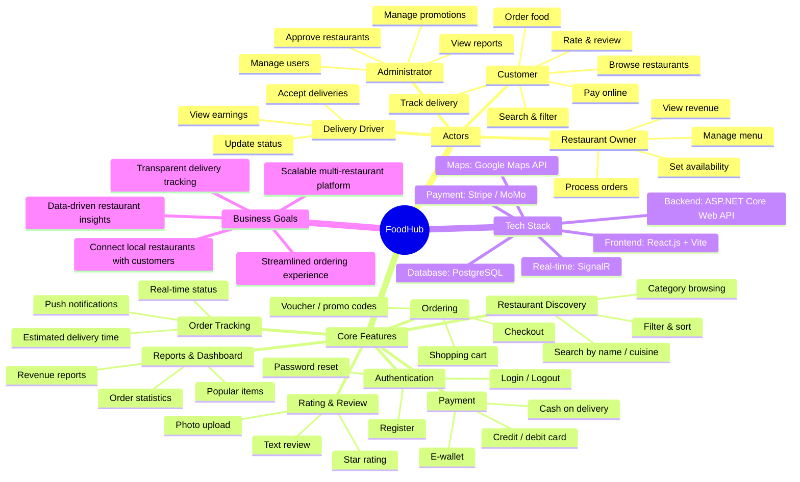
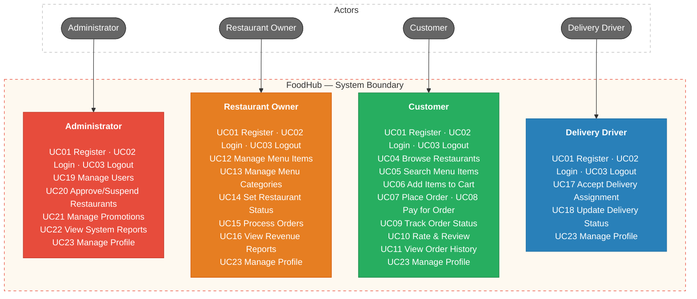
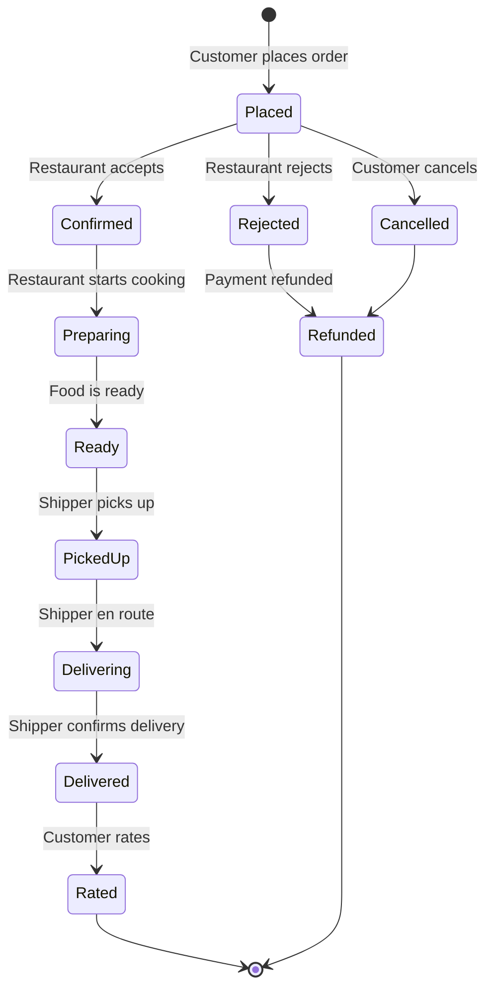
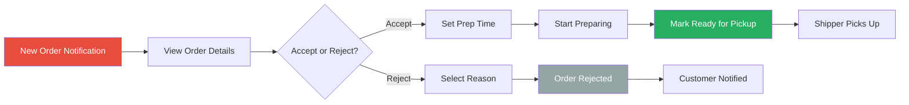

# FoodHub

FoodHub is an online food ordering platform that connects customers with local restaurants and delivery drivers. It handles the full order lifecycle — from browsing restaurants and placing orders, through payment processing and real-time tracking, to delivery and post-order reviews. FoodHub brings together restaurant discovery, cart management, order tracking, delivery coordination, promotions, reports, and role-based access for everyone involved.

## 1. Requirements — INVEST, Use Cases, and Acceptance Criteria

Requirements define what FoodHub must do, who uses it, the value delivered, and the observable conditions of success. User stories are reviewed with INVEST and mapped to use cases and acceptance criteria.

### 1.1 Product Mind Map



### 1.2 INVEST Requirements

The V1 backlog includes 20 user stories. These stories cover registration, restaurant discovery, ordering, payment, tracking, review, restaurant management, delivery, promotions, admin management, and profile.
Before a user story is ready for development, it is checked using the INVEST criteria.


| Criterion       | Meaning in FoodHub                                                                                                          |
| --------------- | --------------------------------------------------------------------------------------------------------------------------- |
| **Independent** | Each story should provide a clear feature and depend on other stories only when necessary.                                  |
| **Negotiable**  | The UI and technical implementation can change as long as the main goal and permission rules stay the same.                  |
| **Valuable**    | Each story should provide value to the user or the business.                                                                |
| **Estimable**   | Roles, inputs, outputs, dependencies, and important failure outcomes are documented.                                        |
| **Small**       | Each story covers one primary capability and can be divided into API, application, persistence, UI, and test tasks.         |
| **Testable**    | Every story maps to observable acceptance criteria and expected authorization, validation, and error behavior.               |


```text
US01–US02   Registration and authentication
US03–US04   Restaurant discovery and search
US05–US06   Cart and order placement
US07        Online payment
US08        Real-time order tracking
US09–US10   Rating/review and order history
US11–US13   Restaurant menu management
US14–US15   Restaurant order processing and revenue
US16–US17   Delivery management
US18        Admin user management
US19        Admin promotion management
US20        Personal profile management
```

All V1 stories now have estimable target behavior. Registration supports email-based signup, payment is processed via third-party gateway, order tracking uses real-time push updates, and delivery status is updated by the assigned driver. The complete story-level review is maintained in [INVEST Requirements](docs/05-user-stories-invest.md).

### 1.3 Use Cases




For detailed actors, permissions, and business flows, see [Actors, roles, and use cases](docs/03-use-cases.md).

### 1.4 Roles and Permissions


| Capability                        | Customer | Restaurant Owner | Delivery Driver | Admin |
| --------------------------------- | -------- | ---------------- | --------------- | ----- |
| Browse restaurants and menus      | Yes      | No               | No              | Yes   |
| Search and filter items           | Yes      | No               | No              | Yes   |
| Place orders                      | Yes      | No               | No              | No    |
| Pay online                        | Yes      | No               | No              | No    |
| Track order status                | Yes      | Own restaurant   | Assigned only   | Yes   |
| Rate and review                   | Yes      | No               | No              | No    |
| View order history                | Yes      | Own restaurant   | Own deliveries  | Yes   |
| Manage menu items                 | No       | Own restaurant   | No              | No    |
| Process orders (accept/reject)    | No       | Own restaurant   | No              | No    |
| Accept delivery assignments       | No       | No               | Yes             | No    |
| Update delivery status            | No       | No               | Assigned only   | No    |
| View revenue / earnings           | No       | Own restaurant   | Own earnings    | All   |
| Manage users                      | No       | No               | No              | Yes   |
| Approve / suspend restaurants     | No       | No               | No              | Yes   |
| Manage promotions                 | No       | No               | No              | Yes   |
| View system reports               | No       | No               | No              | Yes   |


The backend must enforce RBAC and ownership policies; hiding frontend controls serves UI/UX only.

## 2. Information Architecture, Screen Hierarchy, and UI/UX

The information architecture organizes the application by business capability and user role. Screen permissions and navigation follow the role matrix, while loading, empty, validation, error, saving, and success states are defined consistently.

### 2.1 Information Architecture

```text
Public
├── Landing Page
├── Login
├── Register
└── Browse Restaurants (limited view)

Customer Authenticated
├── Home Feed (restaurants, promotions, categories)
├── Restaurant Detail
│   ├── Menu
│   ├── Reviews
│   └── Info (hours, address, contact)
├── Cart
├── Checkout
│   ├── Address Selection
│   ├── Payment Method
│   └── Order Confirmation
├── Order Tracking (real-time map + status)
├── Order History
│   └── Order Detail
├── Vouchers / Promotions
├── Profile Settings
└── Notifications

Restaurant Owner Authenticated
├── Dashboard (today's orders, revenue summary)
├── Menu Management
│   ├── Categories
│   └── Items (add/edit/delete)
├── Order Management
│   ├── Incoming Orders
│   ├── Active Orders
│   └── Order History
├── Revenue Reports
│   ├── Daily / Weekly / Monthly
│   └── Export
├── Restaurant Settings
│   ├── Profile & Info
│   ├── Business Hours
│   └── Open / Close Toggle
├── Reviews & Ratings
└── Notifications

Delivery Driver Authenticated
├── Available Orders (nearby)
├── Active Delivery
│   ├── Navigation to Restaurant
│   ├── Navigation to Customer
│   └── Delivery Confirmation
├── Delivery History
├── Earnings
│   └── Daily / Weekly Summary
├── Profile Settings
└── Notifications

Admin Authenticated
├── Dashboard (system-wide KPIs)
├── User Management
│   ├── Customer List
│   ├── Restaurant Owner List
│   ├── Driver List
│   └── User Detail
├── Restaurant Management
│   ├── Pending Approvals
│   ├── Active Restaurants
│   └── Suspended Restaurants
├── Category Management
├── Promotion Management
│   ├── Active Promotions
│   └── Create / Edit Promotion
├── Reports
│   ├── Revenue Reports
│   ├── Order Reports
│   ├── User Reports
│   └── Popular Items
└── System Settings

Shared
├── 404 Not Found
├── 403 Forbidden
└── 500 Server Error
```

### 2.2 Screen Hierarchy

Login leads to the role-specific shell. The shell owns navigation to feature pages. Customer interactions include modals for cart, checkout, and review. Restaurant Owner uses modals for menu item create/edit and order processing. Unauthorized navigation resolves to the Forbidden screen.

Detailed screen IDs, user flows, screen states, accessibility rules, and API mappings are maintained in [Information Architecture](docs/04-information-architecture.md).

### 2.3 Key User Flows

#### Customer Order Flow

```mermaid
flowchart LR
    A[Browse Restaurants] --> B[Select Restaurant]
    B --> C[View Menu]
    C --> D[Add to Cart]
    D --> E{More items?}
    E -->|Yes| C
    E -->|No| F[View Cart]
    F --> G[Checkout]
    G --> H[Select Address]
    H --> I[Select Payment]
    I --> J[Apply Voucher]
    J --> K[Place Order]
    K --> L[Payment Processing]
    L --> M[Order Confirmed]
    M --> N[Track Order]
    N --> O[Order Delivered]
    O --> P[Rate & Review]

    style A fill:#27ae60,color:#fff
    style K fill:#e74c3c,color:#fff
    style O fill:#2980b9,color:#fff
    style P fill:#f39c12,color:#fff
```



#### Order Lifecycle



#### Restaurant Order Processing Flow



#### Shipper Delivery Flow

```mermaid
flowchart LR
    A[View Available Orders] --> B[Accept Delivery]
    B --> C[Navigate to Restaurant]
    C --> D[Confirm Pickup]
    D --> E[Navigate to Customer]
    E --> F[Deliver Food]
    F --> G[Upload Proof Photo]
    G --> H[Delivery Complete]

    style A fill:#2980b9,color:#fff
    style D fill:#e67e22,color:#fff
    style H fill:#27ae60,color:#fff
```



## 3. User Stories (INVEST)

### 3.1 Story Summary

| ID   | Title                    | Actor            | Priority   | Points |
| ---- | ------------------------ | ---------------- | ---------- | ------ |
| US01 | Customer Registration    | Customer         | Must Have  | 3      |
| US02 | Login / Logout           | All              | Must Have  | 2      |
| US03 | Browse Restaurants       | Customer         | Must Have  | 5      |
| US04 | Search & Filter          | Customer         | Must Have  | 5      |
| US05 | Add to Cart              | Customer         | Must Have  | 3      |
| US06 | Place Order              | Customer         | Must Have  | 8      |
| US07 | Online Payment           | Customer         | Must Have  | 8      |
| US08 | Track Order              | Customer         | Should Have| 5      |
| US09 | Rate & Review            | Customer         | Should Have| 3      |
| US10 | View Order History       | Customer         | Should Have| 3      |
| US11 | Manage Menu Items        | Restaurant Owner | Must Have  | 5      |
| US12 | Manage Menu Categories   | Restaurant Owner | Must Have  | 3      |
| US13 | Set Restaurant Status    | Restaurant Owner | Must Have  | 2      |
| US14 | Process Orders           | Restaurant Owner | Must Have  | 5      |
| US15 | View Revenue Reports     | Restaurant Owner | Should Have| 5      |
| US16 | Accept Delivery          | Delivery Driver  | Must Have  | 3      |
| US17 | Update Delivery Status   | Delivery Driver  | Must Have  | 3      |
| US18 | Manage Users             | Admin            | Must Have  | 5      |
| US19 | Manage Promotions        | Admin            | Should Have| 5      |
| US20 | Manage Profile           | All              | Must Have  | 2      |

**Total story points: 84**

### 3.2 Detailed User Stories

---

#### US01 — Customer Registration

> **As a** customer, **I want to** register an account with my email and phone number **so that** I can order food online.

| Criterion       | Evaluation                                                                                          |
| --------------- | --------------------------------------------------------------------------------------------------- |
| **Independent** | Standalone. No dependency on other stories except providing data for US02.                          |
| **Negotiable**  | Registration method (email, phone, social) is negotiable. Core identity fields are fixed.           |
| **Valuable**    | Enables the customer to access all ordering features.                                                |
| **Estimable**   | Standard form with email/phone validation, password hashing, and confirmation.                      |
| **Small**       | One form, one API endpoint, one database insert. Fits a single sprint.                              |
| **Testable**    | Verify account creation, duplicate email rejection, password strength, and confirmation email.      |

**Acceptance Criteria:**

```
AC-01.1: Successful registration
Given the registration form is displayed
When the customer enters a valid full name, email, phone number, and password
Then the system creates the account, sends a confirmation email, and redirects to login

AC-01.2: Duplicate email
Given the email "user@example.com" is already registered
When a new customer tries to register with the same email
Then the system displays "This email is already registered" and does not create a duplicate

AC-01.3: Invalid password
Given the registration form is displayed
When the customer enters a password shorter than 8 characters
Then the system displays "Password must be at least 8 characters" and blocks submission

AC-01.4: Missing required fields
Given the registration form is displayed
When the customer submits the form with empty required fields
Then the system highlights each missing field with a validation message
```

---

#### US02 — Login / Logout

> **As a** user, **I want to** log in with my email and password and log out **so that** I can access my account securely.

| Criterion       | Evaluation                                                                                    |
| --------------- | --------------------------------------------------------------------------------------------- |
| **Independent** | Depends on US01 for account existence. All other stories depend on authentication.            |
| **Negotiable**  | Login method (email, phone, social) is negotiable. JWT token mechanism is fixed.               |
| **Valuable**    | Enables secure access to role-specific features.                                                |
| **Estimable**   | Login form, JWT issue/verify, token storage, logout = token discard.                           |
| **Small**       | One login endpoint, one logout action (client-side). Fits a single sprint.                    |
| **Testable**    | Verify successful login, wrong credentials, inactive account, token expiry, and logout.       |

**Acceptance Criteria:**

```
AC-02.1: Successful login
Given a registered and active account exists
When the user enters correct email and password
Then the system issues a JWT token, stores it client-side, and redirects to the role-specific home

AC-02.2: Wrong credentials
Given the login form is displayed
When the user enters an incorrect email or password
Then the system displays "Invalid email or password" without revealing which field is wrong

AC-02.3: Inactive account
Given the user's account has been deactivated by admin
When the user attempts to log in
Then the system displays "Your account has been deactivated. Contact support."

AC-02.4: Logout
Given the user is logged in
When the user clicks "Logout"
Then the system clears the JWT token and redirects to the login page
```

---

#### US03 — Browse Restaurants

> **As a** customer, **I want to** browse restaurants by category **so that** I can find what I want to eat.

| Criterion       | Evaluation                                                                                  |
| --------------- | ------------------------------------------------------------------------------------------- |
| **Independent** | Standalone. Uses category data seeded by admin.                                              |
| **Negotiable**  | Category taxonomy, card layout, and sorting defaults are negotiable.                         |
| **Valuable**    | Core discovery feature — the starting point of every order.                                   |
| **Estimable**   | Category list API, restaurant list with pagination, filter by category.                      |
| **Small**       | Two API endpoints (categories, restaurants), one list page with category tabs.               |
| **Testable**    | Verify category filter, pagination, restaurant card data, empty state, and loading state.    |

**Acceptance Criteria:**

```
AC-03.1: Browse by category
Given the customer is on the home page
When the customer selects a category (e.g., "Vietnamese")
Then the system displays only restaurants in that category with name, image, rating, delivery time, and distance

AC-03.2: Pagination
Given there are more than 20 restaurants in a category
When the customer scrolls to the bottom
Then the system loads the next page of restaurants (infinite scroll)

AC-03.3: Empty category
Given a category has no restaurants
When the customer selects that category
Then the system displays "No restaurants found in this category"

AC-03.4: Restaurant card information
Given restaurants are displayed
Then each card shows: restaurant name, cover image, average rating, estimated delivery time, delivery fee, and distance
```

---

#### US04 — Search & Filter

> **As a** customer, **I want to** search and filter menu items **so that** I can quickly find specific food.

| Criterion       | Evaluation                                                                                |
| --------------- | ----------------------------------------------------------------------------------------- |
| **Independent** | Depends on restaurant and menu data. Independent from ordering flow.                       |
| **Negotiable**  | Search algorithm, filter options, and result ranking are negotiable.                        |
| **Valuable**    | Saves time for customers who know what they want.                                           |
| **Estimable**   | Search API with keyword, filters for price/rating/distance/delivery time.                  |
| **Small**       | One search endpoint, filter UI with dropdowns and sliders.                                  |
| **Testable**    | Verify keyword match, filter accuracy, no results state, and search suggestions.           |

**Acceptance Criteria:**

```
AC-04.1: Keyword search
Given the customer is on the search page
When the customer types "phở" in the search bar
Then the system displays restaurants and menu items matching "phở"

AC-04.2: Filter by price range
Given search results are displayed
When the customer sets the price filter to "$0 – $10"
Then only items within that price range are shown

AC-04.3: Sort results
Given search results are displayed
When the customer selects "Sort by: Rating"
Then results are ordered by average rating (highest first)

AC-04.4: No results
Given the customer searches for "xyznonexistent"
Then the system displays "No results found. Try a different keyword."
```

---

#### US05 — Add to Cart

> **As a** customer, **I want to** add items to my cart **so that** I can prepare my order before checkout.

| Criterion       | Evaluation                                                                                    |
| --------------- | --------------------------------------------------------------------------------------------- |
| **Independent** | Depends on menu data. Independent from payment.                                                |
| **Negotiable**  | Cart persistence method (local storage vs server-side) is negotiable.                          |
| **Valuable**    | Enables multi-item ordering and order review before payment.                                   |
| **Estimable**   | Cart state management, add/remove/update quantity, cart persistence.                           |
| **Small**       | Client-side cart with API sync. One component, one state slice.                                |
| **Testable**    | Verify add, remove, quantity change, cart total, multi-restaurant warning, and persistence.    |

**Acceptance Criteria:**

```
AC-05.1: Add item to cart
Given the customer is viewing a restaurant's menu
When the customer clicks "Add to Cart" on an item
Then the item is added to the cart with quantity 1 and the cart badge updates

AC-05.2: Adjust quantity
Given an item is in the cart
When the customer increases the quantity to 3
Then the cart shows quantity 3 and the total updates accordingly

AC-05.3: Multi-restaurant warning
Given the cart contains items from Restaurant A
When the customer tries to add an item from Restaurant B
Then the system shows a warning: "Your cart contains items from another restaurant. Clear cart and add new item?"

AC-05.4: Remove item
Given an item is in the cart
When the customer clicks "Remove"
Then the item is removed and the cart total updates
```

---

#### US06 — Place Order

> **As a** customer, **I want to** place an order with delivery address and special instructions **so that** I can get food delivered to my location.

| Criterion       | Evaluation                                                                                          |
| --------------- | --------------------------------------------------------------------------------------------------- |
| **Independent** | Depends on US05 (cart) and US07 (payment). Core transactional story.                                |
| **Negotiable**  | Checkout flow steps and delivery time options are negotiable.                                        |
| **Valuable**    | The primary revenue-generating action of the platform.                                               |
| **Estimable**   | Order creation API, address selection, delivery time, order summary, stock validation.              |
| **Small**       | Multi-step checkout form (address → time → summary → confirm). Single API transaction.              |
| **Testable**    | Verify order creation, stock validation, minimum order, delivery fee calculation, and confirmation. |

**Acceptance Criteria:**

```
AC-06.1: Successful order placement
Given the cart has items and a delivery address is selected
When the customer confirms the order
Then the system creates the order, clears the cart, and shows the order confirmation page

AC-06.2: Minimum order amount
Given the restaurant has a minimum order of $5
When the cart total is $3
Then the system displays "Minimum order amount is $5. Add $2 more to proceed."

AC-06.3: Restaurant closed
Given the restaurant is currently closed
When the customer tries to place an order
Then the system displays "This restaurant is currently closed. Please try again later."

AC-06.4: Special instructions
Given the customer is at checkout
When the customer adds a note "No onions, extra chili"
Then the note is saved with the order and visible to the restaurant
```

---

#### US07 — Online Payment

> **As a** customer, **I want to** pay for my order online **so that** I don't need to prepare cash.

| Criterion       | Evaluation                                                                                    |
| --------------- | --------------------------------------------------------------------------------------------- |
| **Independent** | Depends on US06 (order). Payment is a distinct bounded context.                                |
| **Negotiable**  | Payment gateway (Stripe, MoMo, ZaloPay) is negotiable. Payment flow is standard.              |
| **Valuable**    | Enables cashless transactions, reduces delivery friction.                                      |
| **Estimable**   | Third-party payment integration, webhook handling, payment status tracking.                    |
| **Small**       | One payment initiation endpoint, one webhook endpoint, one status check.                      |
| **Testable**    | Verify successful payment, failed payment, refund, and payment status display.                |

**Acceptance Criteria:**

```
AC-07.1: Successful card payment
Given the customer selects "Credit Card" as payment method
When the customer enters valid card details and confirms
Then the payment is processed, order status changes to "Paid", and confirmation is shown

AC-07.2: Cash on delivery
Given the customer selects "Cash on Delivery"
When the customer confirms the order
Then the order is placed with payment status "Pending" and the customer pays the driver on delivery

AC-07.3: Payment failure
Given the customer's card is declined
When the payment fails
Then the system displays "Payment failed. Please try another method." and the order remains unpaid

AC-07.4: Refund on cancellation
Given a paid order is cancelled within the allowed window
When the cancellation is confirmed
Then the system initiates a refund and displays "Refund will be processed within 5-7 business days"
```

---

#### US08 — Track Order

> **As a** customer, **I want to** track my order in real-time **so that** I know when my food will arrive.

| Criterion       | Evaluation                                                                                    |
| --------------- | --------------------------------------------------------------------------------------------- |
| **Independent** | Depends on US06 (order exists). Independent from payment and review.                           |
| **Negotiable**  | Real-time technology (WebSocket, SSE, polling) is negotiable. Status stages are fixed.         |
| **Valuable**    | Reduces customer anxiety, fewer "where's my order?" support requests.                          |
| **Estimable**   | Order status API, real-time push (SignalR), status timeline UI, ETA calculation.               |
| **Small**       | One tracking page with status timeline and optional map. One real-time channel.                |
| **Testable**    | Verify status updates, push notifications, ETA display, and map tracking.                     |

**Acceptance Criteria:**

```
AC-08.1: Status timeline
Given the customer has an active order
When the customer opens the tracking page
Then the system shows a timeline: Placed → Confirmed → Preparing → Ready → Picked Up → Delivering → Delivered

AC-08.2: Real-time updates
Given the restaurant marks the order as "Preparing"
When the status changes
Then the customer's tracking page updates in real-time without page refresh

AC-08.3: Estimated delivery time
Given the order is confirmed
Then the tracking page shows "Estimated delivery: 30-40 minutes"

AC-08.4: Push notification
Given the order status changes to "Delivering"
Then the customer receives a push notification: "Your order is on its way!"
```

---

#### US09 — Rate & Review

> **As a** customer, **I want to** rate and review a restaurant after delivery **so that** I can share my experience.

| Criterion       | Evaluation                                                                          |
| --------------- | ----------------------------------------------------------------------------------- |
| **Independent** | Depends on delivered order. Independent from other post-order features.              |
| **Negotiable**  | Review format (stars, text, photo) is negotiable.                                    |
| **Valuable**    | Builds trust, helps other customers decide, provides feedback to restaurants.        |
| **Estimable**   | Review form, star rating, photo upload, review display on restaurant page.           |
| **Small**       | One review form, one API endpoint, one review list component.                        |
| **Testable**    | Verify rating submission, review text, photo upload, duplicate prevention.           |

**Acceptance Criteria:**

```
AC-09.1: Submit rating and review
Given the order has been delivered
When the customer submits a 4-star rating with text "Great food, fast delivery!"
Then the review is saved and visible on the restaurant's review page

AC-09.2: Photo review
Given the review form is displayed
When the customer attaches a food photo
Then the photo is uploaded and displayed alongside the review text

AC-09.3: One review per order
Given the customer has already reviewed this order
When the customer tries to submit another review
Then the system displays "You have already reviewed this order"

AC-09.4: Rating required
Given the review form is displayed
When the customer submits without selecting a star rating
Then the system displays "Please select a rating"
```

---

#### US10 — View Order History

> **As a** customer, **I want to** view my past orders **so that** I can reorder or check order details.

**Acceptance Criteria:**

```
AC-10.1: Order list
Given the customer has placed 5 orders
When the customer opens "Order History"
Then the system shows all 5 orders sorted by date (newest first) with status, restaurant name, total, and date

AC-10.2: Order detail
Given the customer is in order history
When the customer clicks on an order
Then the system shows full details: items, quantities, prices, delivery address, payment method, and status

AC-10.3: Reorder
Given the customer is viewing a past order
When the customer clicks "Reorder"
Then the same items are added to the cart (if still available) and the customer is taken to checkout

AC-10.4: Empty history
Given the customer has no past orders
Then the system displays "No orders yet. Start ordering!"
```

---

#### US11 — Manage Menu Items

> **As a** restaurant owner, **I want to** add, edit, and delete menu items **so that** I can keep my menu up to date.

**Acceptance Criteria:**

```
AC-11.1: Add menu item
Given the restaurant owner is on the menu management page
When they fill in name, description, price, category, and photo, then click "Save"
Then the new item appears on the menu and is visible to customers

AC-11.2: Edit menu item
Given a menu item exists
When the restaurant owner changes the price from $10 to $12
Then the updated price is reflected immediately

AC-11.3: Delete menu item
Given a menu item exists
When the restaurant owner clicks "Delete" and confirms
Then the item is removed from the menu (soft delete)

AC-11.4: Set item availability
Given a menu item exists
When the restaurant owner toggles it to "Out of Stock"
Then customers see the item as unavailable and cannot add it to cart
```

---

#### US12 — Manage Menu Categories

> **As a** restaurant owner, **I want to** organize my menu into categories **so that** customers can browse easily.

**Acceptance Criteria:**

```
AC-12.1: Create category
Given the restaurant owner is on menu management
When they create a new category "Appetizers"
Then the category appears and items can be assigned to it

AC-12.2: Reorder categories
Given multiple categories exist
When the restaurant owner drags "Desserts" above "Main Course"
Then the new order is saved and reflected on the customer-facing menu

AC-12.3: Delete empty category
Given a category has no items
When the restaurant owner deletes it
Then the category is removed

AC-12.4: Delete non-empty category
Given a category has 3 items
When the restaurant owner tries to delete it
Then the system displays "Move or delete items in this category first"
```

---

#### US13 — Set Restaurant Status

> **As a** restaurant owner, **I want to** set my restaurant as open or closed **so that** customers know my availability.

**Acceptance Criteria:**

```
AC-13.1: Toggle open/closed
Given the restaurant is currently "Open"
When the owner toggles to "Closed"
Then customers see "Closed" and cannot place orders

AC-13.2: Business hours
Given the owner sets hours as "Mon-Fri 9:00-22:00"
Then the restaurant auto-closes outside these hours

AC-13.3: Holiday closure
Given the owner marks Dec 25 as a holiday
Then the restaurant shows as closed on that date
```

---

#### US14 — Process Orders

> **As a** restaurant owner, **I want to** accept or reject incoming orders **so that** I can manage my kitchen capacity.

**Acceptance Criteria:**

```
AC-14.1: Accept order
Given a new order arrives
When the restaurant owner clicks "Accept" and sets prep time to 20 minutes
Then the order status changes to "Confirmed" and the customer is notified

AC-14.2: Reject order
Given a new order arrives
When the restaurant owner clicks "Reject" and selects reason "Kitchen full"
Then the order status changes to "Rejected" and the customer is notified with the reason

AC-14.3: Mark as ready
Given an accepted order is being prepared
When the restaurant owner clicks "Ready for Pickup"
Then a delivery driver is notified to pick up the order

AC-14.4: Auto-reject timeout
Given a new order has been pending for 10 minutes without response
Then the system auto-rejects the order and notifies the customer
```

---

#### US15 — View Revenue Reports

> **As a** restaurant owner, **I want to** view my revenue reports **so that** I can track my business performance.

**Acceptance Criteria:**

```
AC-15.1: Daily revenue
Given the restaurant had 15 orders today totaling $450
When the owner views the daily report
Then the system shows total orders (15), total revenue ($450), and average order value ($30)

AC-15.2: Date range filter
Given the owner selects "This month"
Then the report shows aggregated data for the current month

AC-15.3: Top items
Given the report is displayed
Then a "Top Selling Items" section shows the 5 most ordered items with quantities and revenue

AC-15.4: Export report
Given the report is displayed
When the owner clicks "Export"
Then the system downloads the report as a PDF or Excel file
```

---

#### US16 — Accept Delivery

> **As a** delivery driver, **I want to** view and accept delivery assignments **so that** I can earn money.

**Acceptance Criteria:**

```
AC-16.1: View available orders
Given the driver is online and available
When they open the app
Then the system shows nearby orders with restaurant name, customer area, distance, and estimated earnings

AC-16.2: Accept delivery
Given an available order is displayed
When the driver clicks "Accept"
Then the order is assigned to the driver and the restaurant and customer are notified

AC-16.3: One active delivery
Given the driver already has an active delivery
Then new orders are not shown until the current delivery is completed

AC-16.4: Order expires
Given an order has been available for 5 minutes without acceptance
Then the system reassigns it to the next available driver
```

---

#### US17 — Update Delivery Status

> **As a** delivery driver, **I want to** update the delivery status **so that** customers and restaurants are informed.

**Acceptance Criteria:**

```
AC-17.1: Picked up
Given the driver arrives at the restaurant
When they click "Picked Up"
Then the status changes and the customer sees "Your food is on its way!"

AC-17.2: Delivered
Given the driver arrives at the customer's location
When they click "Delivered" and upload a proof photo
Then the order is marked as completed and the customer is notified

AC-17.3: Delivery issue
Given the driver cannot find the customer
When they report "Customer unreachable"
Then the system notifies the customer and admin for resolution
```

---

#### US18 — Manage Users (Admin)

> **As an** admin, **I want to** manage user accounts **so that** I can maintain platform integrity.

**Acceptance Criteria:**

```
AC-18.1: View user list
Given the admin opens user management
Then the system shows all users with name, email, role, status, and registration date

AC-18.2: Deactivate user
Given a user account is active
When the admin clicks "Deactivate"
Then the user can no longer log in and their active orders are handled gracefully

AC-18.3: Filter by role
Given the user list is displayed
When the admin filters by "Restaurant Owner"
Then only restaurant owner accounts are shown

AC-18.4: Search users
Given the admin types "john" in the search bar
Then users with "john" in their name or email are shown
```

---

#### US19 — Manage Promotions (Admin)

> **As an** admin, **I want to** create and manage promotions **so that** I can attract customers and boost orders.

**Acceptance Criteria:**

```
AC-19.1: Create promotion
Given the admin opens promotion management
When they create a promotion: "WELCOME20" – 20% off, max $5, min order $15, valid 30 days
Then the promotion is active and customers can apply it at checkout

AC-19.2: Deactivate promotion
Given a promotion is active
When the admin deactivates it
Then customers can no longer apply the code

AC-19.3: Usage limit
Given a promotion has a limit of 100 uses
When 100 customers have used it
Then the promotion auto-deactivates

AC-19.4: Promotion analytics
Given a promotion exists
Then the admin can see: total uses, total discount given, and orders generated
```

---

#### US20 — Manage Profile

> **As a** user, **I want to** manage my personal profile **so that** my information is up to date.

**Acceptance Criteria:**

```
AC-20.1: Edit profile
Given the user opens profile settings
When they update their full name and phone number
Then the changes are saved and reflected immediately

AC-20.2: Change password
Given the user wants to change their password
When they enter the current password and a new password (meeting strength requirements)
Then the password is updated and a confirmation email is sent

AC-20.3: Upload avatar
Given the user opens profile settings
When they upload a new profile photo
Then the avatar is updated across the platform

AC-20.4: Manage addresses (Customer only)
Given the customer opens "Saved Addresses"
When they add a new address with label "Home"
Then the address is saved and available at checkout
```

---

## 4. Technology Stack

| Component        | Technology                                    |
| ---------------- | --------------------------------------------- |
| Frontend         | React 19 + Vite                               |
| Backend          | ASP.NET Core Web API                          |
| Database         | PostgreSQL                                    |
| Real-time        | SignalR (WebSocket)                           |
| Authentication   | JWT Bearer Token                              |
| Payment Gateway  | Stripe / MoMo / ZaloPay                      |
| Maps & Location  | Google Maps API                               |
| File Storage     | AWS S3 / Azure Blob Storage                   |
| Push Notification| Firebase Cloud Messaging (FCM)                |
| Containerization | Docker + Docker Compose                       |
| API Spec         | OpenAPI 3.0                                   |
| Testing          | Vitest (FE) + xUnit (BE)                      |

## 5. Target Folder Structures

### 5.1 Frontend (React)

```text
src/frontend/src/
├── app/                 # Routes, providers, and application composition
├── components/          # Shared layout, forms, feedback, and data display
├── features/
│   ├── auth/            # Registration, login, logout
│   ├── home/            # Landing page, restaurant feed
│   ├── restaurant/      # Restaurant detail, menu view
│   ├── cart/             # Shopping cart
│   ├── checkout/         # Address, payment, confirmation
│   ├── order-tracking/   # Real-time tracking page
│   ├── orders/           # Order history
│   ├── reviews/          # Rating and review
│   ├── menu-mgmt/        # Restaurant menu management
│   ├── order-mgmt/       # Restaurant order processing
│   ├── delivery/         # Shipper delivery management
│   ├── admin/            # User, restaurant, promotion management
│   ├── reports/          # Revenue reports, system reports
│   └── profile/          # Profile management
├── services/            # Shared API client, endpoints
├── hooks/               # Shared reusable hooks
├── lib/                 # Pure helpers (date, money, format, validation)
├── styles/
└── test/                # Setup, fixtures, handlers
```

### 5.2 Backend (ASP.NET Core Three-Tier)

```text
src/backend/
├── src/
│   ├── FoodHub.Api/                # Controllers, DTOs, middleware, mapping
│   ├── FoodHub.Application/        # Services, policies, validators, entities, interfaces
│   └── FoodHub.Infrastructure/     # PostgreSQL repos, JWT, payment, maps, file storage
└── tests/
    ├── FoodHub.Application.Tests/
    ├── FoodHub.Api.Tests/
    └── FoodHub.Infrastructure.Tests/
```

Dependency rules:

```text
Api → Application
Infrastructure → Application
Api → Infrastructure only at the dependency-injection composition root
Application → neither Api nor Infrastructure
```

## Documentation

- Requirements: [Scope](docs/01-scope.md), [Features](docs/02-features.md), [User Stories & INVEST](docs/05-user-stories-invest.md), [Acceptance Criteria](docs/06-acceptance-criteria.md).
- Use Cases: [Actors, roles, and use cases](docs/03-use-cases.md).
- UI/UX: [Information Architecture](docs/04-information-architecture.md).

## Project Progress

- [x] Define scope, goals, and user roles
- [x] Write the feature list and use cases
- [x] Write user stories following INVEST
- [x] Write acceptance criteria
- [x] Design the information architecture and screen permissions
- [x] Design the screen hierarchy, task flows, and UI states
- [ ] Design the C4 architecture (System Context, Container, Component)
- [ ] Design the database schema (PostgreSQL)
- [ ] Write the OpenAPI 3.0 API specification
- [ ] Design class diagrams and sequence diagrams
- [ ] Build the React UI prototype
- [ ] Build the ASP.NET Core backend
- [ ] Implement payment integration
- [ ] Implement real-time order tracking
- [ ] Write unit tests and integration tests
