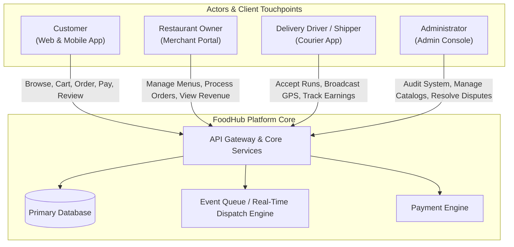
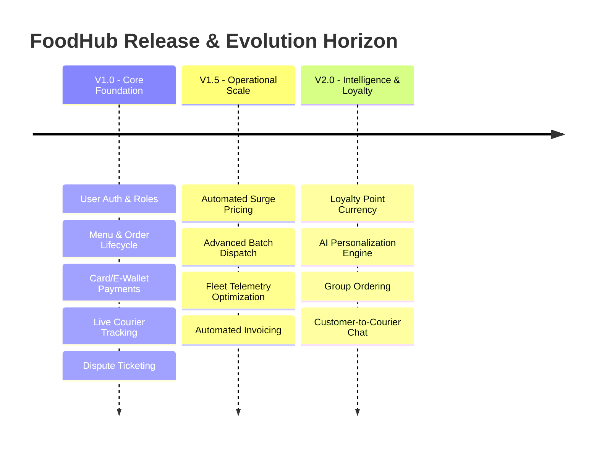
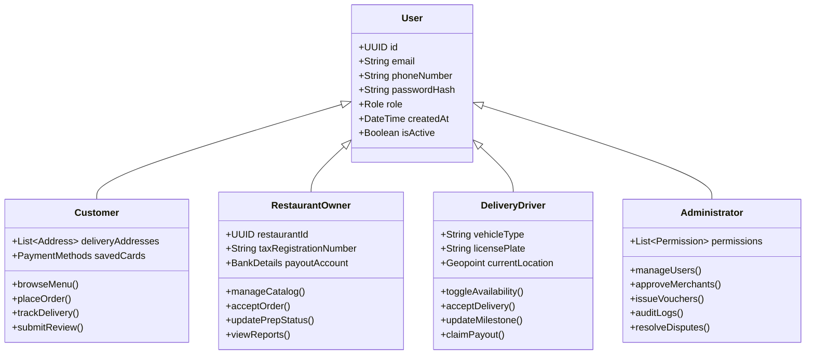
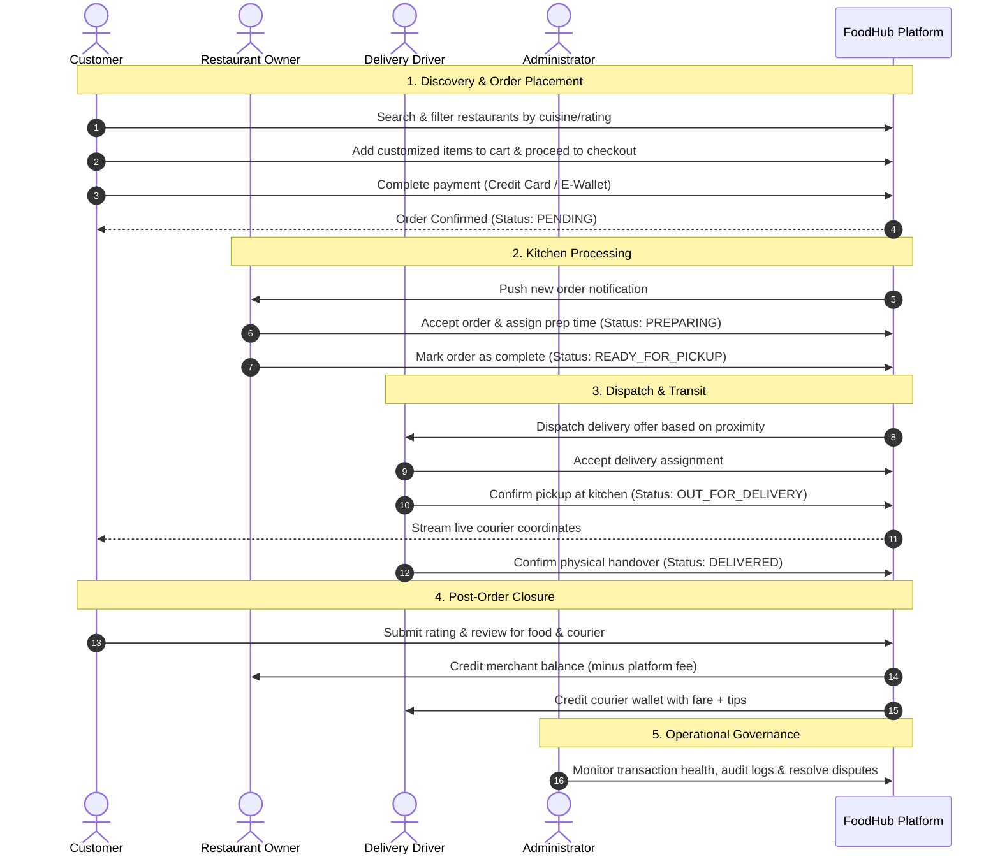
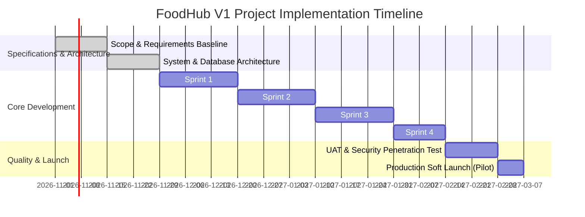
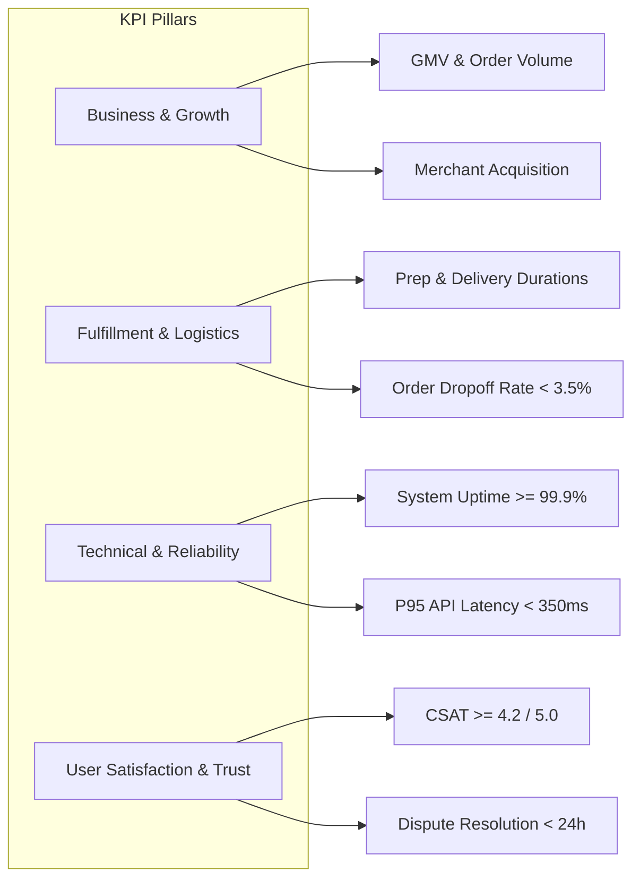
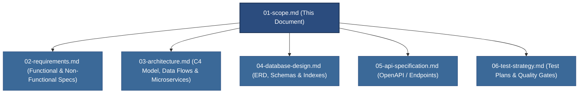

# Project Scope Document: FoodHub Platform (V1.0)

---

## Document Control & Metadata

| Field | Detail |
| :--- | :--- |
| **Document ID** | `FHB-DOC-SCP-001` |
| **Project Title** | FoodHub - Online Food Ordering & Delivery Platform |
| **Version** | 1.0.0 |
| **Status** | Approved / Baseline |
| **Classification** | Internal - Confidential |
| **Target Release** | Version 1.0 (MVP Launch) |
| **Document Owner** | Lead Systems Architect / Product Management |
| **Target Audience** | Engineering, QA, Product Management, Executive Stakeholders, Operations |

---

## 1. Project Overview

### 1.1 Executive Summary
**FoodHub** is an end-to-end, multi-sided digital food ordering and delivery marketplace designed to connect consumers with local culinary establishments and on-demand delivery couriers. The platform orchestrates the complete lifecycle of food commerce—from culinary discovery and digital menu browsing to transaction processing, real-time dispatch, transit monitoring, and post-fulfillment reputation management.

By consolidating the supply chain into a unified technological ecosystem, FoodHub eliminates operational friction for dining establishments, creates flexible income streams for couriers, and provides consumers with transparent, rapid, and friction-free access to prepared meals.

### 1.2 Problem Statement
The contemporary urban food marketplace suffers from fragmentation, high operational overhead, and inconsistent customer experiences:

* **Consumer Challenges:**
  * Inconsistent delivery estimates and lack of transparent, real-time shipment telemetry.
  * Cluttered user interfaces with inefficient search, filtering, and dietary preference sorting.
  * Inflexible or unreliable payment flows, leading to abandoned transactions.
* **Restaurant Operator Challenges:**
  * Prohibitive technical barriers to establishing in-house digital storefronts and dispatch logistics.
  * Inability to dynamically update menus, track inventory exhaustion (86ing items), or adjust kitchen preparation buffers during peak hours.
  * Opaque fee structures and delayed revenue settlements from legacy aggregators.
* **Delivery Driver (Shipper) Challenges:**
  * Suboptimal route assignment and manual dispatch inefficiencies resulting in extended idle times.
  * Unpredictable compensation calculations and delayed payout tracking.
* **Platform Administration & Compliance Challenges:**
  * Difficulty monitoring food safety disputes, order cancellation spikes, and fraudulent transactions across high transaction volumes.

### 1.3 Proposed Solution & System Ecosystem
FoodHub delivers a centralized, cloud-native software suite that coordinates interactions across four distinct participant archetypes through dedicated web and mobile interfaces backed by unified RESTful and event-driven APIs.

---

## 2. Goals & Objectives

### 2.1 Strategic Business Goals
* **Market Entry & Velocity:** Establish FoodHub as a viable digital marketplace across target metropolitan clusters within 6 months of V1 launch.
* **Transaction Liquidity:** Achieve and maintain a month-over-month (MoM) Gross Merchandise Value (GMV) growth rate of at least 15% through high merchant onboarding and repeat ordering.
* **Order Fulfillment Reliability:** Attain a complete order fulfillment success rate exceeding 96.5% of placed orders without logistical cancellation.
* **Merchant & Courier Retention:** Limit merchant churn to < 4% monthly and maintain an active delivery fleet capable of sustaining peak-hour surge volume.

### 2.2 User-Centric Goals

| Actor | Key Objectives |
| :--- | :--- |
| **Customer** | Complete food discovery and checkout in under 3 minutes; receive exact sub-minute tracking updates; experience zero payment transaction failures. |
| **Restaurant Owner** | Process incoming orders in under 30 seconds; configure menus and modifiers effortlessly; maintain complete transparency on daily revenue settlements. |
| **Delivery Driver** | Receive algorithmic trip assignments without manual intervention; maximize hourly earnings via streamlined route sequencing; verify earnings instantaneously. |
| **Administrator** | Gain 360-degree observability over platform transactions; resolve user disputes and refund requests within guaranteed SLAs; enforce platform security policies. |

### 2.3 Strategic Alignment Matrix

---

## 3. Target Users & Actor Profiles

FoodHub classifies all authenticated and guest actors into four well-defined architectural roles.

### 3.1 Customer (Consumer)
* **Description:** End-users ordering food for immediate on-demand consumption or scheduled pickup/delivery.
* **Core Responsibilities:**
  * Discover restaurants using proximity, rating, cuisine, and pricing filters.
  * Configure meal specifications (item variants, preparation notes, add-ons).
  * Execute secure checkout via integrated payment gateways (Credit/Debit Card, E-Wallet).
  * Monitor order transit via real-time telemetry checkpoints.
  * Evaluate restaurant quality and delivery performance via 1-5 star ratings and textual reviews.
* **Primary Channels:** Responsive Mobile Web, Native iOS/Android clients.

### 3.2 Restaurant Owner (Merchant Partner)
* **Description:** Kitchen managers, franchise operators, or independent restaurateurs selling culinary items on FoodHub.
* **Core Responsibilities:**
  * Configure establishment profiles (operating hours, kitchen capacity, geofenced preparation radius).
  * Perform Full CRUD operations on hierarchical menus (Categories -> Items -> Modifier Groups -> Options).
  * Manage real-time order states (`Pending` -> `Accepted` -> `In Preparation` -> `Ready for Pickup`).
  * Monitor sales performance, average ticket sizes, and item-level profitability dashboards.
* **Primary Channels:** Dedicated Tablet Interface, Desktop Merchant Web Portal.

### 3.3 Delivery Driver (Shipper / Courier)
* **Description:** Independent gig-economy logistics contractors responsible for the physical custody and transportation of orders.
* **Core Responsibilities:**
  * Toggle duty status (`Online / Available`, `Offline`, `On Delivery`).
  * Review and accept incoming dispatch offers showing pickup distance, dropoff distance, and guaranteed fare.
  * Execute sequential operational milestones (`Arrived at Merchant` -> `Picked Up / Out for Delivery` -> `Delivered`).
  * View accumulated trip earnings, bonuses, tips, and daily balance ledgers.
* **Primary Channels:** Mobile Courier Application (GPS & Push-Notification enabled).

### 3.4 Platform Administrator (System Operator)
* **Description:** Internal operations personnel, compliance officers, and system administrators responsible for governance and platform integrity.
* **Core Responsibilities:**
  * Manage authentication states, identity verification (KYC for drivers/merchants), and account access controls.
  * Oversee master taxonomic data (global cuisine categories, dietary tags, fee algorithms).
  * Create, activate, and evaluate promotional campaigns and discount vouchers.
  * Adjudicate customer complaints, merchant disputes, chargebacks, and refund triggers.
  * Inspect audit logs, system telemetry, and platform-wide financial settlement reports.
* **Primary Channels:** Secure Desktop Administration Console.

---

## 4. Scope Boundaries (Version 1.0 Release)

### 4.1 In-Scope Capabilities (V1 Baseline)

The V1 milestone delivers a complete, production-ready transaction lifecycle.

#### Detailed Functional Modules (V1)

| Module Ref | Module Name | Target Actor(s) | Functional Scope Included in V1 |
| :--- | :--- | :--- | :--- |
| **MOD-01** | **Identity & Access Management** | All Roles | - Email/password registration and credential login. - Role-based Access Control (RBAC) enforcing Customer, Merchant, Driver, Admin partitions. - JWT token-based session handling with secure refresh rotation. - Password reset via verified email OTP tokens. - Self-service profile updates (name, phone, avatar, vehicle details for drivers). |
| **MOD-02** | **Catalog & Restaurant Discovery** | Customer | - Search restaurants and items via text keywords. - Multi-criteria filtering (cuisine type, price band, minimum rating, dietary tags). - Dynamic sorting (distance, delivery time, popularity). - Restaurant detail view with active operational status, estimated delivery time, and operating hours. |
| **MOD-03** | **Menu & Inventory Management** | Restaurant Owner | - Hierarchical menu structuring: Category -> Item -> Customization Group (e.g., Size, Spice Level, Add-ons). - Item pricing, image upload, promotional pricing flags. - Quick-toggle item availability (In-Stock / Out-of-Stock). |
| **MOD-04** | **Cart & Checkout Engine** | Customer | - Single-restaurant cart validation (prevents mixed-vendor carts). - Dynamic calculation of subtotal, tax, variable delivery fee, and platform service fee. - Promotional voucher code validation and real-time discount application. - Multiple delivery address management with geolocation coordinate pin. |
| **MOD-05** | **Payment & Financial Checkout** | Customer, Admin | - Integration with PCI-DSS compliant payment gateways (Stripe/Paypal for Credit/Debit cards). - Integrated E-Wallet support (Mocked/Direct sandbox for popular regional digital wallets). - Automated webhook handling for payment authorization, capture, and failure callbacks. - Transaction receipt generation and delivery via email. |
| **MOD-06** | **Kitchen Order Processing** | Restaurant Owner | - Real-time incoming order dashboard with audio/visual alerts. - Order disposition: Accept (with estimated prep duration) or Reject (with structured reason codes). - Order state transitions: `Preparing` -> `Ready for Pickup`. - Historic order logs and itemized reprint capabilities. |
| **MOD-07** | **Logistics & Driver Dispatch** | Delivery Driver | - Driver availability state toggle (`Online` / `Offline`). - Proximity-based trip dispatch notification showing distance, pickup/dropoff points, and guaranteed payout. - Trip state transitions: `Accepted` -> `Arrived at Store` -> `Picked Up` -> `Delivered`. - Proof of delivery confirmation (single-tap customer code / signature capture). |
| **MOD-08** | **Live Order Telemetry** | Customer | - Real-time status pipeline view (Order Placed -> Kitchen Accepted -> Preparing -> Picked Up -> Arriving -> Delivered). - Real-time map displaying driver GPS position updates during `OUT_FOR_DELIVERY` phase. |
| **MOD-09** | **Ratings, Reviews & Reputation** | Customer, Restaurant, Admin | - Post-delivery dual rating: Restaurant Quality (1-5 stars + textual review) and Courier Delivery Experience (1-5 stars). - Aggregation engine calculating rolling average ratings for restaurants and couriers. - Merchant view of received customer feedback. |
| **MOD-10** | **Admin Governance & Operations** | Administrator | - Merchant onboarding review, document verification, and activation/suspension. - Driver account verification (driver license, vehicle registration check) and account lifecycle management. - Global taxonomy management (cuisines, food categories, system fees). - Promotional campaign creation (fixed percentage, fixed amount, minimum spend, expiry date). - Customer dispute ticket handling with manual refund authorization. |
| **MOD-11** | **Operational Reporting & Dashboards** | Restaurant, Driver, Admin | - **Restaurant:** Daily/weekly revenue summaries, total order count, top-selling items. - **Driver:** Completed trips, total earnings, active tip balance, trip history. - **Admin:** Platform GMV, active users, order completion rate, cancellation ratios, platform commission accruals. |

### 4.2 Explicitly Out-of-Scope Capabilities (V1 Exclusion Matrix)

The following features are intentionally deferred to future versions to maintain delivery velocity, limit operational complexity, and ensure baseline stability.

| Excluded Feature | Scope Ref | Strategic Rationale for V1 Exclusion | Target Roadmap Phase |
| :--- | :--- | :--- | :--- |
| **Multi-Language & Localization** | `OUT-01` | High localization translation overhead; initial launch targets a single primary regional market. | Version 2.0 |
| **AI-Powered Recommendation Engine** | `OUT-02` | Insufficient historical behavioral training data at launch; standard category and popularity sorting suffices for MVP. | Version 2.1 |
| **Subscription & Membership Plans** | `OUT-03` | Introduces complex recurring billing, prorated cancellations, and tiered delivery fee logic that complicates V1 accounting. | Version 2.0 |
| **Group / Collaborative Ordering** | `OUT-04` | Multi-user websocket state synchronization and split-billing introduce non-critical front-end and back-end complexity. | Version 2.2 |
| **Table Dine-In Reservations** | `OUT-05` | Dilutes product focus; FoodHub V1 is strictly an off-premise pickup and delivery marketplace. | Version 3.0 |
| **Loyalty & Gamification Points** | `OUT-06` | Virtual wallet balances and loyalty tier engines require regulatory compliance and financial reserve models. Standard vouchers cover V1 promotional needs. | Version 1.5 |
| **Real-Time In-App Chat** | `OUT-07` | Requires dedicated real-time socket infrastructure, message retention compliance, and moderation overhead. V1 relies on masked phone calls / automated SMS alerts. | Version 1.5 |
| **Advanced Machine Learning Logistics** | `OUT-08` | Dynamic multi-order batched routing and predictive cooking times require mature telemetry datasets. V1 uses deterministic radius dispatch. | Version 2.0 |

---

## 5. Key Assumptions

### 5.1 Business & Commercial Assumptions
1. **Merchant Cooperation:** Partner restaurants possess adequate kitchen hardware (tablets or PC terminals) and reliable broadband access to monitor incoming orders in real time.
2. **Gig Workforce Availability:** Sufficient independent courier density exists within target geographic zones to fulfill deliveries within a 35-minute average service window.
3. **Monetization Viability:** The agreed commission structure (e.g., 15-20% merchant commission + fixed consumer delivery fee) covers payment gateway fees, server overhead, and operational expenses.
4. **Single-Merchant Carts:** Consumers will accept the limitation that a single checkout transaction can only contain items sourced from one specific restaurant.

### 5.2 Technical & Architectural Assumptions
1. **Cloud Service Provider High Availability:** Third-party cloud infrastructure (e.g., AWS, GCP, or Azure) provides at least 99.9% uptime for core databases, compute nodes, and storage buckets.
2. **Payment Gateway Reliability:** External payment gateways provide synchronous authorization webhooks and sandboxes with SLA commitments exceeding 99.95%.
3. **Location Services Accuracy:** Client devices support HTML5 Geolocation / native GPS services capable of providing courier position accuracy within an acceptable margin (±15 meters).
4. **Single Base Currency:** All monetary transactions, menu item prices, and disbursement calculations in V1 are executed in a single sovereign base currency.

### 5.3 Legal, Regulatory & Compliance Assumptions
1. **Independent Contractor Classification:** Couriers operate under compliant local independent contractor arrangements, avoiding full-time employer liability during V1.
2. **Food Safety Disclaimers:** Liability for meal freshness, allergen cross-contamination, and hygiene rests solely with the partner restaurant, reinforced via platform terms of service.
3. **Consumer Data Privacy:** User data collection strictly aligns with prevailing regional data privacy frameworks (e.g., GDPR, CCPA, or local equivalent).

---

## 6. Constraints

### 6.1 Technical Constraints
* **Platform Compatibility:**
  * Web portals must support modern Chromium, WebKit, and Gecko engines (Chrome >= 100, Safari >= 15, Edge, Firefox).
  * Mobile web viewports must provide full responsive parity down to 360px screen width.
* **Network Latency:** Telemetry tracking must function reliably under throttled 3G mobile data connections without crashing or exhausting client memory.
* **Security & Compliance:**
  * Zero plain-text storage of user credentials; enforced Bcrypt hashing (cost factor >= 12) or Argon2id.
  * Zero cardholder data stored on FoodHub databases; all credit card operations must use tokenized gateway iframes compliant with PCI-DSS Level 1 standards.

### 6.2 Schedule & Timeline Constraints
* **Target Delivery Window:** V1 MVP completion within 16 calendar weeks across 4 iterative sprints.
* **Milestone Critical Path:**

### 6.3 Resource & Budgetary Constraints
* **Core Team Composition:** Constrained to a dedicated team: 1 Lead Architect / PM, 2 Backend Engineers, 2 Frontend / Mobile Engineers, 1 QA Automation Engineer, and 1 UI/UX Designer.
* **Third-Party API Consumption Caps:** Map tile rendering, reverse geocoding, and SMS OTP verifications are constrained by freemium/tier-1 operational budgets; strict client-side caching and debouncing are required.

---

## 7. Success Metrics & Key Performance Indicators (KPIs)

To evaluate the operational health, technical viability, and user adoption of the FoodHub V1 release, the platform establishes quantitative criteria across four categories.

### 7.1 Quantitative Success Metrics Table

| Dimension | Metric Identifier | Key Indicator / Target | Measurement Window | Action Threshold (Trigger) |
| :--- | :--- | :--- | :--- | :--- |
| **Business** | `KPI-BIZ-01` | **Total Completed Orders:** >= 15,000 orders across pilot zone | First 90 Days post-launch | < 8,000 orders triggers marketing review |
| **Business** | `KPI-BIZ-02` | **Active Partner Restaurants:** >= 75 licensed merchants onboarded | First 60 Days post-launch | < 40 merchants triggers merchant sales pivot |
| **Business** | `KPI-BIZ-03` | **Cart-to-Order Conversion Rate:** >= 22% of initiated checkouts completed | Continuous (Weekly average) | < 15% triggers checkout UX audit |
| **Logistics** | `KPI-LOG-01` | **Average Order Fulfillment Duration:** <= 38 minutes (from placement to delivery) | Rolling 30-Day average | > 45 minutes triggers fleet density expansion |
| **Logistics** | `KPI-LOG-02` | **Merchant Order Acceptance Speed:** <= 90 seconds from notification | Continuous (Daily aggregate) | > 180 seconds triggers merchant reminder workflow |
| **Logistics** | `KPI-LOG-03` | **Courier Pickup Delay:** <= 7 minutes waiting time at kitchen | Weekly average | > 12 minutes triggers kitchen prep buffer calibration |
| **Technical** | `KPI-TEC-01` | **Core Platform Availability:** >= 99.9% uptime excluding scheduled maintenance | Monthly rolling SLA | < 99.5% triggers infrastructure review |
| **Technical** | `KPI-TEC-02` | **API Latency (95th Percentile):** <= 350ms for read endpoints; <= 600ms for write/payment calls | Continuous monitoring | > 800ms triggers database query optimization |
| **Technical** | `KPI-TEC-03` | **Payment Processing Failure Rate:** <= 1.5% of valid payment attempts | Daily aggregate | > 3.0% triggers gateway failover routing |
| **User Trust** | `KPI-SAT-01` | **Customer Satisfaction Score (CSAT):** >= 4.3 out of 5.0 average order rating | Monthly rolling average | < 4.0 triggers quality control investigation |
| **User Trust** | `KPI-SAT-02` | **Customer Dispute SLA:** 100% of cancellation/refund tickets resolved within 24 hours | Daily reporting | < 95% triggers admin staffing reassignment |

---

## 8. Traceability & Downstream Artifacts

This scope document serves as the formal upstream baseline for all subsequent technical and product engineering documentation.

> [!IMPORTANT]
> Any proposed additions or structural alterations to the capabilities demarcated as **In-Scope** or **Out-of-Scope** within this document require a formal Change Request (CR) submitted to the Product Steering Committee. Unapproved deviations are strictly prohibited to prevent scope creep during the V1 delivery lifecycle.
