# FoodHub - System Feature Specifications

**Document Identifier:** `DOC-FS-02`  
**Project Name:** FoodHub - Online Food Ordering & Delivery Platform  
**Document Version:** `1.0.0`  
**Status:** Approved  
**Last Updated:** October 2026  
**Target Audience:** Product Managers, Software Architects, Engineering Leads, QA Teams, UI/UX Designers, Business Operations  

---

## 1. Executive Summary & Document Overview

### 1.1 Purpose
This document provides a comprehensive, production-grade specification of all functional features for the **FoodHub** online food ordering platform. It establishes the functional baseline for system architecture, database schema design, API endpoint specifications, UI/UX wireframes, and test case matrices.

### 1.2 System Actors & Stakeholders
FoodHub serves four distinct primary actors, each operating within dedicated system boundaries and interfaces:

| Actor ID | Actor Name | Role & System Scope | Primary Interfaces |
| :--- | :--- | :--- | :--- |
| **ACT-01** | **Customer** | End-consumer discovering food, placing orders, executing payments, tracking deliveries in real time, and reviewing merchants and couriers. | Responsive Web Portal, iOS App, Android App |
| **ACT-02** | **Restaurant Owner** | Merchant managing restaurant profile, menu catalog, inventory availability, incoming kitchen orders, operational hours, and financial reports. | Merchant Web Portal, Merchant Tablet/Mobile App |
| **ACT-03** | **Delivery Driver (Shipper)** | Independent or fleet courier accepting delivery requests, navigating pickup/drop-off routes, verifying order handovers, and tracking earnings. | Driver Mobile App (iOS / Android) |
| **ACT-04** | **Administrator** | Platform operator overseeing ecosystem health, approving merchants, managing categories, governing promotions, mediating disputes, and auditing finances. | Centralized Admin Web Dashboard |

### 1.3 Prioritization Framework (MoSCoW)
All functional features are prioritized according to the industry-standard MoSCoW method:
* **Must Have (M):** Critical core requirements mandatory for the Minimum Viable Product (MVP / Version 1.0). The system cannot launch without these capabilities.
* **Should Have (S):** High-priority features that provide vital business value and enhanced user experience, planned for immediate post-MVP or complete V1 rollout.
* **Could Have (C):** Desirable enhancements and non-critical optimizations that will be implemented if engineering bandwidth and timeline permit.
* **Won't Have V1 (W):** Explicitly deferred capabilities slated for future evolutionary iterations (Version 2.0+).

---

## 2. Platform Feature Architecture & Actor Mapping

### 2.1 High-Level Feature Ecosystem
The following diagram illustrates how the 14 core feature domains (F01–F14) map across the platform actors and cross-cutting functional services.

```mermaid
graph TB
    subgraph Actors["Platform Actors"]
        A1["Customer (ACT-01)"]
        A2["Restaurant Owner (ACT-02)"]
        A3["Delivery Driver / Shipper (ACT-03)"]
        A4["Administrator (ACT-04)"]
    end

    subgraph CoreCommerce["Core Commerce & Ordering"]
        F02["F02: Restaurant Discovery"]
        F03["F03: Menu & Cart"]
        F04["F04: Order & Checkout"]
        F05["F05: Payment Processing"]
        F06["F06: Order Tracking"]
        F08["F08: Order History"]
    end

    subgraph MerchantDelivery["Merchant & Logistics Engine"]
        F09["F09: Restaurant Management"]
        F10["F10: Restaurant Order Processing"]
        F11["F11: Delivery Management"]
    end

    subgraph PlatformGov["Platform Growth & Governance"]
        F01["F01: Auth & Registration"]
        F07["F07: Rating & Review"]
        F12["F12: Promotions & Vouchers"]
        F13["F13: Admin Dashboard"]
        F14["F14: Profile Management"]
    end

    A1 --> F01 & F02 & F03 & F04 & F05 & F06 & F07 & F08 & F12 & F14
    A2 --> F01 & F09 & F10 & F07 & F12 & F14
    A3 --> F01 & F11 & F06 & F14
    A4 --> F01 & F13 & F12 & F07 & F14
```

### 2.2 Master Feature Matrix

| Group ID | Feature Domain Name | Target Actors | Primary Business Goal | MVP Priority |
| :--- | :--- | :--- | :--- | :--- |
| **F01** | Authentication & Registration | All Actors | Secure onboarding, identity verification, role-based access | **Must Have** |
| **F02** | Restaurant Discovery | Customer | Fast, intuitive exploration of restaurants and cuisines | **Must Have** |
| **F03** | Menu & Cart | Customer | Frictionless item selection, customization, and cart management | **Must Have** |
| **F04** | Order & Checkout | Customer | Transparent pricing calculation and streamlined order dispatch | **Must Have** |
| **F05** | Payment | Customer, Shipper | Multi-channel payment capture, COD, e-wallets, refunds | **Must Have** |
| **F06** | Order Tracking | Customer, Shipper, Merchant | End-to-end operational visibility and live map telemetry | **Must Have** |
| **F07** | Rating & Review | Customer, Merchant, Admin | Quality feedback loop for food quality and courier reliability | **Should Have** |
| **F08** | Order History | Customer | Reorder acceleration, digital audit trail, receipts | **Must Have** |
| **F09** | Restaurant Management | Merchant | Autonomous control over storefront, catalog, and operations | **Must Have** |
| **F10** | Restaurant Order Processing | Merchant | Low-latency order dispatch, kitchen status progression | **Must Have** |
| **F11** | Delivery Management | Shipper | Optimized order acceptance, route guidance, payout logging | **Must Have** |
| **F12** | Promotions & Vouchers | Customer, Merchant, Admin | Conversion uplift, marketing campaigns, customer retention | **Should Have** |
| **F13** | Admin Dashboard & Management | Administrator | Platform health governance, merchant verification, dispute mediation | **Must Have** |
| **F14** | Profile Management | All Actors | Self-service credential, address, and preference maintenance | **Must Have** |

---

## 3. Detailed Feature Specifications

---

### F01. Authentication & Registration

#### 3.1.1 Overview
The Authentication & Registration subsystem establishes secure, verified digital identities across all four actors. It enforces Role-Based Access Control (RBAC), supports session management via stateless JSON Web Tokens (JWT), and guarantees data privacy and platform integrity.

#### 3.1.2 Authentication Lifecycle & Security Flow
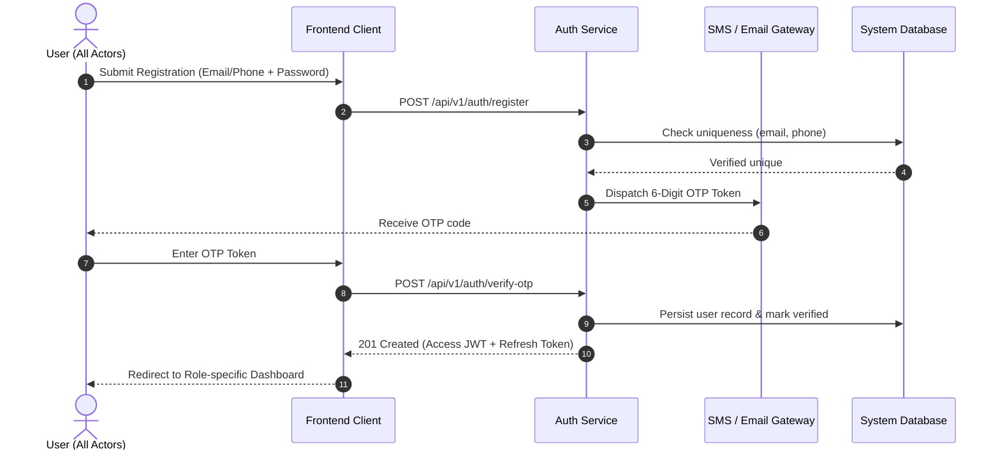

#### 3.1.3 Sub-Feature Specifications

| Sub-Feature ID | Sub-Feature Name | Priority | Associated Actors | Description & Functional Rules | Acceptance Criteria |
| :--- | :--- | :--- | :--- | :--- | :--- |
| **F01.01** | Email & Password Registration | **Must Have** | Customer | Allows customers to register with email, strong password (min 8 characters, 1 digit, 1 symbol), full name, and phone. | Account created in `PENDING_VERIFICATION` status; verification email/SMS triggered. |
| **F01.02** | Phone Number & OTP Verification | **Must Have** | Customer, Shipper | Mandatory 6-digit One-Time Password (OTP) verification sent via SMS. OTP valid for 3 minutes with rate limiting (max 3 resends per hour). | Account activates to `ACTIVE` status only upon valid OTP submission. |
| **F01.03** | JWT Login & Session Management | **Must Have** | All Actors | Authenticates credentials and issues short-lived JWT Access Token (15 min) and persistent Refresh Token (7 days) stored securely in HttpOnly cookies. | Seamless silent token refresh; invalid/expired tokens return HTTP 401 Unauthorized. |
| **F01.04** | Password Reset & Recovery | **Must Have** | All Actors | Self-service password recovery flow via signed time-limited (15-min expiry) reset link or phone OTP. | Old password invalidated immediately; all active sessions revoked upon reset. |
| **F01.05** | Social Authentication (Google OAuth2) | **Could Have** | Customer | One-tap registration and sign-in using Google OAuth2.0 identity provider. | On initial Google login, user profile auto-created; phone verification prompted if missing. |
| **F01.06** | Role-Based Access & Portal Routing | **Must Have** | All Actors | Strict server-side RBAC gating API endpoints and redirecting users post-login to their respective web/mobile workspaces. | Unauthorized access attempts trigger HTTP 403 Forbidden with security logging. |
| **F01.07** | Session Invalidation & Logout | **Must Have** | All Actors | Secure logout mechanism that revokes refresh tokens on Redis blacklist and clears client-side credentials. | Subsequent requests with revoked tokens fail instantly. |

---

### F02. Restaurant Discovery

#### 3.2.1 Overview
Restaurant Discovery empowers customers to effortlessly explore, search, filter, and evaluate food vendors based on real-time location telemetry, culinary tastes, ratings, and price tiers.

#### 3.2.2 Search & Discovery Architecture
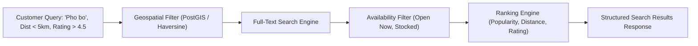

#### 3.2.3 Sub-Feature Specifications

| Sub-Feature ID | Sub-Feature Name | Priority | Associated Actors | Description & Functional Rules | Acceptance Criteria |
| :--- | :--- | :--- | :--- | :--- | :--- |
| **F02.01** | Category-Based Browsing | **Must Have** | Customer | Visual browsing of curated cuisine categories (e.g., Vietnamese, Japanese, Fast Food, Milk Tea, Desserts, Healthy). | Clicking a category filters restaurants serving items associated with that taxonomy. |
| **F02.02** | Multi-Attribute Search Engine | **Must Have** | Customer | Instant search matching restaurant brand names, dish names, cuisine tags, and specific ingredients. | Debounced search input (300ms) returning matching entities with highlighted keywords. |
| **F02.03** | Geospatial Proximity & Radius Filtering | **Must Have** | Customer | Filters restaurants located within standard delivery radiuses (default 5km, extendable up to 15km). | Restaurants outside maximum delivery range or not serving the user's GPS point are marked unserviceable. |
| **F02.04** | Multi-Facet Filtering Engine | **Should Have** | Customer | Granular filtering by minimum average rating (3.0+, 4.0+, 4.5+), price bracket ($, $$, $$$), delivery time (<30m, <45m), and active promo tags. | Multi-select filters combine logically (`AND` condition); updates result set dynamically. |
| **F02.05** | Dynamic Sorting System | **Must Have** | Customer | Sort results by: "Most Popular" (order volume), "Top Rated" (star rating), "Fastest Delivery" (prep + transit), and "Distance" (nearest first). | Accurate client-side/server-side list re-ordering maintaining pagination state. |
| **F02.06** | Restaurant Detail Page | **Must Have** | Customer | Comprehensive merchant view displaying banner, logo, business hours, operational status, delivery fee estimate, full menu tabs, and customer reviews. | Page indicates if restaurant is currently "Closed" or "Busy" and blocks immediate checkout if closed. |
| **F02.07** | Favorite / Bookmarked Stores | **Could Have** | Customer | Allows authenticated customers to bookmark restaurants for rapid access via a dedicated "Favorites" tab. | Instant toggle state with optimistic UI update, persisted to customer account. |

---

### F03. Menu & Cart

#### 3.3.1 Overview
The Menu & Cart engine powers item selection, recipe customization, and shopping cart persistence. It enforces single-restaurant cart validation to prevent multi-vendor delivery complications.

#### 3.3.2 Cart Validation Logic
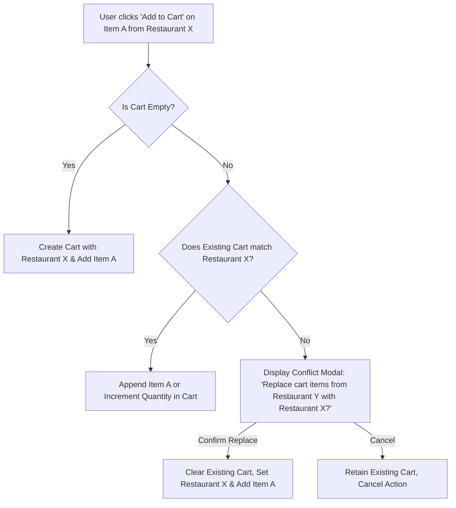

#### 3.3.3 Sub-Feature Specifications

| Sub-Feature ID | Sub-Feature Name | Priority | Associated Actors | Description & Functional Rules | Acceptance Criteria |
| :--- | :--- | :--- | :--- | :--- | :--- |
| **F03.01** | Categorized Menu Display | **Must Have** | Customer | Displays restaurant items grouped into merchant-defined categories (e.g., Starters, Main Courses, Beverages, Combos). | Responsive sticky navigation bar for smooth anchor jumping across menu sections. |
| **F03.02** | Menu Item Detail & Media | **Must Have** | Customer | Displays high-resolution photos, dish title, detailed descriptions, base price, and dietary tags (Vegetarian, Spicy, Halal). | Fallback placeholder image rendered if merchant image fails to load. |
| **F03.03** | Item Customization & Modifiers | **Should Have** | Customer | Configurable options including mandatory single-choice (e.g., Size: Regular, Large) and optional multi-choice (e.g., Extra Toppings, Sugar/Ice level). | Add-to-cart button enabled only after all mandatory modifier requirements are met. |
| **F03.04** | Item Special Instructions | **Must Have** | Customer | Free-text field per item (max 150 characters) for kitchen instructions (e.g., "No onions", "Sauce on the side"). | Special instructions stored with cart line-item and displayed on kitchen receipts. |
| **F03.05** | Quantity Adjustment & Item Removal | **Must Have** | Customer | Increment, decrement, or delete items directly from the cart drawer or order summary screen. | Decrementing quantity below 1 triggers item removal confirmation. Subtotals update immediately. |
| **F03.06** | Multi-Restaurant Cart Guard | **Must Have** | Customer | Enforces single-restaurant ordering. Warns the customer if an item from a different restaurant is selected. | Explicit user confirmation required to purge existing cart before adding items from a new vendor. |
| **F03.07** | Cross-Session Cart Persistence | **Should Have** | Customer | Cart contents persist across browser refreshes, device switches, and login sessions via cloud-backed storage. | Guest cart automatically merged into customer account upon login. |
| **F03.08** | Real-Time Stock & Price Sync | **Must Have** | Customer | Live check validating that items in cart remain in-stock and prices have not been altered before checkout. | Out-of-stock items highlighted with prompt to remove or substitute prior to proceeding. |

---

### F04. Order & Checkout

#### 3.4.1 Overview
The Order & Checkout module transforms cart items into legally binding, monetized orders. It coordinates delivery address resolution, time slot scheduling, voucher application, dynamic fee calculation, and order dispatch.

#### 3.4.2 Checkout Calculation Flow
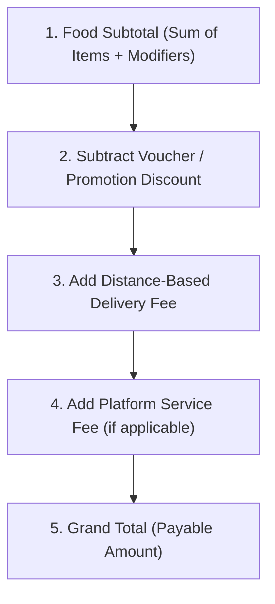

#### 3.4.3 Sub-Feature Specifications

| Sub-Feature ID | Sub-Feature Name | Priority | Associated Actors | Description & Functional Rules | Acceptance Criteria |
| :--- | :--- | :--- | :--- | :--- | :--- |
| **F04.01** | Delivery Address Management | **Must Have** | Customer | Allows selecting from saved addresses or specifying a new delivery point with GPS pinpointing and unit notes. | Pinned coordinates accurately validated against merchant delivery radius. |
| **F04.02** | Delivery Time Selection | **Must Have** | Customer | Option to select "ASAP" (immediate kitchen dispatch) or "Scheduled Delivery" up to 48 hours in advance in 15-minute intervals. | Scheduled orders held in queue and dispatched to restaurant according to calculated prep time. |
| **F04.03** | Itemized Order Summary | **Must Have** | Customer | Transparent financial summary detailing item subtotal, delivery fee, platform fee, applied discounts, and grand total. | Calculations verified on server side; floating-point rounding errors eliminated (rounded to nearest integer currency unit). |
| **F04.04** | Voucher Code Application | **Should Have** | Customer | Manual entry or selection of available platform/store vouchers with immediate validation against order eligibility criteria. | Invalid vouchers display specific rejection reason (e.g., "Min order $15 required"). |
| **F04.05** | Order Placement & Idempotency | **Must Have** | Customer | Submission of order with unique client-generated idempotency key preventing duplicate orders upon rapid double-clicks. | Order created with status `PLACED`; lock acquired on inventory items. |
| **F04.06** | Real-Time Order Confirmation | **Must Have** | Customer, Merchant | Instant transition to visual confirmation screen showing Order ID, estimated arrival time, and live status indicator. | Webhook/WebSocket notification pushed to merchant terminal within 2 seconds. |

---

### F05. Payment

#### 3.5.1 Overview
The Payment engine supports diverse payment rails commonly used in modern e-commerce, including Cash on Delivery (COD), credit/debit card gateway processing, and domestic digital wallets (MoMo, ZaloPay). It manages the transaction lifecycle from authorization through capture and refund reconciliation.

#### 3.5.2 Payment State Machine
```mermaid
stateDiagram-v2
    [*] --> PaymentInitiated: Order Placed
    PaymentInitiated --> COD_Pending: Select Cash on Delivery
    PaymentInitiated --> Gateway_Pending: Select Card / E-Wallet
    
    COD_Pending --> Paid: Shipper Collects Cash at Delivery
    COD_Pending --> PaymentFailed: Customer Refuses / Delivery Fails
    
    Gateway_Pending --> Authorized: Gateway Captures Funds
    Gateway_Pending --> PaymentFailed: Insufficient Funds / Timeout
    
    Authorized --> Paid: Order Successfully Delivered
    Authorized --> Refunded: Order Cancelled / Rejected by Merchant
    Paid --> Refunded: Post-delivery dispute approved
    
    PaymentFailed --> [*]
    Paid --> [*]
    Refunded --> [*]
```

#### 3.5.3 Sub-Feature Specifications

| Sub-Feature ID | Sub-Feature Name | Priority | Associated Actors | Description & Functional Rules | Acceptance Criteria |
| :--- | :--- | :--- | :--- | :--- | :--- |
| **F05.01** | Cash on Delivery (COD) | **Must Have** | Customer, Shipper | Customer pays cash directly to courier upon physical arrival. COD is capped at a maximum limit (e.g., $100 / 2,000,000 VND) to limit merchant fraud exposure. | Shipper verifies cash receipt on app; order marked `PAID`. |
| **F05.02** | Credit/Debit Card Processing | **Must Have** | Customer | Seamless tokenized card checkout via PCI-DSS compliant payment gateway (Stripe/CyberSource). | Supports 3D-Secure 2.0 verification; card details never stored on FoodHub servers. |
| **F05.03** | E-Wallet Integration (MoMo) | **Must Have** | Customer | Direct deep-linking to MoMo mobile app or dynamic QR code rendering for web desktop checkout. | Instant asynchronous IPN (Instant Payment Notification) callback updates transaction to `SUCCESS`. |
| **F05.04** | E-Wallet Integration (ZaloPay) | **Should Have** | Customer | Native payment integration with ZaloPay gateway supporting app-to-app switch and barcode/QR scanning. | Verified cryptographic signature validation on webhook payloads. |
| **F05.05** | Payment Transaction Ledger | **Must Have** | Admin, Merchant | Complete audit trail recording transaction ID, gateway reference, fee deductions, net payout, and timestamp. | Searchable and exportable by administrators for financial settlement. |
| **F05.06** | Automated Refund Engine | **Should Have** | Customer, Admin | Automated reversal of authorized card/wallet charges when an order is rejected or cancelled within allowed time windows. | Refund triggered within 60 seconds of order cancellation; customer notified via push/email. |

---

### F06. Order Tracking & Real-Time Logistics

#### 3.6.1 Overview
Order Tracking gives customers, merchants, and couriers complete transparency over the order fulfillment lifecycle. It combines a strict order state machine, live WebSocket event streaming, push alerts, and interactive map tracking.

#### 3.6.2 Complete Order Fulfillment Lifecycle
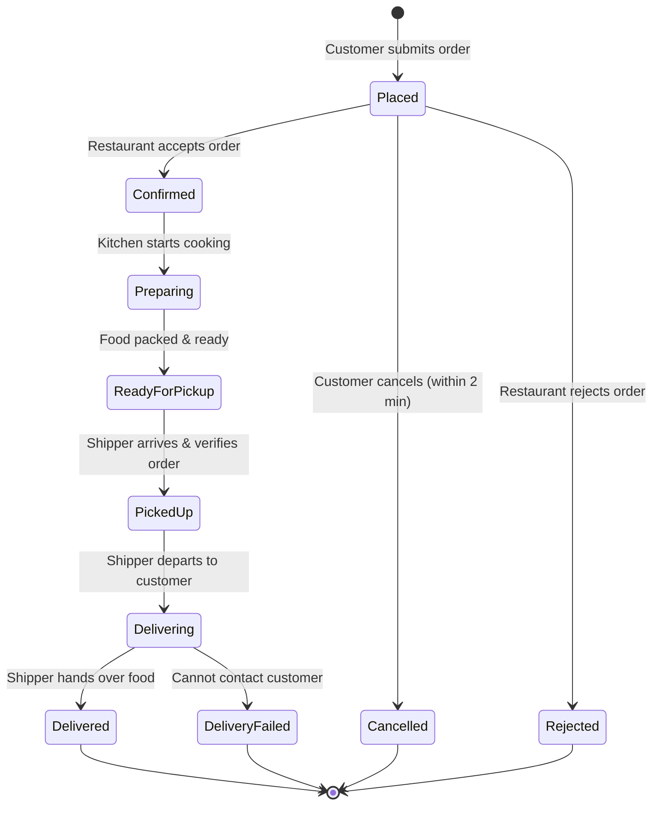

#### 3.6.3 Sub-Feature Specifications

| Sub-Feature ID | Sub-Feature Name | Priority | Associated Actors | Description & Functional Rules | Acceptance Criteria |
| :--- | :--- | :--- | :--- | :--- | :--- |
| **F06.01** | Lifecycle State Machine | **Must Have** | All Actors | Enforces strict transitions across states: `PLACED` → `CONFIRMED` → `PREPARING` → `READY_FOR_PICKUP` → `PICKED_UP` → `DELIVERING` → `DELIVERED`. | Out-of-order state transitions are strictly rejected by the server. |
| **F06.02** | Real-Time Status Telemetry | **Must Have** | Customer | WebSocket / Server-Sent Events (SSE) feed updating client UI instantaneously without manual page refreshes. | State changes reflected on customer screen within < 1.0 second of trigger. |
| **F06.03** | Automated Push Notifications | **Must Have** | Customer, Shipper, Merchant | Multi-channel push alerts (Firebase Cloud Messaging) dispatched upon key milestone transitions (Confirmed, Picked Up, Near Arrival). | Notifications delivered reliably in background and foreground application states. |
| **F06.04** | Dynamic ETA Calculation | **Should Have** | Customer | Dynamic Estimated Time of Arrival calculated as: $\text{ETA} = \text{Kitchen Prep Time} + \text{Shipper Travel Time} + \text{Buffer}$. | ETA recalibrates if kitchen extends prep time or traffic delays occur. |
| **F06.05** | Live Shipper GPS Tracking on Map | **Should Have** | Customer, Shipper | Real-time map displaying driver marker, restaurant location, customer address, and route polyline with 5-second GPS updates. | Smooth marker animation along route without erratic visual jumping. |
| **F06.06** | In-App Masked Communication | **Could Have** | Customer, Shipper | VoIP or masked phone proxy allowing customer and driver to communicate without revealing private phone numbers. | Call connects seamlessly while masking true subscriber numbers for privacy compliance. |

---

### F07. Rating & Review

#### 3.7.1 Overview
The Rating & Review module provides a transparent, dual-sided feedback loop. Customers evaluate both food quality (restaurant) and delivery service (courier) independently, maintaining high standards across the marketplace.

#### 3.7.2 Feedback Flow Architecture
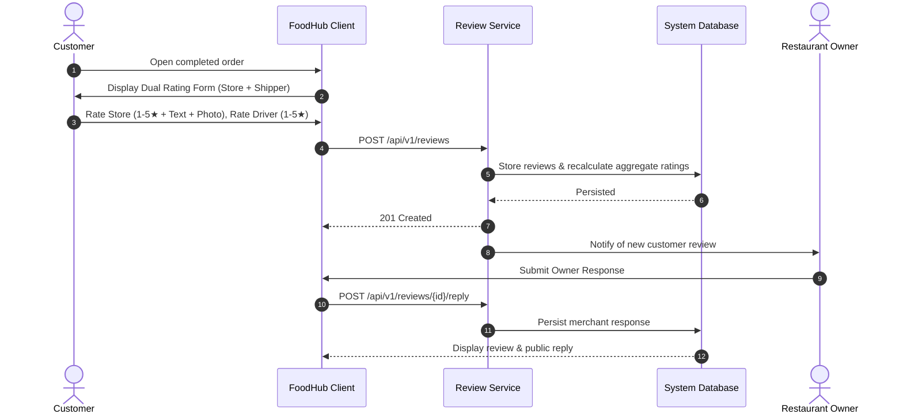

#### 3.7.3 Sub-Feature Specifications

| Sub-Feature ID | Sub-Feature Name | Priority | Associated Actors | Description & Functional Rules | Acceptance Criteria |
| :--- | :--- | :--- | :--- | :--- | :--- |
| **F07.01** | Dual-Target Rating System | **Must Have** | Customer | Independent 1-to-5 star rating inputs for: (1) Restaurant Food Quality and (2) Delivery Driver Professionalism. | Enforces that only customers with orders in `DELIVERED` status can submit reviews. |
| **F07.02** | Text Feedback & Photo Uploads | **Should Have** | Customer | Optional written review (up to 500 characters) and attachment of up to 3 verified food photos (JPEG/PNG, max 5MB each). | Media sanitized, resized, and scanned for inappropriate content prior to S3 persistence. |
| **F07.03** | Public Rating Aggregation | **Must Have** | Customer, Merchant | Real-time recalculation of merchant overall score and rating distribution histogram (percentage of 5★, 4★, 3★, 2★, 1★). | Displayed on restaurant profile with total verified review count. |
| **F07.04** | Merchant Official Reply | **Should Have** | Merchant | Allows restaurant owners to post a single public reply to any customer review on their storefront. | Merchant response displays highlighted as "Store Owner Response" beneath the review. |
| **F07.05** | Review Moderation & Flagging | **Should Have** | Admin, All Actors | Automated profanity filtering and manual "Report Review" flag for abusive, defamatory, or fraudulent reviews. | Flagged reviews routed to Administrator dispute queue for moderation. |

---

### F08. Order History

#### 3.8.1 Overview
Order History serves as the customer's personal record of past transactions. It enables quick repeat ordering, electronic receipt retrieval, and self-service cancellation within defined operational windows.

#### 3.8.2 Sub-Feature Specifications

| Sub-Feature ID | Sub-Feature Name | Priority | Associated Actors | Description & Functional Rules | Acceptance Criteria |
| :--- | :--- | :--- | :--- | :--- | :--- |
| **F08.01** | Historical Orders Explorer | **Must Have** | Customer | Chronological list of past orders with status badges, date, restaurant name, item thumbnail summary, and total cost. | Infinite scroll pagination with filters for active vs past orders. |
| **F08.02** | Granular Order Breakdown | **Must Have** | Customer | View full historical details of any previous order, including customized items, driver details, payment method, and timeline. | All pricing and discount line-items match original checkout state exactly. |
| **F08.03** | One-Click Reorder | **Should Have** | Customer | Single button to recreate cart from a previous order. System automatically validates item availability and updated pricing. | In-stock items loaded to cart; user alerted if any historical items are discontinued. |
| **F08.04** | Digital Invoice / Receipt Export | **Should Have** | Customer | Downloadable, printable PDF receipt containing VAT registration numbers, merchant address, order breakdown, and payment confirmation. | Generates standardized, professionally formatted PDF receipt. |
| **F08.05** | Grace-Period Order Cancellation | **Must Have** | Customer | Self-service cancellation allowed strictly while order remains in `PLACED` status (or within a 2-minute grace window). | Cancellation button disabled once merchant updates status to `CONFIRMED` or `PREPARING`. |

---

### F09. Restaurant Management

#### 3.9.1 Overview
Restaurant Management grants merchants complete control over their digital storefront, business operating schedule, categorization hierarchy, menu items, modifier groups, and real-time inventory toggles.

#### 3.9.2 Menu Hierarchy Model
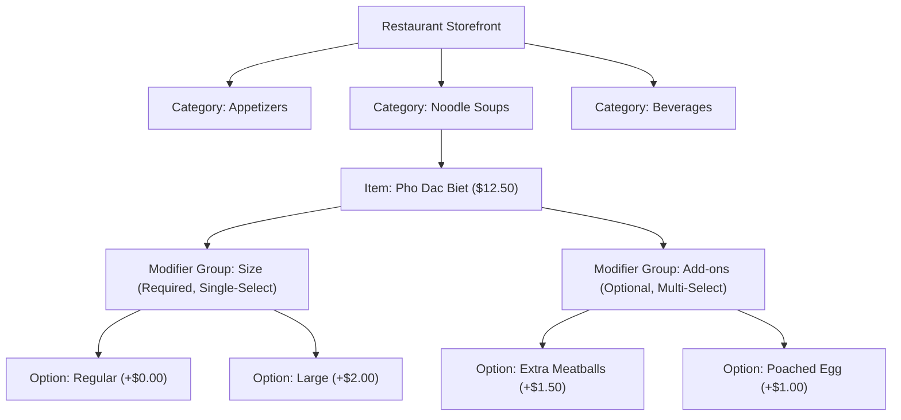

#### 3.9.3 Sub-Feature Specifications

| Sub-Feature ID | Sub-Feature Name | Priority | Associated Actors | Description & Functional Rules | Acceptance Criteria |
| :--- | :--- | :--- | :--- | :--- | :--- |
| **F09.01** | Storefront Profile Management | **Must Have** | Merchant | Configure restaurant public name, phone, physical address, cuisine tags, logo image, and promotional banner. | Profile modifications updated immediately on the customer-facing discovery app. |
| **F09.02** | Menu Category CRUD | **Must Have** | Merchant | Create, edit, reorder (drag-and-drop), and delete menu categories (e.g., Soups, Rice Dishes, Drinks). | Category order persists and reflects on the customer menu navigation. |
| **F09.03** | Menu Item & Modifier Management | **Must Have** | Merchant | Full CRUD for menu items: title, description, base price, image upload, allergen tags, and nested modifier groups (single/multi-select). | Modifier constraints (min/max selections) enforced during validation. |
| **F09.04** | Real-Time Stock Availability Toggle | **Must Have** | Merchant | One-tap switch to mark any menu item or modifier as "In Stock" or "Out of Stock" (86-ing). | Out-of-stock items immediately greyed out on customer menu, preventing selection. |
| **F09.05** | Operating Hours & Holiday Scheduling | **Must Have** | Merchant | Configure daily operating time intervals (supporting split shifts, e.g., 10:00–14:00 and 17:00–22:00) and temporary holiday closures. | Store automatically marks itself closed outside configured operational hours. |
| **F09.06** | Emergency Store Pause ("Busy Mode") | **Must Have** | Merchant | Master toggle to temporarily take the store offline or activate "Busy Mode" to pause new incoming orders during kitchen overload. | Customer discovery immediately reflects "Busy - Not taking orders right now". |

---

### F10. Restaurant Order Processing

#### 3.10.1 Overview
The Restaurant Order Processing module acts as the merchant’s digital kitchen display system (KDS). It notifies kitchen staff of incoming orders in real time, manages cooking status transitions, and coordinates courier handovers.

#### 3.10.2 Merchant Kitchen Workflow
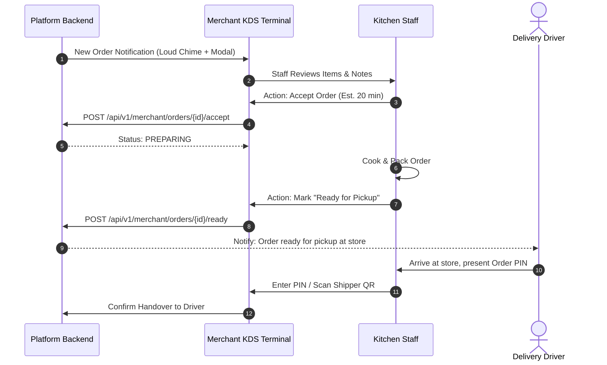

#### 3.10.3 Sub-Feature Specifications

| Sub-Feature ID | Sub-Feature Name | Priority | Associated Actors | Description & Functional Rules | Acceptance Criteria |
| :--- | :--- | :--- | :--- | :--- | :--- |
| **F10.01** | Real-Time Order Dispatch Queue | **Must Have** | Merchant | Prominent audio-visual alert (continuous chime + modal pop-up) on merchant screen when a new order arrives. | Alert plays continuously until staff acknowledges order (auto-reject after 5 min). |
| **F10.02** | Order Acceptance & Rejection | **Must Have** | Merchant | Staff can accept order with estimated prep time, or reject order by selecting a mandatory reason (e.g., "Out of ingredients", "Store closing"). | Customer notified immediately of rejection; refund auto-initiated. |
| **F10.03** | Kitchen Prep Workflow Progression | **Must Have** | Merchant | Progress order status from `CONFIRMED` → `PREPARING` → `READY_FOR_PICKUP`. | Status updates broadcast immediately to customer and matched delivery driver. |
| **F10.04** | Order Handover Verification | **Must Have** | Merchant, Shipper | Verify driver identity via short 4-digit Order PIN or barcode/QR scan before releasing food packages. | Prevents unauthorized courier pickups and lost packages. |
| **F10.05** | Merchant Daily Sales & Order History | **Should Have** | Merchant | In-app reporting dashboard showing daily completed orders, cancellation rate, gross sales, and net payout after commission. | Searchable historical list with itemized receipts and date range filters. |

---

### F11. Delivery Management (Shipper)

#### 3.11.1 Overview
Delivery Management equips couriers with an optimized mobile interface to discover nearby delivery dispatches, accept delivery trips, navigate between merchant and customer, confirm handovers, and track earnings.

#### 3.11.2 Shipper Dispatch & Delivery Flow
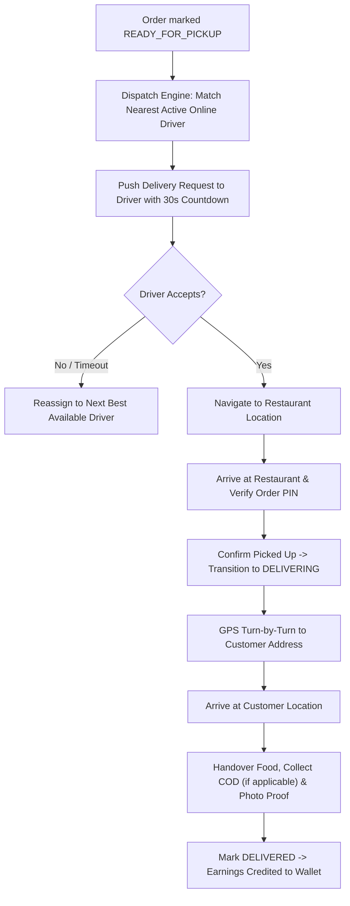

#### 3.11.3 Sub-Feature Specifications

| Sub-Feature ID | Sub-Feature Name | Priority | Associated Actors | Description & Functional Rules | Acceptance Criteria |
| :--- | :--- | :--- | :--- | :--- | :--- |
| **F11.01** | Shift Management & Online Status | **Must Have** | Shipper | Driver toggle switch to transition between "Online" (ready to receive trips) and "Offline". | Offline drivers are excluded from the dispatch matching engine. |
| **F11.02** | Delivery Opportunity Broadcast | **Must Have** | Shipper | Delivery broadcast card showing pickup location, drop-off destination, distance, estimated trip earnings, and 30-second countdown timer. | Unaccepted requests auto-cascade to next nearest courier upon timer expiration. |
| **F11.03** | Turn-by-Turn GPS Navigation | **Should Have** | Shipper | In-app map navigation with optimal route guidance or one-tap deep-link opening external Google Maps / Waze. | Route recalculates dynamically if driver deviates from trajectory. |
| **F11.04** | Delivery State Execution | **Must Have** | Shipper | Sequential buttons to trigger: "Arrived at Store" → "Confirm Pickup" → "Arrived at Customer" → "Completed Delivery". | Proximity GPS validation (within 200m) enforces physical presence before marking arrived. |
| **F11.05** | Electronic Proof of Delivery (e-POD) | **Must Have** | Shipper | Mandatory camera capture of package delivered at door/customer hands, plus COD cash confirmation if applicable. | Photo uploaded to cloud storage and linked to order audit record. |
| **F11.06** | Shipper Wallet & Earnings Ledger | **Must Have** | Shipper | Breakdown of completed trip fares, distance bonuses, customer tips, daily/weekly cumulative earnings, and payout withdrawal requests. | Detailed earnings ledger updated instantaneously upon each completed delivery. |

---

### F12. Promotions & Vouchers

#### 3.12.1 Overview
The Promotions & Vouchers engine drives platform growth and merchant sales via configurable marketing campaigns, multi-tier voucher discount rules, automated cart discount optimization, and home screen promotional carousels.

#### 3.12.2 Promotion Rules Engine
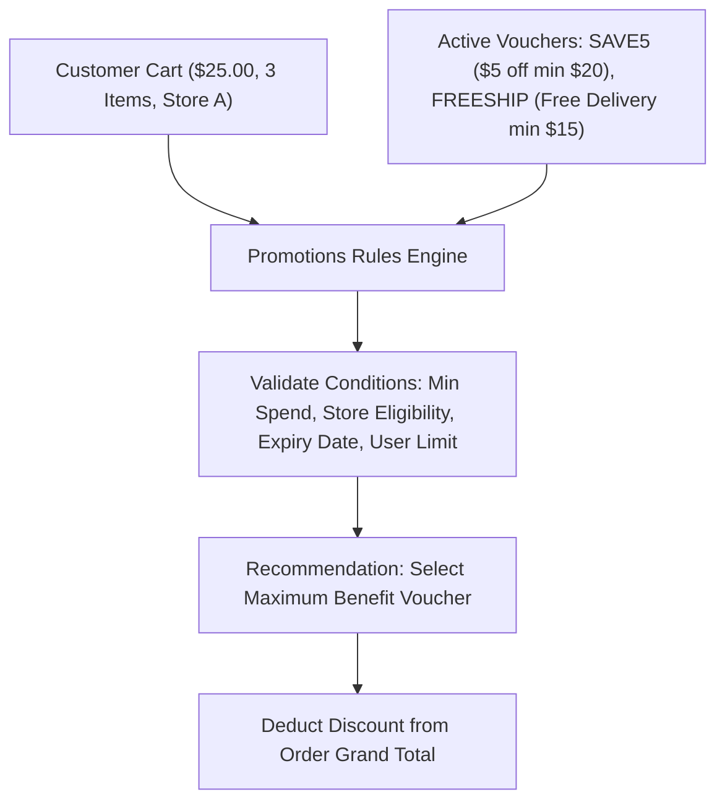

#### 3.12.3 Sub-Feature Specifications

| Sub-Feature ID | Sub-Feature Name | Priority | Associated Actors | Description & Functional Rules | Acceptance Criteria |
| :--- | :--- | :--- | :--- | :--- | :--- |
| **F12.01** | Platform-Wide Promotional Campaigns | **Should Have** | Admin | Admin creates global promotional campaigns (e.g., "FoodHub Summer Festival - Free Delivery") funded by the platform. | Campaign parameters (start/end date, total budget cap, usage quotas) enforced across platform. |
| **F12.02** | Merchant-Funded Store Vouchers | **Should Have** | Merchant | Restaurant owners create custom vouchers (e.g., "$3 off orders above $20", "Buy 1 Get 1") applicable exclusively to their menu. | Store voucher discounts absorbed entirely by merchant settlement account. |
| **F12.03** | Configurable Voucher Rules Engine | **Must Have** | Admin, Merchant | Support rules: Fixed Amount Discount ($ off), Percentage Discount (% off with max cap), Free Delivery, Minimum Order Value, and Per-User Usage Limits. | System blocks application if order falls below minimum qualifying threshold. |
| **F12.04** | Auto-Apply Best Available Promotion | **Could Have** | Customer | System automatically evaluates all applicable vouchers in customer wallet and applies the one yielding the greatest savings. | Customer can override auto-selection with an alternative valid voucher code. |
| **F12.05** | Promotional Banners & Deal Carousel | **Should Have** | Customer, Admin | Dynamic banner carousel rendered on home screen and category headers showcasing active sales and featured partners. | Clicking banner links directly to participating merchant catalog or curated deal list. |

---

### F13. Admin Dashboard & System Management

#### 3.13.1 Overview
The Centralized Admin Dashboard provides administrative oversight, merchant compliance review, user governance, category taxonomy management, dispute mediation, and platform financial reporting.

#### 3.13.2 Merchant Approval & Platform Governance Workflow
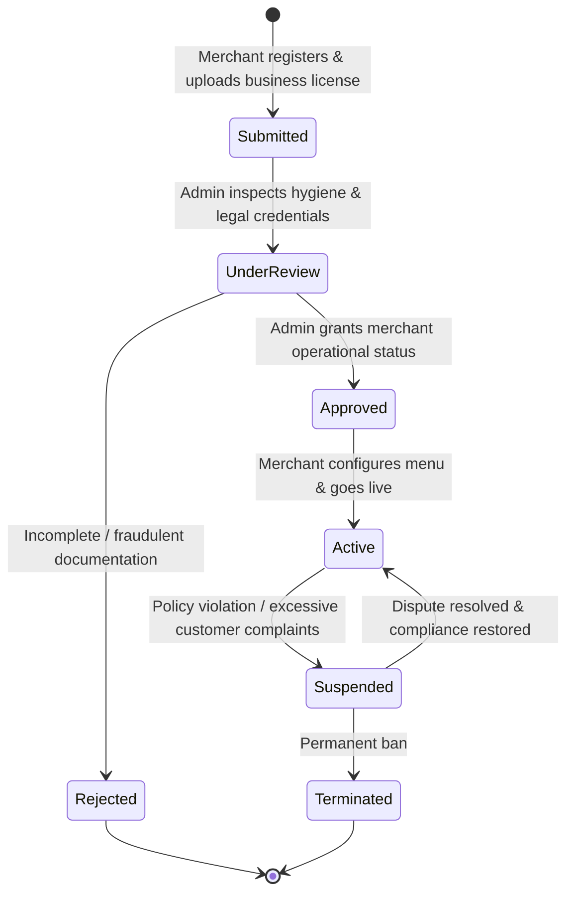

#### 3.13.3 Sub-Feature Specifications

| Sub-Feature ID | Sub-Feature Name | Priority | Associated Actors | Description & Functional Rules | Acceptance Criteria |
| :--- | :--- | :--- | :--- | :--- | :--- |
| **F13.01** | System Executive Dashboard | **Must Have** | Admin | High-level metrics view: Gross Merchandise Value (GMV), active orders, online drivers, active stores, cancellation rate, and platform revenue. | Real-time widgets updating on 30-second polling or WebSocket telemetry. |
| **F13.02** | Unified User Account Management | **Must Have** | Admin | Search, filter, view details, activate, suspend, or reset passwords for all accounts across Customer, Merchant, and Driver roles. | Account suspension instantly terminates active session tokens and blocks subsequent logins. |
| **F13.03** | Merchant Onboarding & Approval | **Must Have** | Admin | Review pending merchant applications, inspect business registration certificates and food safety licenses; approve or reject with feedback. | Only `APPROVED` restaurants can activate storefronts and receive customer orders. |
| **F13.04** | Cuisine Category & Taxonomy Control | **Must Have** | Admin | Global CRUD for food categories (e.g., Vietnamese, Fast Food), category icon/graphic asset uploads, and display order sequencing. | Taxonomy changes propagate immediately to customer discovery filters. |
| **F13.05** | Customer Dispute & Complaint Resolution | **Must Have** | Admin | Centralized dispute queue for unresolved order issues (missing items, damaged food, delayed deliveries). Admin can issue partial/full refunds. | Admin actions logged with mandatory notes; refund notifications dispatched to customer. |
| **F13.06** | System Financial & Operational Reports | **Should Have** | Admin | Comprehensive analytics: revenue breakdown, commission earnings, peak delivery demand hours, popular menu items, exportable to CSV/Excel. | High-performance reporting queries execute without impacting live transactional database. |
| **F13.07** | Platform Configuration & Commission Rates | **Must Have** | Admin | Configure platform-wide baseline parameters: default commission percentage (e.g., 20%), delivery fee per kilometer, base search radius. | Config changes take effect on subsequent checkout operations without requiring service restart. |

---

### F14. Profile Management

#### 3.14.1 Overview
Profile Management enables all platform actors to maintain their identity credentials, multiple delivery addresses, payment methods, security settings, and notification preferences.

#### 3.14.2 Sub-Feature Specifications

| Sub-Feature ID | Sub-Feature Name | Priority | Associated Actors | Description & Functional Rules | Acceptance Criteria |
| :--- | :--- | :--- | :--- | :--- | :--- |
| **F14.01** | Personal Identity & Avatar Management | **Must Have** | All Actors | Update full name, contact email, profile photograph, and display name. | Photo uploaded to cloud storage, thumbnail generated; email change requires re-verification. |
| **F14.02** | Multiple Delivery Address Book | **Must Have** | Customer | Create, label ("Home", "Work", "Gym", "Other"), edit, and delete multiple delivery addresses; specify default delivery address. | Addresses store geographic latitude/longitude coordinates alongside street address text. |
| **F14.03** | Security Credential Maintenance | **Must Have** | All Actors | Update account password by verifying existing password; view active login devices and trigger remote logout on other sessions. | Password updates revoke all legacy refresh tokens across external devices. |
| **F14.04** | Notification Preferences | **Should Have** | All Actors | Granular opt-in/opt-out toggles for Order Updates (Push/SMS), Marketing Promotions (Email), and Driver Alerts. | Critical transactional notifications (order status changes) remain mandatory and cannot be disabled. |
| **F14.05** | Account Deactivation & Data Privacy | **Could Have** | Customer | Self-service account deactivation or data erasure request in compliance with digital privacy and data protection standards. | Account transitioned to `DEACTIVATED`; personal identifiable information (PII) anonymized upon confirmation. |

---

## 4. Cross-Cutting Dependencies & Actor Permission Matrix

### 4.1 Cross-Feature Dependency Matrix
The following table outlines the prerequisite dependencies between feature modules, ensuring proper development sequencing:

| Feature Domain | Dependent On (Prerequisites) | Reason for Dependency |
| :--- | :--- | :--- |
| **F02 (Discovery)** | F09, F13 | Requires approved restaurants and structured categories to display catalogs. |
| **F03 (Menu & Cart)** | F02, F09 | Items must exist in merchant catalog and be retrieved through discovery. |
| **F04 (Order & Checkout)** | F01, F03, F14 | Requires authenticated user, active cart items, and saved delivery address. |
| **F05 (Payment)** | F04, F12 | Requires calculated order total, adjusted for applicable vouchers and delivery fees. |
| **F06 (Tracking)** | F04, F05, F10, F11 | Order must be authorized, accepted by kitchen, and assigned to courier. |
| **F07 (Rating & Review)** | F06 | Reviews are strictly gated to orders that have achieved `DELIVERED` status. |
| **F08 (Order History)** | F04 | Populated by completed or cancelled transactional orders. |
| **F10 (Order Processing)** | F04, F05 | Kitchen receives orders only after successful payment authorization. |
| **F11 (Delivery)** | F06, F10 | Driver dispatch triggers as kitchen progresses order toward `READY_FOR_PICKUP`. |
| **F12 (Promotions)** | F03, F04, F13 | Discounts calculate against active cart values and platform campaign rules. |
| **F13 (Admin)** | F01, F09, F11 | Central governance depends on existing merchant and driver account lifecycles. |

### 4.2 Role-Based Access Control (RBAC) Feature Grid

| Feature Domain | Customer (ACT-01) | Restaurant Owner (ACT-02) | Delivery Driver (ACT-03) | Administrator (ACT-04) |
| :--- | :---: | :---: | :---: | :---: |
| **F01: Auth & Registration** | Full Access | Full Access | Full Access | Full Access |
| **F02: Restaurant Discovery** | Full Access | Read-Only (Public View) | Read-Only (Public View) | Full Audit Access |
| **F03: Menu & Cart** | Full Access | Manage Own Menu Only | No Access | Full Audit Access |
| **F04: Order & Checkout** | Full Access | View Assigned Orders | View Assigned Deliveries | Full Audit Access |
| **F05: Payment** | Execute Payment | View Net Settlements | View Collected COD | Full Financial Control |
| **F06: Order Tracking** | Track Own Orders | Track Store Orders | Track Assigned Delivery | Monitor All Active Orders |
| **F07: Rating & Review** | Submit Reviews | Reply to Store Reviews | View Driver Score | Moderate All Reviews |
| **F08: Order History** | View Own History | View Store Order History | View Driver Trip History | Complete Platform History |
| **F09: Restaurant Management** | No Access | Full Access (Own Store) | No Access | Full Administrative Override |
| **F10: Restaurant Order Processing** | No Access | Full Access (Own Kitchen) | No Access | Dispute Intervention |
| **F11: Delivery Management** | No Access | View Driver Assignment | Full Access (Driver App) | Full Fleet Management |
| **F12: Promotions & Vouchers** | Apply Vouchers | Create Store Vouchers | No Access | Create Global Campaigns |
| **F13: Admin Dashboard** | No Access | No Access | No Access | Full Master Control |
| **F14: Profile Management** | Manage Own Profile | Manage Own Profile | Manage Own Profile | Manage Any Profile |

---

## 5. Technical Enablers & External Service Integrations

To guarantee low latency, real-time synchronization, and transaction security, FoodHub integrates with standard external platforms and protocols:

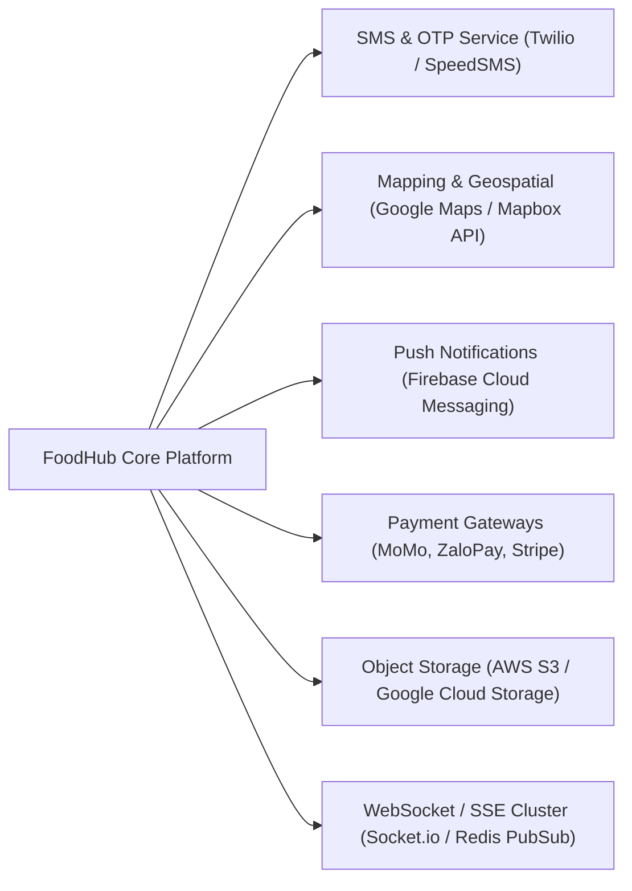

1. **Geospatial & Mapping Services:**
   * Geocoding API for address auto-completion and coordinate conversion.
   * Distance Matrix & Routing API for computing optimal driving distances and accurate ETAs.
   * Real-time GPS coordinate ingestion streaming over WebSockets.
2. **Payment Service Providers (PSP):**
   * Digital Wallets: MoMo Payment Gateway API, ZaloPay Merchant SDK.
   * International Credit Cards: Stripe Elements & Webhooks (PCI-DSS Level 1 compliant).
3. **Communication & Messaging:**
   * Push Notifications: Firebase Cloud Messaging (FCM) for mobile and web push tokens.
   * SMS & OTP: Twilio or local telecommunications aggregator for high-deliverability SMS verification.
   * Transactional Email: SendGrid or Amazon SES for digital invoices and password reset links.
4. **Cloud Media Storage & CDN:**
   * AWS S3 / Cloudflare R2 for storing restaurant cover banners, dish thumbnails, and proof-of-delivery photos.
   * Cloudflare CDN for edge caching of static assets and menu catalogs.

---

## 6. Release Roadmap & MoSCoW Summary

### 6.1 MoSCoW Distribution Summary

```
Total Sub-Features Specified: 65 Sub-Features
├── Must Have (M):   45 Features (69.2%) -> Target: Version 1.0 (MVP Release)
├── Should Have (S): 16 Features (24.6%) -> Target: Version 1.1 (Enhancement Release)
├── Could Have (C):   4 Features ( 6.2%) -> Target: Version 1.2 (Optimization Release)
└── Won't Have V1:    Deferred to Version 2.0 (e.g., Drone delivery, AI food recommendations)
```

### 6.2 Phased Implementation Timeline

```mermaid
gantt
    title FoodHub Engineering Delivery Roadmap
    dateFormat  YYYY-MM-DD
    section Phase 1: Core Foundation (MVP)
    F01: Authentication & RBAC       :done,    des1, 2026-11-01, 2026-11-14
    F09: Restaurant Management Catalog:active,  des2, 2026-11-08, 2026-11-22
    F02: Restaurant Discovery Engine  :         des3, 2026-11-15, 2026-11-29
    F03: Menu & Cart Engine          :         des4, 2026-11-22, 2026-12-06
    F04: Order & Checkout Flow       :         des5, 2026-11-29, 2026-12-13
    F05: Payment (COD & MoMo Gateway):         des6, 2026-12-06, 2026-12-20
    F10: Kitchen Order Processing KDS:         des7, 2026-12-13, 2026-12-27
    F11: Driver Delivery Workflow    :         des8, 2026-12-20, 2027-01-03
    F06: Core Order Tracking         :         des9, 2026-12-27, 2027-01-10
    F13: Admin Management Dashboard  :         des10, 2027-01-03, 2027-01-17
    F14: Profile & Address Book      :         des11, 2027-01-10, 2027-01-24
    section Phase 2: Engagement & Expansion
    F07: Rating & Review Subsystem   :         des12, 2027-01-25, 2027-02-08
    F12: Promotions & Vouchers       :         des13, 2027-02-01, 2027-02-15
    F05: ZaloPay & Card Tokenization :         des14, 2027-02-08, 2027-02-22
    F08: Reorder & Invoicing         :         des15, 2027-02-15, 2027-03-01
    section Phase 3: Optimizations
    F06: Live Map GPS Telemetry      :         des16, 2027-03-01, 2027-03-15
    F01: Google Social Authentication:         des17, 2027-03-08, 2027-03-22
```

---

## 7. Document Revision History

| Version | Date | Author / Contributor | Description of Changes | Approved By |
| :--- | :--- | :--- | :--- | :--- |
| **1.0.0** | 2026-10-30 | Lead Software Documentation Architect | Initial release of comprehensive feature specifications across 14 functional domains (F01–F14), complete with MoSCoW priorities, actor mappings, acceptance criteria, and Mermaid architecture diagrams. | FoodHub Technical Architecture Board |
