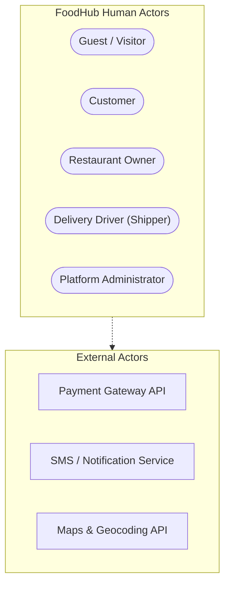
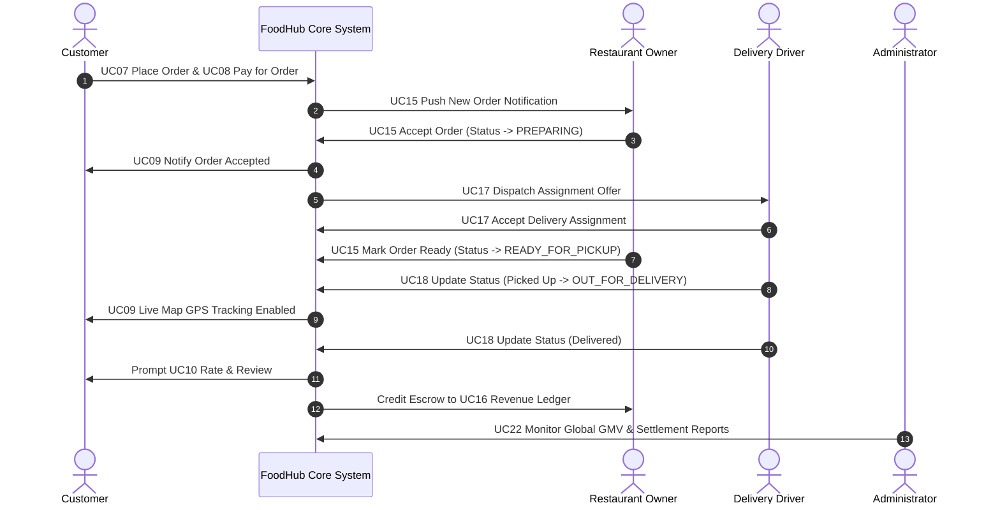

# FoodHub — Use Case Specifications

> **Document Status:** TARGET SPECIFICATION V1.0  
> **System Name:** FoodHub — Multi-Actor Online Food Ordering & Delivery Platform  
> **Classification:** Software Requirements & System Analysis Document  

---

## 1. Actor Descriptions

FoodHub is an enterprise-grade multi-sided online food ordering and on-demand delivery ecosystem. The platform serves four primary registered human actors alongside unauthenticated guests and automated system/external actors.

### 1.1 Customer
- **Role Identifier:** `CUSTOMER`
- **Actor Type:** Primary Human Actor
- **Description:** An end-consumer seeking to discover restaurants, order meals, pay digitally or via cash on delivery (COD), monitor order fulfillment in real time, and share feedback.
- **Primary Goals:**
  - Locate nearby open restaurants with fast delivery times.
  - Customize dishes (modifiers, dietary preferences, notes) and checkout seamlessly.
  - Track food preparation and driver delivery location on an interactive live map.
  - Review historical receipts and rate both food and courier performance.
- **Access Channels:** Responsive Web Application (Desktop/Mobile), Native Mobile App (iOS / Android).
- **Core Permissions:**
  - Search restaurants, categories, and dishes.
  - Create and manage shopping carts.
  - Place orders and execute payment transactions.
  - Cancel orders before kitchen acceptance.
  - Track real-time driver telemetry for active orders.
  - Submit ratings and reviews for fulfilled orders.
  - Manage personal profile, payment methods, and delivery addresses.

### 1.2 Restaurant Owner
- **Role Identifier:** `RESTAURANT_OWNER`
- **Actor Type:** Merchant Business Partner (Human Actor)
- **Description:** A commercial food establishment operator responsible for maintaining restaurant profile information, managing dynamic digital menus, processing incoming meal orders, setting operating availability, and reconciling financial revenues.
- **Primary Goals:**
  - Showcase an appealing, up-to-date food catalog with categories, add-ons, and stock levels.
  - Receive real-time kitchen tickets and manage preparation statuses efficiently.
  - Control kitchen throughput by updating store status (Open, Busy, Closed).
  - Track daily, weekly, and monthly net payouts after platform commissions.
- **Access Channels:** Merchant Web Portal, Merchant Tablet/KDS (Kitchen Display System) Application.
- **Core Permissions:**
  - Configure restaurant branding, hours, minimum order values, and prep times.
  - Perform CRUD operations on menu categories, items, and option groups.
  - Accept, reject, or mark food orders as preparing or ready for pickup.
  - Access settlement statements, revenue analytics, and customer ratings.

### 1.3 Delivery Driver (Shipper)
- **Role Identifier:** `DELIVERY_DRIVER`
- **Actor Type:** Logistics Courier Partner (Human Actor)
- **Description:** An independent courier partner responsible for accepting dispatch assignments, traveling to merchant locations to collect prepared orders, and safely transporting meals to customer destinations within SLA windows.
- **Primary Goals:**
  - Receive optimal delivery assignment opportunities with clear distance, fare, and tips.
  - Navigate between restaurants and customer delivery addresses with integrated GPS routing.
  - Maintain an active delivery milestone log (Arrived at Store, Picked Up, Arrived at Customer, Delivered).
  - Monitor daily completed trips and earned balances.
- **Access Channels:** Courier Mobile Application (iOS / Android with background GPS).
- **Core Permissions:**
  - Toggle driver availability status (`ONLINE`, `BUSY`, `OFFLINE`).
  - Accept or decline dispatched delivery requests within an SLA countdown.
  - Update delivery milestone states for assigned deliveries.
  - View turn-by-turn navigation coordinates and masked customer contact numbers.
  - Inspect driver trip history, tips, incentives, and wallet withdrawals.

### 1.4 Administrator
- **Role Identifier:** `ADMINISTRATOR`
- **Actor Type:** Platform Operations & Governance Actor (Human Actor)
- **Description:** A privileged platform operator entrusted with system-wide oversight, user identity lifecycle management, restaurant compliance approval, platform fee and promotion management, reporting, and dispute resolution.
- **Primary Goals:**
  - Verify restaurant food safety credentials, business registration, and bank details.
  - Moderate users, couriers, and merchants to maintain platform safety and trust.
  - Deploy platform-wide discount codes, promotional banners, and commission tiers.
  - Monitor gross platform health, transaction volumes, driver density, and financial revenues.
- **Access Channels:** Secure Administrative Web Console (Protected by Multi-Factor Authentication).
- **Core Permissions:**
  - Global user management (View, Edit roles, Lock, Suspend, Ban accounts).
  - Restaurant merchant lifecycle management (Approve new onboardings, Suspend for violations).
  - Global menu category taxonomy management.
  - Marketing campaign and promotional voucher code configuration.
  - System-wide audit logging, revenue reconciliation, and BI report generation.

### 1.5 Supporting Actors
- **Guest / Unauthenticated Visitor:** An unregistered or logged-out user who may view public restaurant directories, search menus, and add items to a local cart before being prompted to register or login.
- **Payment Gateway API (External):** Third-party financial systems (Stripe, MoMo, ZaloPay, VNPay) processing credit card, e-wallet, and bank transfer authorizations.
- **Geocoding & Map Engine (External):** Map services (Google Maps API, Mapbox) providing forward/reverse geocoding, distance matrices, and real-time polyline routing.
- **Notification Service (External / Internal):** Cloud push messaging (FCM, Apple APNs) and SMS/Email gateways for transactional alerts.

### 1.6 Actor Comparison Matrix

| Attribute | Customer | Restaurant Owner | Delivery Driver | Administrator | Guest |
|---|---|---|---|---|---|
| **Primary Device** | Mobile App / Web | Tablet / Web Portal | Courier Mobile App | Desktop Web Console | Web / Mobile Web |
| **Authentication** | Email / Phone / OAuth | Email + Password + 2FA | Phone OTP + PIN | Email + Password + MFA | None |
| **Financial Nature** | Payer | Payee (Commission Net) | Payee (Fee + Tips) | Platform Collector | None |
| **Data Scope** | Own Profile & Orders | Own Restaurant Entity | Assigned Deliveries | Entire Platform | Public Catalog |
| **Location Tracking** | Destination Receiver | Fixed Physical Store | Continuous High-Precision GPS | Global Heatmaps | Approximate GeoIP |

---

## 2. Use Case Diagram (Mermaid)

The following flowchart captures the FoodHub system boundary, isolating external human actors on the periphery and structuring the core system functionality into modular operational domains.

```mermaid
flowchart TB
    subgraph roles["Actors"]
        direction TB
        customer["Customer"]
        owner["Restaurant Owner"]
        driver["Delivery Driver (Shipper)"]
        admin["Administrator"]
    end

    subgraph system["FoodHub — System Boundary"]
        direction TB
        
        subgraph auth_mgmt["Identity & Profile Management"]
            direction LR
            uc01["UC01 Register Account"]
            uc02["UC02 Login"]
            uc03["UC03 Logout"]
            uc23["UC23 Manage Profile"]
        end

        subgraph catalog_ordering["Customer Discovery & Ordering"]
            direction LR
            uc04["UC04 Browse Restaurants"]
            uc05["UC05 Search Menu Items"]
            uc06["UC06 Add Items to Cart"]
            uc07["UC07 Place Order"]
            uc08["UC08 Pay for Order"]
            uc09["UC09 Track Order Status"]
            uc10["UC10 Rate & Review"]
            uc11["UC11 View Order History"]
        end

        subgraph merchant_ops["Restaurant Operations & Catalog"]
            direction LR
            uc12["UC12 Manage Menu Items (CRUD)"]
            uc13["UC13 Manage Menu Categories"]
            uc14["UC14 Set Restaurant Status"]
            uc15["UC15 Process Orders"]
            uc16["UC16 View Restaurant Revenue"]
        end

        subgraph logistics_ops["Delivery & Logistics"]
            direction LR
            uc17["UC17 Accept Delivery Assignment"]
            uc18["UC18 Update Delivery Status"]
        end

        subgraph governance["Platform Administration & Governance"]
            direction LR
            uc19["UC19 Manage Users"]
            uc20["UC20 Approve/Suspend Restaurants"]
            uc21["UC21 Manage Promotions"]
            uc22["UC22 View System Reports"]
        end
    end

    %% Customer Connections
    customer --> uc01 & uc02 & uc03 & uc04 & uc05 & uc06 & uc07 & uc08 & uc09 & uc10 & uc11 & uc23

    %% Restaurant Owner Connections
    owner --> uc01 & uc02 & uc03 & uc12 & uc13 & uc14 & uc15 & uc16 & uc23

    %% Delivery Driver Connections
    driver --> uc01 & uc02 & uc03 & uc17 & uc18 & uc23

    %% Administrator Connections
    admin --> uc02 & uc03 & uc19 & uc20 & uc21 & uc22 & uc23

    %% Styling
    classDef actorStyle fill:#2D3748,color:#FFFFFF,stroke:#1A202C,stroke-width:2px,font-weight:bold;
    classDef authStyle fill:#EBF8FF,color:#2B6CB0,stroke:#3182CE,stroke-width:1.5px;
    classDef orderStyle fill:#F0FFF4,color:#276749,stroke:#38A169,stroke-width:1.5px;
    classDef merchantStyle fill:#FFFAF0,color:#9C4221,stroke:#DD6B20,stroke-width:1.5px;
    classDef deliveryStyle fill:#FAF5FF,color:#553C9A,stroke:#805AD5,stroke-width:1.5px;
    classDef adminStyle fill:#FFF5F5,color:#9B2C2C,stroke:#E53E3E,stroke-width:1.5px;

    class customer,owner,driver,admin actorStyle;
    class uc01,uc02,uc03,uc23 authStyle;
    class uc04,uc05,uc06,uc07,uc08,uc09,uc10,uc11 orderStyle;
    class uc12,uc13,uc14,uc15,uc16 merchantStyle;
    class uc17,uc18 deliveryStyle;
    class uc19,uc20,uc21,uc22 adminStyle;
```

### 2.1 Order Fulfillment Interaction Flow

The following sequence illustrates how the four actors collaborate across a single end-to-end order lifecycle:

---

## 3. Roles and Permissions Matrix

The access control model of FoodHub implements strict Role-Based Access Control (RBAC) complemented by tenancy/resource-ownership checks.

### 3.1 Permission Key Legend
- **`CRUD`**: Full Create, Read, Update, Delete access.
- **`OWN`**: Permitted strictly on resources created by or assigned to the authenticated user.
- **`ALL`**: Permitted system-wide across all user and merchant records.
- **`✓`**: Explicitly allowed.
- **`—`**: Strictly denied (HTTP `401 Unauthorized` or `403 Forbidden`).

### 3.2 Master Role × Use Case Matrix

| Use Case ID | Use Case Name | Guest | Customer | Restaurant Owner | Delivery Driver | Administrator |
|---|---|:---:|:---:|:---:|:---:|:---:|
| **UC01** | Register Account | ✓ | — | Self (Partner App) | Self (Driver App) | Admin Create |
| **UC02** | Login | ✓ | ✓ | ✓ | ✓ | ✓ (MFA) |
| **UC03** | Logout | — | ✓ | ✓ | ✓ | ✓ |
| **UC04** | Browse Restaurants | ✓ | ✓ | ✓ | ✓ | ✓ |
| **UC05** | Search Menu Items | ✓ | ✓ | ✓ | ✓ | ✓ |
| **UC06** | Add Items to Cart | Local Cart | ✓ | — | — | — |
| **UC07** | Place Order | — | ✓ | — | — | — |
| **UC08** | Pay for Order | — | ✓ | — | — | — |
| **UC09** | Track Order Status | — | OWN | OWN (Store Orders) | Assigned Order | ALL |
| **UC10** | Rate & Review | — | OWN | Respond Only | Rate Customer | Moderate |
| **UC11** | View Order History | — | OWN | OWN (Store Orders) | OWN (Completed) | ALL |
| **UC12** | Manage Menu Items (CRUD) | — | — | OWN Store | — | ALL |
| **UC13** | Manage Menu Categories | — | — | OWN Store | — | Global Taxonomies |
| **UC14** | Set Restaurant Status | — | — | OWN Store | — | Override ALL |
| **UC15** | Process Orders | — | — | OWN Store | — | Support Override |
| **UC16** | View Restaurant Revenue | — | — | OWN Store | — | ALL (Platform GMV) |
| **UC17** | Accept Delivery Assignment | — | — | — | Assigned Offers | Dispatch Reassign |
| **UC18** | Update Delivery Status | — | — | — | Assigned Order | Admin Revert |
| **UC19** | Manage Users | — | — | — | — | ALL (Full CRUD) |
| **UC20** | Approve/Suspend Restaurants | — | — | Submit KYC | — | ALL (Approval/Ban) |
| **UC21** | Manage Promotions | — | View Public | Store Promos | — | Global Promos |
| **UC22** | View System Reports | — | — | Store Analytics | Driver Summary | Comprehensive BI |
| **UC23** | Manage Profile | — | OWN | OWN | OWN | ALL + OWN |

### 3.3 Security & Ownership Enforcement Rules

> [!IMPORTANT]
> 1. **Tenancy Boundary:** A `RESTAURANT_OWNER` possesses zero read or write access to menu items, orders, or revenues belonging to other restaurants (`WHERE restaurant_id = session.user.restaurant_id`).
> 2. **Driver Assignment Isolation:** A `DELIVERY_DRIVER` can only stream GPS updates and advance delivery stages for trips explicitly bound to their `driver_id`.
> 3. **Order Lifecycle Immutability:** A `CUSTOMER` cannot alter, cancel, or refund an order once the restaurant transitions the status to `PREPARING` without invoking administrative mediation.
> 4. **Administrative Audit:** Every state mutation executed by an `ADMINISTRATOR` generates an append-only audit event in the platform compliance log.

---

## 4. Detailed Use Case Specifications

---

### UC01: Register Account

| Attribute | Details |
|---|---|
| **Use Case ID** | **UC01** |
| **Use Case Name** | **Register Account** |
| **Primary Actor(s)** | Guest / Prospective User (Customer, Restaurant Owner, Delivery Driver) |
| **Secondary Actor(s)**| SMS / Email Verification Gateway |
| **Precondition** | The user has accessed the FoodHub website or mobile application and is currently unauthenticated. |
| **Postcondition (Success)** | A new account record is persisted with an encrypted password hash; an activation verification token is generated; the user is authenticated or directed to onboarding. |
| **Postcondition (Failure)** | Account is not created; error notifications inform the user of conflicting data or validation violations. |
| **Trigger** | User clicks the "Sign Up" or "Register" button. |
| **Related User Story** | *As a new user, I want to create a FoodHub account so that I can access personalized food ordering, merchant operations, or courier delivery services.* |

#### Main Success Scenario
1. User navigates to the registration interface and selects their intended role profile (Customer by default; "Become a Partner" for Restaurant Owner; "Drive with FoodHub" for Delivery Driver).
2. System presents the appropriate registration form with mandatory fields:
   - **Customer:** Full Name, Email Address, Phone Number, Password, Password Confirmation.
   - **Restaurant Owner:** Owner Name, Business Email, Phone, Restaurant Legal Name, Business License Number, Physical Address.
   - **Delivery Driver:** Full Name, Phone, National ID / SSN, Driver's License Number, Vehicle Type, Vehicle Plate Number.
3. User enters required credentials and submits the form.
4. System executes client and server-side validation (RFC-compliant email, phone format, password entropy >= 8 characters with numbers and special characters).
5. System verifies that neither the email address nor the phone number already exists in the database.
6. System securely hashes the password using Argon2id / bcrypt with a salt factor.
7. System generates a 6-digit Time-based One-Time Password (TOTP) and dispatches it via SMS/Email.
8. User inputs the 6-digit verification code.
9. System validates the code:
   - For **Customer:** Account is activated immediately (`status = ACTIVE`), a JWT session is issued, and the user is redirected to the home feed.
   - For **Restaurant Owner / Driver:** Account is placed into `PENDING_VERIFICATION` status; user is guided to the document upload screen for onboarding review.

#### Alternative Flows
- **3a. Incomplete or Malformed Input:**
  - System flags invalid fields with descriptive inline validation errors (e.g., "Password must contain at least one uppercase letter and one numeral").
  - Form state is preserved; user corrects inputs and re-submits.
- **5a. Identity Conflict (Email or Phone already registered):**
  - System blocks registration and displays message: *"An account with this email/phone number already exists. Please log in or reset your password."*
  - System offers a direct link to the Login screen.
- **9a. Invalid or Expired Verification Code:**
  - System displays *"The verification code entered is invalid or has expired."*
  - System presents a "Resend Code" countdown timer (enforcing a 60-second cooldown to mitigate SMS spamming).
- **9b. Maximum Verification Retries Exceeded:**
  - If the code is entered incorrectly 5 consecutive times, registration is locked for 15 minutes.

---

### UC02: Login

| Attribute | Details |
|---|---|
| **Use Case ID** | **UC02** |
| **Use Case Name** | **Login** |
| **Primary Actor(s)** | Customer, Restaurant Owner, Delivery Driver, Administrator |
| **Secondary Actor(s)**| Multi-Factor Authentication (MFA) Provider |
| **Precondition** | User has an existing registered account on FoodHub. |
| **Postcondition (Success)** | User identity is verified, an encrypted JWT Access Token and Refresh Token pair are issued, user permissions are loaded into client state, and the user lands on their role-specific dashboard. |
| **Postcondition (Failure)** | Access is denied; authentication failure count is incremented; no security tokens are issued. |
| **Trigger** | User navigates to the Login screen and submits credentials. |
| **Related User Story** | *As a registered user, I want to securely log into my account so that I can access my permissions, personal data, and transaction workflows.* |

#### Main Success Scenario
1. User navigates to the login screen.
2. User provides authentication credentials (Registered Email or Phone Number and Password).
3. User submits the login form.
4. System validates non-empty inputs and executes rate-limiting checks based on client IP.
5. System queries the user database by identifier and compares the supplied password against the stored cryptographic hash.
6. System checks the account operational status:
   - Status must be `ACTIVE`.
7. System checks if Multi-Factor Authentication (MFA) is enforced (mandatory for `ADMINISTRATOR`, optional for others).
   - If MFA is required: System challenges the user for a TOTP code; user enters code; system validates code.
8. System generates a short-lived cryptographically signed JWT Access Token (15-minute validity) and a long-lived Refresh Token (7-day validity stored in an `HttpOnly`, `SameSite=Strict` secure cookie).
9. System logs the login event (IP address, User-Agent, Timestamp).
10. System routes the user to the appropriate landing view:
    - Customer -> Restaurant Discovery Feed.
    - Restaurant Owner -> Kitchen Orders Dashboard.
    - Delivery Driver -> Active Dispatch Map / Duty Status.
    - Administrator -> System Executive Overview Console.

#### Alternative Flows
- **5a. Invalid Credentials (Incorrect Password or Non-Existent User):**
  - System returns a generic error: *"Invalid email/phone or password combination."* (preventing user enumeration).
  - System increments the failed login attempt counter for the account.
- **5b. Account Brute-Force Lockout:**
  - If 5 consecutive failed login attempts occur within 10 minutes, system locks the account for 15 minutes and sends a security alert email with an unlock link.
- **6a. Account Suspended or Banned:**
  - If `status == SUSPENDED`, system rejects login and displays: *"Your account has been temporarily suspended. Please contact customer support with ticket reference."*
- **6b. Merchant / Driver Account Still Pending Approval:**
  - If `status == PENDING_VERIFICATION`, system redirects user to the Onboarding Progress Tracker: *"Your application is currently under administrative review. Typical review duration is 24-48 business hours."*
- **7a. Invalid MFA Code:**
  - System prompts user to re-enter the authenticator code. After 3 failures, session initialization aborts.

---

### UC03: Logout

| Attribute | Details |
|---|---|
| **Use Case ID** | **UC03** |
| **Use Case Name** | **Logout** |
| **Primary Actor(s)** | All Authenticated Actors (Customer, Owner, Driver, Admin) |
| **Secondary Actor(s)**| Central Token Revocation Store (Redis) |
| **Precondition** | The user possesses an active authenticated session backed by a valid JWT token. |
| **Postcondition (Success)** | The client-side JWT token and refresh cookies are purged; the refresh token is blacklisted in server cache; all private state is cleared; user is redirected to the public landing page. |
| **Postcondition (Failure)** | Token persists or client state remains partially cached. |
| **Trigger** | User clicks the "Logout" or "Sign Out" button in user navigation. |
| **Related User Story** | *As an authenticated user, I want to securely log out of the platform so that unauthorized users cannot access my session on shared or public devices.* |

#### Main Success Scenario
1. Authenticated user clicks the "Logout" option from the user menu or mobile settings drawer.
2. Client application presents a confirmation modal (optional on mobile, immediate on desktop).
3. Client dispatches an authenticated `POST /api/v1/auth/logout` request containing the current Bearer token and Refresh Cookie.
4. Backend extracts token metadata and registers the token JTI (JWT ID) in the Redis Revocation Blacklist with a TTL matching the token's remaining lifespan.
5. Backend invalidates the stored Refresh Token family in the database.
6. Backend responds with HTTP `200 OK` and sends a `Set-Cookie` header clearing the refresh cookie (`Max-Age=0`).
7. Client application clears all memory-cached user profiles, cart state, and local storage tokens.
8. System redirects the user to the public home page (`/`) with an ephemeral toast message: *"You have been logged out successfully."*

#### Alternative Flows
- **3a. Network Failure during Logout Request:**
  - If the network request times out or returns HTTP 5xx, the client application executes a graceful fallback: forcibly discards all local session tokens and cached sensitive data, then routes the user to the login page.
- **4a. Token Already Expired at Time of Logout:**
  - Backend acknowledges request idempotently with HTTP `200 OK`; client purges local cache as normal.

---

### UC04: Browse Restaurants

| Attribute | Details |
|---|---|
| **Use Case ID** | **UC04** |
| **Use Case Name** | **Browse Restaurants** |
| **Primary Actor(s)** | Customer, Guest |
| **Secondary Actor(s)**| Maps / Geocoding Service |
| **Precondition** | The platform catalog is operational; user has accessed FoodHub web or mobile app. |
| **Postcondition (Success)** | A curated, filtered, and sorted list of available restaurants matching the customer's geocoded delivery coordinates is rendered. |
| **Postcondition (Failure)** | No restaurants are displayed, or an error states that the delivery location is unserviceable. |
| **Trigger** | User enters a delivery address or opens the home discovery feed. |
| **Related User Story** | *As a customer, I want to browse restaurants near my current location so that I can discover dining options within acceptable delivery radiuses.* |

#### Main Success Scenario
1. User provides a delivery address via manual entry or browser/device geolocation permission.
2. System geocodes the address into latitude and longitude coordinates.
3. System queries the restaurant database using geospatial bounding calculations (PostGIS `ST_DWithin` radius <= 10 km).
4. System filters results to include restaurants whose delivery zone covers the customer's coordinates and whose operational status is `ACTIVE` (approved by admin).
5. System displays restaurant cards showing:
   - Restaurant Name and Banner Image.
   - Cuisine Categories (e.g., Italian, Burgers, Vegan).
   - Average Star Rating and Total Review Count.
   - Estimated Delivery Time window (e.g., "25 - 35 mins").
   - Delivery Fee (calculated via distance matrix) and Minimum Order amount.
   - Current Operating Status badge ("Open", "Busy", "Closed").
   - Active Promo Badges (e.g., "20% OFF", "Free Delivery").
6. User applies multi-criteria filters:
   - Dietary preferences (Halal, Vegetarian, Gluten-Free).
   - Price Tier ($ to $$$$).
   - Maximum Delivery Fee.
   - Rating threshold (e.g., "4.5+ Stars").
7. User selects a sorting option (Recommended, Highest Rated, Fastest Delivery, Distance).
8. System updates the displayed list dynamically without requiring a full page reload.

#### Alternative Flows
- **1a. Geolocation Denied or Unavailable:**
  - System prompts user: *"Please enter your delivery address to see restaurants delivering to your area."*
  - System presents an address autocomplete input powered by Google Places API.
- **3a. No Restaurants Found within Delivery Radius:**
  - System displays an empty state illustration: *"We couldn't find any restaurants delivering to this address yet."*
  - System provides recommendations for nearby popular pickup spots or allows user to expand search radius up to 15 km.
- **5a. Restaurant Currently Closed:**
  - Restaurant card is rendered with a greyed overlay and badge: *"Closed — Opens today at 11:00 AM"*.
  - User can view the menu and pre-order for scheduled delivery if the restaurant supports advanced ordering.

---

### UC05: Search Menu Items

| Attribute | Details |
|---|---|
| **Use Case ID** | **UC05** |
| **Use Case Name** | **Search Menu Items** |
| **Primary Actor(s)** | Customer, Guest |
| **Secondary Actor(s)**| Full-Text Search Engine (Elasticsearch / Meilisearch) |
| **Precondition** | User has established an active delivery location context. |
| **Postcondition (Success)** | Relevant dishes matching search keywords and dietary filters are returned, grouped by restaurant. |
| **Postcondition (Failure)** | Empty search results returned with alternative query suggestions. |
| **Trigger** | User types keywords into the top search bar. |
| **Related User Story** | *As a customer, I want to search for specific dishes or ingredients across all nearby restaurants so that I can quickly satisfy a specific craving.* |

#### Main Success Scenario
1. User enters a query term (e.g., "Spicy Chicken Wings", "Matcha Latte", "Pho") in the global search input.
2. As the user types (after a 300ms debounce), the search engine presents an instant auto-complete dropdown showing matching dishes, restaurants, and cuisine tags.
3. User presses "Enter" or selects a suggested query.
4. System executes a fuzzy full-text search against menu item names, item descriptions, and category tags, filtering by restaurants delivering to the user's location.
5. System displays matching items in a card grid showing:
   - Dish Name, High-Resolution Photo, Price.
   - Restaurant Name with link to full store menu.
   - Description excerpt with highlighted keyword matches.
   - "Add to Cart" quick-action button.
6. User clicks on a dish card to open the Item Detail & Customization modal.

#### Alternative Flows
- **4a. Typo or Misspelling in Query:**
  - Search engine uses Levenshtein distance fuzzy matching to return intended results: *"Showing results for 'Pizza' instead of 'Pizaa'."*
- **4b. Zero Matching Menu Items:**
  - System displays: *"No dishes matched your search for '{keyword}'."*
  - System renders fallback carousel: *"Popular dishes near you"* or *"Trending cuisines"*.

---

### UC06: Add Items to Cart

| Attribute | Details |
|---|---|
| **Use Case ID** | **UC06** |
| **Use Case Name** | **Add Items to Cart** |
| **Primary Actor(s)** | Customer, Guest |
| **Secondary Actor(s)**| None |
| **Precondition** | User is viewing a restaurant menu or item detail modal; restaurant is currently `OPEN`. |
| **Postcondition (Success)** | Selected item with customized modifier groups and special instructions is added to the active cart; cart subtotal and badge count update. |
| **Postcondition (Failure)** | Item is not added; user is alerted to missing required modifiers or restaurant conflicts. |
| **Trigger** | User clicks the "Add to Cart" button on an item. |
| **Related User Story** | *As a customer, I want to customize menu items with options and add them to my shopping cart so that I can prepare my order for checkout.* |

#### Main Success Scenario
1. Customer clicks on a menu item card.
2. System displays the item customization modal showing:
   - High-resolution dish photography and full ingredients description.
   - Base price.
   - Mandatory option groups (e.g., "Choose Size (Select 1)", "Spice Level (Select 1)").
   - Optional modifier groups (e.g., "Extra Toppings (Max 3)", "Sauces").
   - Special cooking/preparation instructions text field (e.g., "No onions please").
   - Quantity selector (+ / - counters, minimum 1).
3. Customer selects required and optional modifiers, specifies quantity, and enters special notes.
4. System calculates the dynamic item price in real time (`Total = (Base Price + Sum of Modifiers) * Quantity`).
5. Customer clicks "Add to Cart — $XX.XX".
6. System checks current cart state:
   - Cart is empty, OR cart already contains items from the same restaurant.
7. System appends the item and its distinct modifier configuration to the active cart.
8. System updates the floating cart summary drawer and badge counter with animated feedback.

#### Alternative Flows
- **3a. Missing Required Option Selection:**
  - Customer attempts to click "Add to Cart" without selecting a mandatory modifier.
  - System halts submission, highlights the omitted group in red, and scrolls directly to it: *"Please select an option for Size to continue."*
- **6a. Cart Conflict (Cart Contains Items from Another Restaurant):**
  - Customer attempts to add an item from "Restaurant B" while cart has items from "Restaurant A".
  - System halts and presents a conflict confirmation dialog:
    *"Create new order? Your cart contains items from '{Restaurant A}'. FoodHub orders can only include items from one restaurant at a time. Would you like to clear your current cart and start a new order from '{Restaurant B}'?"*
  - **Option 1 (User confirms "Clear Cart & Add"):** System purges existing cart items, adds the new item from Restaurant B, and notifies user.
  - **Option 2 (User clicks "Cancel"):** System dismisses modal; existing cart items from Restaurant A remain intact.
- **7a. Item Out of Stock:**
  - System checks real-time inventory; if the dish was marked unavailable by the kitchen during browsing, system displays: *"Sorry, this item just sold out!"* and refreshes the item card status to `OUT_OF_STOCK`.

---

### UC07: Place Order

| Attribute | Details |
|---|---|
| **Use Case ID** | **UC07** |
| **Use Case Name** | **Place Order** |
| **Primary Actor(s)** | Customer |
| **Secondary Actor(s)**| Geolocation / Distance Calculation Engine, Promotion Engine |
| **Precondition** | Customer is authenticated (if guest, prompted to register/login); cart has >= 1 valid item; restaurant is currently accepting orders. |
| **Postcondition (Success)** | A persistent Order entity is created in `PENDING` status; items are reserved; pricing is locked; customer proceeds to payment execution. |
| **Postcondition (Failure)** | Order creation is aborted; detailed reason provided to customer; cart remains intact. |
| **Trigger** | Customer clicks "Proceed to Checkout" from the cart and submits the order. |
| **Related User Story** | *As a customer, I want to review my order summary, delivery details, and final costs so that I can officially place my order.* |

#### Main Success Scenario
1. Customer clicks "Checkout" from the shopping cart.
2. System navigates to the Checkout Review screen and presents:
   - Itemized list of dishes, selected modifiers, quantities, and line item costs.
   - Selected Delivery Address with option to edit or add unit/building notes.
   - Recipient Contact Name and Phone Number.
   - Delivery Timing options: "Deliver Now (ASAP)" or "Schedule for Later".
   - Delivery Instructions for driver (e.g., "Leave at front desk", "Gate code 1234").
   - Voucher / Promo Code input box.
   - Payment Method selector (Online Card / E-Wallet / Cash on Delivery).
   - Financial Ledger Breakdown:
     - Subtotal.
     - Delivery Fee (dynamic by distance).
     - Platform Service Fee (standard operational fee).
     - Promotional Discount (negative adjustment if applicable).
     - Value Added Tax (VAT / Sales Tax).
     - **Final Grand Total**.
3. Customer enters a valid promotional code and clicks "Apply".
4. System validates promo rules (minimum spend, validity window, usage limits) and applies discount.
5. Customer reviews details, chooses payment method, and clicks "Place Order".
6. System checks:
   - Restaurant is currently `OPEN`.
   - All items remain in stock.
   - Order total satisfies the restaurant's minimum order requirement.
7. System generates a unique Order Reference Code (e.g., `#FH-89214`), creates the order record in database with status `PENDING`, and locks items.
8. If payment method is Online -> triggers **UC08 Pay for Order**. If Cash on Delivery (COD) -> order advances directly to `CONFIRMED` and kitchen is alerted.

#### Alternative Flows
- **1a. User is an Unauthenticated Guest:**
  - System redirects user to a login/signup modal with message: *"Please sign in or register to complete your order."*
  - After successful authentication, user is returned directly to the Checkout Review screen with cart intact.
- **2a. Delivery Address Out of Radius:**
  - Customer changes address at checkout to a location exceeding 10 km from store.
  - System blocks submission: *"Selected address is outside this restaurant's delivery range."*
- **3a. Invalid or Expired Promo Code:**
  - System alerts user: *"Promo code 'SUMMER50' is expired or minimum spend of $25 has not been reached."*
  - Total is recalculated without discount; user can proceed or enter a different code.
- **6a. Order Subtotal Below Minimum:**
  - System displays: *"Restaurant requires a minimum order of $15.00. Please add $3.50 more to checkout."*
- **6b. Item Out of Stock during Checkout:**
  - System removes sold-out item from cart, updates subtotal, and notifies user: *"One of your items has sold out and was removed from checkout. Please review your updated cart."*

---

### UC08: Pay for Order

| Attribute | Details |
|---|---|
| **Use Case ID** | **UC08** |
| **Use Case Name** | **Pay for Order** |
| **Primary Actor(s)** | Customer |
| **Secondary Actor(s)**| External Payment Gateway (Stripe / MoMo / VNPay / E-Wallet) |
| **Precondition** | An order has been placed in `PENDING` state awaiting digital payment settlement. |
| **Postcondition (Success)** | Payment authorization succeeds; transaction reference is recorded; order status updates to `CONFIRMED`; restaurant receives order notification. |
| **Postcondition (Failure)** | Payment is declined or aborted; order remains `PENDING_PAYMENT` with a 10-minute timeout before automatic cancellation. |
| **Trigger** | System prompts for payment authorization upon placing order. |
| **Related User Story** | *As a customer, I want to securely pay for my food order using my preferred electronic payment method so that my order can be confirmed and prepared.* |

#### Main Success Scenario
1. Customer selects an online payment channel (Credit/Debit Card, Apple Pay / Google Pay, E-Wallet).
2. System initializes a secure payment intent with the external Payment Gateway via API, transmitting order ID, currency, and exact grand total.
3. Gateway returns a secure client secret or hosted checkout URL.
4. Client application mounts the PCI-DSS compliant secure payment iframe or redirects to the gateway app.
5. Customer enters card credentials (Card Number, Expiry, CVV) or approves biometric transaction in e-wallet.
6. Gateway performs 3D-Secure (3DS) authentication challenge with customer's issuing bank.
7. Customer completes 3DS verification (OTP / Banking App approval).
8. Gateway processes charge and dispatches an asynchronous, cryptographically signed webhook (`payment_intent.succeeded`) to FoodHub core backend.
9. FoodHub backend verifies webhook cryptographic signature.
10. System creates a `PaymentTransaction` record (Gateway Txn ID, amount, timestamp, method).
11. System updates Order status from `PENDING` to `CONFIRMED`.
12. System transmits an immediate order alert to the Restaurant Owner KDS/portal and pushes a confirmation notification to the customer.

#### Alternative Flows
- **6a. 3DS Authentication Failure or User Cancellation:**
  - Customer cancels the 3DS verification or closes the gateway modal.
  - Gateway returns `payment_failed` with reason code.
  - FoodHub alerts customer: *"Payment could not be completed. Please try another card or select Cash on Delivery."*
  - Order remains in `PENDING_PAYMENT` for 10 minutes, allowing customer to retry payment before automated cancellation.
- **8a. Gateway Webhook Delay or Drop:**
  - If webhook is delayed, client polling or customer returning to app invokes `GET /api/v1/payments/verify/{orderId}`.
  - Backend queries gateway directly, reconciles payment state, and transitions order safely.
- **12a. Restaurant Auto-Reject Timeout Refund:**
  - If order is paid, but the restaurant does not accept it within 5 minutes, the system automatically cancels the order and issues an automated 100% refund to the original payment source.

---

### UC09: Track Order Status

| Attribute | Details |
|---|---|
| **Use Case ID** | **UC09** |
| **Use Case Name** | **Track Order Status** |
| **Primary Actor(s)** | Customer |
| **Secondary Actor(s)**| WebSocket / Real-Time Messaging Server, Driver App (Telemetry Source) |
| **Precondition** | Customer has placed a confirmed order that is currently active. |
| **Postcondition (Success)** | Customer views the exact lifecycle phase, updated estimated arrival time, and dynamic live driver coordinates on an interactive map. |
| **Postcondition (Failure)** | Real-time connection drops; client falls back to periodic polling. |
| **Trigger** | Customer clicks "Track Order" or taps an order push notification. |
| **Related User Story** | *As a customer, I want to track the real-time progress of my order and driver location so that I know exactly when to expect my food.* |

#### Main Success Scenario
1. Customer navigates to the Active Order Tracking screen.
2. System establishes a secure WebSocket connection (`wss://`) subscribed to the specific order channel (`order:{id}`).
3. System renders the step-by-step progress timeline:
   - `PLACED` -> Order received by platform.
   - `CONFIRMED` -> Kitchen accepted and scheduled.
   - `PREPARING` -> Chef is preparing items.
   - `READY_FOR_PICKUP` -> Packed and waiting for driver.
   - `OUT_FOR_DELIVERY` -> Courier picked up and in transit.
   - `DELIVERED` -> Handed over successfully.
4. System displays an interactive map rendering:
   - Restaurant pin location.
   - Customer delivery destination pin.
   - Dynamic courier marker moving in real time based on GPS coordinates broadcast by the driver app.
   - Polyline showing optimal route and real-time Estimated Time of Arrival (ETA in minutes).
5. Customer can view courier profile details (First Name, Vehicle Plate Number, Star Rating) and click "Call Driver" or "Chat" (using masked proxy numbers for privacy).
6. When the courier completes delivery, the system transitions view to the delivery completed screen and triggers **UC10 Rate & Review**.

#### Alternative Flows
- **2a. WebSocket Disconnection:**
  - If the socket connection is interrupted, the client displays a non-intrusive indicator: *"Reconnecting..."* and seamlessly switches to HTTP long-polling every 10 seconds until the WebSocket re-establishes.
- **4a. Driver Not Yet Assigned:**
  - Before a driver accepts the assignment, the map displays the restaurant and destination pins with status: *"Finding a nearby delivery driver..."*
- **4b. Order Delayed by Kitchen or Traffic:**
  - If prep time or travel time exceeds initial estimates by > 10 minutes, system dynamically updates the ETA countdown and dispatches a push notification: *"Your order is taking a bit longer than expected due to high kitchen volume. Updated ETA: 12:45 PM."*

---

### UC10: Rate & Review

| Attribute | Details |
|---|---|
| **Use Case ID** | **UC10** |
| **Use Case Name** | **Rate & Review** |
| **Primary Actor(s)** | Customer |
| **Secondary Actor(s)**| Content Moderation Filter |
| **Precondition** | Order status is `DELIVERED`; customer has not previously submitted a review for this order. |
| **Postcondition (Success)** | Review record is persisted; restaurant and driver cumulative aggregate ratings are updated; review is published on the restaurant page. |
| **Postcondition (Failure)** | Review rejected due to content policy violation or non-completed order status. |
| **Trigger** | Customer receives post-delivery rating prompt or visits order details in history. |
| **Related User Story** | *As a customer, I want to rate my dining and delivery experience so that I can provide feedback to the restaurant and help other customers make informed choices.* |

#### Main Success Scenario
1. Following order delivery, system presents the "Rate Your Experience" interface.
2. System provides two distinct rating sections:
   - **Restaurant Review:**
     - 1 to 5 Star Rating for food quality.
     - Optional tags (e.g., "Great Packaging", "Hot & Fresh", "Generous Portion").
     - Written comment box.
     - Photo attachment uploader (up to 3 photos of the meal).
   - **Delivery Driver Review:**
     - 1 to 5 Star Rating for courier service.
     - Compliment tags (e.g., "Quick Delivery", "Polite & Friendly", "Careful Handling").
     - Driver tip option ($1, $2, $5, Custom).
3. Customer completes the ratings, inputs comments, and clicks "Submit Review".
4. System executes profanity and spam checks on the written comment.
5. System saves the review entities to the database linked to the order.
6. System recalculates and atomically updates the aggregate rating and total review counts for the restaurant and delivery driver.
7. System displays confirmation message: *"Thank you for your feedback!"*

#### Alternative Flows
- **4a. Inappropriate Language Detected:**
  - Automated sentiment/moderation filter flags offensive terms or harassment.
  - System blocks immediate publication and prompts user: *"Your review contains language that violates our community standards. Please revise your comments."*
- **5a. Customer Skips Driver Rating:**
  - Driver rating is optional; customer can submit restaurant feedback independently.
- **7a. Restaurant Owner Response:**
  - Restaurant Owner views the published review in their portal and submits an official merchant reply, which appears nested beneath the customer's review.

---

### UC11: View Order History

| Attribute | Details |
|---|---|
| **Use Case ID** | **UC11** |
| **Use Case Name** | **View Order History** |
| **Primary Actor(s)** | Customer |
| **Secondary Actor(s)**| None |
| **Precondition** | Customer is logged into their account. |
| **Postcondition (Success)** | Chronological list of past and active orders is displayed with filtering and reordering options. |
| **Postcondition (Failure)** | Failed to load orders; error message displayed. |
| **Trigger** | Customer selects "Orders" or "My Orders" from navigation. |
| **Related User Story** | *As a customer, I want to view my past orders and receipts so that I can track my spending and easily reorder my favorite meals.* |

#### Main Success Scenario
1. Customer clicks "My Orders" in the navigation bar or mobile tab bar.
2. System queries order service for records where `customer_id = session.user.id`, sorted by `created_at DESC`.
3. System displays two tabs:
   - **Active Orders:** Orders currently in `PENDING`, `CONFIRMED`, `PREPARING`, `READY_FOR_PICKUP`, or `OUT_FOR_DELIVERY` status, featuring a prominent "Track Order" button.
   - **Past Orders:** Orders in `DELIVERED` or `CANCELLED` status.
4. Each order card displays:
   - Restaurant Name, Logo, Order Reference Code, and Date/Time.
   - Item summary (e.g., "1x Truffle Burger, 1x Truffle Fries...").
   - Total Cost paid and Payment Method used.
   - Final Status badge ("Delivered", "Cancelled").
   - Action buttons: "View Receipt", "Reorder", and "Rate" (if unrated).
5. Customer clicks on a specific order card to view the full detailed digital receipt (itemized costs, delivery address, driver info, tax breakdown).
6. Customer clicks "Reorder".
7. System verifies that the restaurant is still active and checks current item availability:
   - If all items are available: System populates the cart with identical items and modifiers and redirects to Cart view.

#### Alternative Flows
- **2a. Zero Orders Found:**
  - If customer has never ordered, system presents empty state: *"You haven't placed any orders yet. Discover delicious food nearby!"* with a button linking to the restaurant browse page.
- **7a. Reorder Item Discontinued or Out of Stock:**
  - System adds available items to cart and alerts user: *"Some items from your previous order are no longer available and were excluded from your new cart."*

---

### UC12: Manage Menu Items (CRUD)

| Attribute | Details |
|---|---|
| **Use Case ID** | **UC12** |
| **Use Case Name** | **Manage Menu Items (CRUD)** |
| **Primary Actor(s)** | Restaurant Owner |
| **Secondary Actor(s)**| Cloud Storage Service (AWS S3 / Cloudinary for photos) |
| **Precondition** | Restaurant Owner is authenticated; restaurant entity is active and owned by the actor. |
| **Postcondition (Success)** | Menu catalog item is created, updated, soft-deleted, or toggled in availability in the persistent database. |
| **Postcondition (Failure)** | Catalog changes rejected due to invalid data; menu remains unchanged. |
| **Trigger** | Restaurant Owner navigates to "Menu Management" in the Merchant Portal. |
| **Related User Story** | *As a restaurant owner, I want to create, edit, and toggle availability of dishes on my menu so that customers see an accurate, up-to-date catalog.* |

#### Main Success Scenario
1. Restaurant Owner navigates to "Menu Management" -> "Dishes".
2. System loads and displays the current restaurant catalog grouped by categories, showing dish thumbnail, name, base price, stock toggle ("In Stock" / "Sold Out"), and action menu.
3. Owner selects an action:
   - **Create New Item:**
     1. Owner clicks "Add Dish".
     2. Form fields provided: Dish Name, Description, Menu Category (dropdown), Base Price, Nutritional/Dietary Tags (Vegan, Spicy, Halal), Upload Dish Image, Option Groups (e.g., Size, Extra toppings).
     3. Owner fills fields, uploads high-res photo, configures option rules (Min/Max choices), and clicks "Save Item".
     4. System validates inputs (price > 0, required fields, image format JPEG/PNG <= 5MB), uploads image to cloud storage, and persists the new item.
   - **Update Existing Item:**
     1. Owner clicks "Edit" on a dish card.
     2. Form pre-populates with existing data.
     3. Owner modifies price, description, or ingredients and clicks "Update".
     4. System updates database and invalidates customer catalog cache.
   - **Toggle Instant Availability:**
     1. Owner clicks the "In Stock / Sold Out" quick-switch toggle on a dish.
     2. System immediately updates `is_available` boolean flag without opening a form.
     3. Instant notification pushed to customer apps browsing this restaurant.
   - **Delete Item:**
     1. Owner clicks "Delete" on an item.
     2. System displays confirmation modal.
     3. Owner confirms; system sets `deleted_at = NOW()` (soft-delete).
4. System displays success notification: *"Menu item updated successfully."*

#### Alternative Flows
- **3a. Image File Exceeds Allowed Limit or Wrong Format:**
  - System rejects upload: *"Image must be a JPEG or PNG file and not exceed 5MB."*
- **3b. Attempting to Hard-Delete Item Present in Active Orders:**
  - System prevents hard database deletion: item is marked soft-deleted so ongoing active order receipts preserve historic pricing and naming integrity.

---

### UC13: Manage Menu Categories

| Attribute | Details |
|---|---|
| **Use Case ID** | **UC13** |
| **Use Case Name** | **Manage Menu Categories** |
| **Primary Actor(s)** | Restaurant Owner |
| **Secondary Actor(s)**| None |
| **Precondition** | Restaurant Owner is authenticated and accessing their restaurant console. |
| **Postcondition (Success)** | Menu categories are created, reordered, edited, or deleted; consumer storefront reflects new category layout. |
| **Postcondition (Failure)** | Category operation blocked (e.g., deleting non-empty category). |
| **Trigger** | Restaurant Owner accesses "Categories" section in the menu editor. |
| **Related User Story** | *As a restaurant owner, I want to organize my dishes into logical categories so that customers can navigate my menu easily.* |

#### Main Success Scenario
1. Restaurant Owner opens the "Categories" tab in the Menu Management view.
2. System displays list of existing store categories (e.g., "Starters", "Woodfired Pizzas", "Beverages", "Desserts") with item count and drag-and-drop sort handles.
3. Owner performs category management actions:
   - **Add Category:** Owner clicks "New Category", types title (e.g., "Chef's Specials") and optional description, and clicks "Create". System assigns display sequence index and saves.
   - **Reorder Categories:** Owner drags and drops category cards to rearrange display order. System persists updated sequence numbers.
   - **Edit Category:** Owner changes category name or active status.
   - **Delete Category:** Owner selects "Delete" on an empty category. System confirms and removes category.
4. System updates public storefront layout immediately.

#### Alternative Flows
- **3a. Attempting to Delete a Category with Assigned Menu Items:**
  - System prevents deletion and prompts: *"This category contains 6 active dishes. Please reassign or delete these dishes before deleting the category."*
- **3b. Duplicate Category Name:**
  - System displays: *"A category named 'Beverages' already exists in your restaurant menu."*

---

### UC14: Set Restaurant Status

| Attribute | Details |
|---|---|
| **Use Case ID** | **UC14** |
| **Use Case Name** | **Set Restaurant Status** |
| **Primary Actor(s)** | Restaurant Owner |
| **Secondary Actor(s)**| Administrator (Policy Override) |
| **Precondition** | Restaurant Owner is authenticated; restaurant profile is approved by Administrator. |
| **Postcondition (Success)** | Restaurant availability state is updated across platform discovery feeds and dispatch engines. |
| **Postcondition (Failure)** | Status modification denied due to administrative suspension. |
| **Trigger** | Owner toggles operating status switch or configures operating schedule. |
| **Related User Story** | *As a restaurant owner, I want to set my store's operating status to Open, Busy, or Closed so that I can control incoming order volume.* |

#### Main Success Scenario
1. Restaurant Owner views the persistent status header in the Merchant Portal.
2. System displays current status:
   - `OPEN`: Accepting all incoming orders normally.
   - `BUSY`: Kitchen experiencing peak volume; prep times automatically increased by 15 mins on customer app; warning displayed to customers.
   - `PAUSED / CLOSED`: Store not accepting orders; marked closed on discovery feed.
3. Owner selects a new status (e.g., switches from `OPEN` to `BUSY` or `CLOSED`).
4. If switching to `CLOSED`, system offers: "Close for rest of day" or "Pause orders for 30 / 60 minutes".
5. Owner confirms selection.
6. System updates restaurant status in the database and broadcasts the change via Redis Pub/Sub to all connected clients browsing the platform.
7. System displays confirmation badge reflecting new operating mode.

#### Alternative Flows
- **3a. Restaurant Under Administrative Suspension:**
  - If the platform Administrator has suspended the restaurant (`admin_status = SUSPENDED`), the status toggle is disabled.
  - System displays banner: *"Your restaurant has been temporarily suspended by FoodHub Administration. Contact partner support."*
- **4a. Automatic Schedule Enforcement:**
  - System cron job checks configured weekly operating hours (e.g., Mon-Fri 10:00 AM - 10:00 PM). If current time is outside operating hours, store status automatically defaults to `CLOSED` unless manual override is set.

---

### UC15: Process Orders (Accept / Reject / Mark Ready)

| Attribute | Details |
|---|---|
| **Use Case ID** | **UC15** |
| **Use Case Name** | **Process Orders (Accept / Reject / Mark Ready)** |
| **Primary Actor(s)** | Restaurant Owner |
| **Secondary Actor(s)**| Dispatch Engine, Customer, SMS/Push Notification Service |
| **Precondition** | A customer has placed a paid/confirmed order for this restaurant (`status = CONFIRMED`). |
| **Postcondition (Success)** | Order state transitions cleanly through the kitchen lifecycle (`PREPARING` -> `READY_FOR_PICKUP`); courier and customer are notified. |
| **Postcondition (Failure)** | Order is rejected or times out; customer is refunded; order is marked `CANCELLED`. |
| **Trigger** | Real-time audio-visual alert triggers on the Merchant KDS / Tablet for a new incoming order. |
| **Related User Story** | *As a restaurant owner, I want to review incoming orders, accept or decline them, and mark them ready so that the kitchen operates smoothly and food is fresh for couriers.* |

#### Main Success Scenario
1. A new order arrives at the restaurant terminal; system triggers an audible chime and displays a prominent visual modal showing:
   - Order Reference Code and Customer First Name.
   - Itemized dish breakdown, special cooking instructions, and modifiers.
   - Estimated prep time counter (default 20 mins, adjustable).
   - 5-minute acceptance countdown timer.
2. Restaurant Owner reviews items and clicks **"Accept Order"**.
3. System updates order status to `PREPARING` and sets estimated pickup time.
4. System triggers the automated logistics dispatch engine to search for and match nearby available delivery drivers (**UC17**).
5. Kitchen team prepares the dishes.
6. When cooking and packaging are complete, Owner seals the bag with order receipt and taps **"Mark as Ready"**.
7. System updates order status to `READY_FOR_PICKUP`.
8. System alerts the matched delivery driver that the food is ready at the counter.

#### Alternative Flows
- **2a. Restaurant Rejects Order:**
  - Owner reviews order and clicks **"Reject Order"**.
  - System prompts owner for mandatory cancellation reason: "Ingredients out of stock", "Kitchen at max capacity", "Store closing early", or "Custom reason".
  - Owner submits reason.
  - System updates order status to `CANCELLED_BY_RESTAURANT`, releases reserved inventory, automatically issues a 100% refund to the customer's payment method, and dispatches an apology notification to the customer.
- **2b. Order Acceptance SLA Timeout (Auto-Reject):**
  - If the 5-minute countdown timer expires without owner interaction:
  - System automatically cancels order, notifies customer, triggers full refund, and sets restaurant status to `PAUSED` to prevent further missed orders.
- **6a. Order Cancellation by Admin/Customer Before Preparation:**
  - If customer cancels before acceptance, the modal automatically dismisses with an alert: *"Order #FH-XXXX was cancelled by customer."*

---

### UC16: View Restaurant Revenue

| Attribute | Details |
|---|---|
| **Use Case ID** | **UC16** |
| **Use Case Name** | **View Restaurant Revenue** |
| **Primary Actor(s)** | Restaurant Owner |
| **Secondary Actor(s)**| Financial Reporting Engine |
| **Precondition** | Restaurant Owner is authenticated and possesses a verified merchant account. |
| **Postcondition (Success)** | Financial dashboard displays accurate sales numbers, commission deductions, net revenue, and payout summaries. |
| **Postcondition (Failure)** | Report fails to generate; error message shown. |
| **Trigger** | Owner navigates to "Financials & Revenue" tab in the Merchant Portal. |
| **Related User Story** | *As a restaurant owner, I want to track my gross sales, platform commissions, and net earnings so that I can understand my business financials and reconcile bank payouts.* |

#### Main Success Scenario
1. Restaurant Owner clicks "Revenue & Financials" in portal navigation.
2. System loads the financial analytics overview for the default period (Current Month).
3. System presents interactive metric cards:
   - **Gross Merchandise Value (GMV):** Total food & beverage sales before deductions.
   - **Platform Commission Deducted:** Standard agreed platform rate (e.g., 20% commission).
   - **Discounts Absorbed by Restaurant:** Store-sponsored promotion costs.
   - **Net Payout Balance:** Amount eligible for bank transfer.
   - **Total Orders Completed:** Count of fulfilled orders.
   - **Average Order Value (AOV):** Mean spend per customer ticket.
4. System renders interactive trend charts:
   - Daily sales bar charts.
   - Peak ordering hours heatmap.
   - Top 5 best-selling menu items by revenue.
5. Owner selects custom date range filter (Today, This Week, Last 30 Days, Custom Range).
6. System dynamically re-aggregates data from completed order ledger records.
7. Owner clicks "Export Report" and chooses format (CSV or PDF).
8. System generates and downloads the itemized settlement statement.

#### Alternative Flows
- **5a. Date Range Contains Zero Sales:**
  - System displays metric cards with `$0.00` values and an informational banner: *"No completed orders found for the selected date range."*
- **7a. Payout Dispute / Discrepancy:**
  - Owner notices discrepancy; portal provides a "Dispute Statement" link that pre-fills a support ticket sent directly to FoodHub finance administration.

---

### UC17: Accept Delivery Assignment

| Attribute | Details |
|---|---|
| **Use Case ID** | **UC17** |
| **Use Case Name** | **Accept Delivery Assignment** |
| **Primary Actor(s)** | Delivery Driver (Shipper) |
| **Secondary Actor(s)**| Central Dispatch & Matching Algorithm |
| **Precondition** | Driver is authenticated, active, has toggled duty status to `ONLINE`, and has active GPS location sharing enabled. |
| **Postcondition (Success)** | Driver is assigned to the delivery; order status links to `driver_id`; driver mobile app shifts to navigation mode. |
| **Postcondition (Failure)** | Assignment offer expires or is declined; system re-dispatches order to the next closest courier. |
| **Trigger** | Central dispatch engine routes an order delivery offer to the driver's device. |
| **Related User Story** | *As a delivery driver, I want to receive and review delivery assignment offers with upfront route and earnings details so that I can decide whether to accept the trip.* |

#### Main Success Scenario
1. Driver sets duty toggle to **"Online"** in the Courier Mobile App.
2. Driver app continuously broadcasts current GPS coordinates to FoodHub backend via MQTT / WebSocket.
3. When an order in the driver's geographic cluster enters `PREPARING` or `READY_FOR_PICKUP`, the dispatch algorithm scores candidate couriers (based on proximity, vehicle type, and acceptance rate) and targets the optimal driver.
4. Driver's mobile phone rings with a high-priority dispatch offer modal displaying:
   - Estimated Total Earnings for the trip (Base Fare + Distance Fee + Customer Tip).
   - Restaurant Name and Pickup Address with distance (e.g., "1.2 km away").
   - Customer Delivery Address with distance (e.g., "3.5 km from restaurant").
   - Estimated total trip duration (e.g., "22 mins").
   - 30-second countdown acceptance timer.
5. Driver clicks **"Accept Delivery"** before timer reaches zero.
6. System executes atomic assignment check: verifies order has not been assigned to another courier.
7. System locks assignment to driver (`order.driver_id = driver.id`) and transitions state to `DRIVER_ASSIGNED`.
8. System sends push notifications to Restaurant and Customer: *"Driver {Name} has been assigned to your order."*
9. Driver app automatically loads turn-by-turn navigation coordinates to the restaurant pickup location.

#### Alternative Flows
- **5a. Driver Clicks "Decline":**
  - Driver explicitly rejects offer by tapping "Decline".
  - System logs decline event, recalculates driver acceptance rate, and immediately routes the offer to the second best candidate driver.
- **5b. Acceptance Timer SLA Expires:**
  - Driver does not respond within 30 seconds.
  - Modal automatically closes; offer is marked "Missed" and routed to next driver. Driver duty status temporarily shifts to "Idle".
- **6a. Race Condition (Order Reassigned):**
  - If dispatch engine reassigned order due to clock drift: app displays: *"Offer no longer available. Searching for new orders..."*

---

### UC18: Update Delivery Status

| Attribute | Details |
|---|---|
| **Use Case ID** | **UC18** |
| **Use Case Name** | **Update Delivery Status** |
| **Primary Actor(s)** | Delivery Driver (Shipper) |
| **Secondary Actor(s)**| Customer, Camera / Device Hardware, Payment Gateway (COD Settlement) |
| **Precondition** | Driver has accepted delivery assignment and is actively fulfilling the order. |
| **Postcondition (Success)** | Order progresses through logistics checkpoints (`ARRIVED_AT_STORE` -> `PICKED_UP` -> `ARRIVED_AT_CUSTOMER` -> `DELIVERED`); driver earnings wallet is credited. |
| **Postcondition (Failure)** | Delivery marked failed / undeliverable; incident ticket created. |
| **Trigger** | Driver arrives at waypoints and taps milestone action buttons in the mobile app. |
| **Related User Story** | *As a delivery driver, I want to update my delivery progress milestones so that the restaurant and customer are informed and my trip earnings are credited upon completion.* |

#### Main Success Scenario
1. Driver drives to restaurant location and taps **"Arrived at Restaurant"**.
2. System notifies restaurant staff of driver arrival.
3. Driver presents Order Reference Code (e.g., `#FH-89214`) to kitchen staff and verifies item checklist.
4. Once package is received, driver taps **"Confirm Pickup"**.
5. System transitions order status to `OUT_FOR_DELIVERY`, activates real-time map GPS tracking for customer, and notifies customer that food is on the way.
6. Driver app displays in-app GPS routing to customer delivery destination.
7. Driver arrives at customer address and taps **"Arrived at Customer"**. System alerts customer via push/SMS.
8. Driver meets customer (or executes contactless drop-off).
9. If payment method was **Cash on Delivery (COD)**:
   - Driver collects exact cash amount indicated on app.
   - Driver marks cash collected.
10. Driver captures a Proof of Delivery (POD) photo showing package at doorstep/with customer, or inputs customer confirmation PIN.
11. Driver taps **"Complete Delivery"**.
12. System verifies POD / PIN, marks order status as `DELIVERED`, records delivery completion timestamp, credits driver wallet with trip earnings, and triggers **UC10 Rate & Review** for customer.

#### Alternative Flows
- **7a. Customer Unreachable at Destination:**
  - Driver arrives but customer does not answer doorbell or phone calls.
  - Driver taps "Customer Unreachable".
  - System initiates an official 10-minute wait timer and dispatches automated urgent push alerts and automated phone calls to the customer.
  - If timer expires and customer remains unresponsive: driver contacts Support, who authorizes order cancellation. Driver disposes of meal per platform policy; driver still receives trip fare.
- **9a. Customer Refuses or Cannot Pay COD:**
  - Driver reports "Payment Refused". Driver does not hand over food. System marks order failed and dispatches support investigation.
- **10a. Camera Hardware Permission Denied:**
  - Driver must enter customer 4-digit confirmation PIN (last 4 digits of customer phone number) as fallback verification.

---

### UC19: Manage Users (Admin)

| Attribute | Details |
|---|---|
| **Use Case ID** | **UC19** |
| **Use Case Name** | **Manage Users (Admin)** |
| **Primary Actor(s)** | Administrator |
| **Secondary Actor(s)**| Central Audit Logger |
| **Precondition** | Administrator is logged into the Admin Console with full administrative RBAC privileges. |
| **Postcondition (Success)** | User records are searched, viewed, modified, role-assigned, suspended, or unbanned; audit log records the admin action. |
| **Postcondition (Failure)** | Action denied due to insufficient administrative privilege tier. |
| **Trigger** | Administrator accesses "User Management" in the Admin Console. |
| **Related User Story** | *As an administrator, I want to search, inspect, and moderate user accounts across all platform roles so that I can maintain community safety and enforce platform policies.* |

#### Main Success Scenario
1. Administrator navigates to "User Management".
2. System presents a master datatable containing all registered users with column filters:
   - User ID, Full Name, Email, Phone Number.
   - Role (`CUSTOMER`, `RESTAURANT_OWNER`, `DELIVERY_DRIVER`, `ADMINISTRATOR`).
   - Account Status (`ACTIVE`, `PENDING_VERIFICATION`, `SUSPENDED`, `BANNED`).
   - Registration Date and Last Login Date.
3. Administrator uses search bar to filter by name, phone, or email.
4. Administrator clicks on a user row to open the detailed User Profile Inspector showing:
   - Profile information and verification status.
   - Order history and spend statistics (for Customers).
   - Restaurant affiliation (for Owners).
   - Driver rating, trip statistics, and KYC documents (for Drivers).
   - Account security activity log (recent logins, IP addresses, password changes).
5. Administrator executes a management action:
   - **Edit User Details:** Updates contact details or flags verified phone/email.
   - **Suspend User Account:** Toggles status to `SUSPENDED`, selects duration (e.g., 7 days, 30 days, Indefinite), and inputs mandatory administrative justification reason.
   - **Reactivate Account:** Reverses suspension for resolved disputes.
   - **Reset Password / Trigger Verification:** Dispatches secure password reset email to user.
6. System validates the action, persists updates to the user table, invalidates all active sessions for that user in Redis, and creates an immutable entry in the `AuditLog` table.
7. System displays confirmation message: *"User account status updated to SUSPENDED."*

#### Alternative Flows
- **5a. Administrator Attempts to Suspend Own Account or Super-Admin:**
  - System intercepts request and blocks action: *"Operation not permitted: You cannot modify your own administrative status or alter a Super Administrator account."*
- **6a. Concurrent Admin Edit Conflict:**
  - If two admins edit the same user profile simultaneously, optimistic concurrency locking detects version mismatch and warns the second admin to refresh.

---

### UC20: Approve / Suspend Restaurants (Admin)

| Attribute | Details |
|---|---|
| **Use Case ID** | **UC20** |
| **Use Case Name** | **Approve / Suspend Restaurants (Admin)** |
| **Primary Actor(s)** | Administrator |
| **Secondary Actor(s)**| Email Notification Service, Restaurant Owner |
| **Precondition** | Administrator is authenticated; a restaurant onboarding application is pending or an active restaurant is flagged for review. |
| **Postcondition (Success)** | Restaurant status transitions to `ACTIVE` (approved), `REJECTED`, or `SUSPENDED`; merchant permissions update accordingly. |
| **Postcondition (Failure)** | Action blocked due to validation or permission error. |
| **Trigger** | Administrator accesses "Restaurant Partners" -> "Onboarding Queue" or "Active Partners". |
| **Related User Story** | *As an administrator, I want to review restaurant partner applications and enforce suspensions for policy violations so that only legitimate, compliant merchants operate on FoodHub.* |

#### Main Success Scenario
1. Administrator navigates to "Restaurant Management" -> "Pending Approvals".
2. System displays list of merchant onboarding submissions with submission date, restaurant legal name, cuisine type, and owner contact.
3. Administrator clicks a pending application to open the Merchant Verification Dossier:
   - Business Registration License document (PDF viewer).
   - Food Safety & Hygiene Certification.
   - Physical store address and exterior/kitchen verification photos.
   - Merchant Bank Account details for automated settlements.
   - Proposed menu categories and pricing tier.
4. Administrator inspects submitted documents for legal compliance and validity.
5. Administrator clicks **"Approve Restaurant"**:
   - System updates restaurant status to `ACTIVE`.
   - System activates the owner's merchant portal permissions.
   - System dispatches a welcome email with portal credentials and operating guidelines to the owner.
   - Restaurant becomes visible on the platform search and discovery feeds.
6. For existing active restaurants violating health standards or terms of service:
   - Administrator selects **"Suspend Restaurant"**.
   - Admin inputs suspension reason (e.g., "Food safety complaint investigation", "Excessive order cancellations") and sets duration.
   - System shifts restaurant status to `SUSPENDED`, unpublishes storefront from customer app, cancels pending unconfirmed orders, and notifies the owner.

#### Alternative Flows
- **5a. Administrator Rejects Application (Deficient Documents):**
  - Admin clicks "Reject Application".
  - Admin specifies rejection category and enters feedback: *"Food hygiene certificate is expired. Please submit a valid renewal."*
  - System updates status to `REJECTED_NEEDS_INFO` and sends automated resubmission email to owner.
- **6a. Reinstating Suspended Restaurant:**
  - Following merchant appeal and compliance resolution, admin clicks "Reactivate Restaurant". System restores `ACTIVE` status and republishes store.

---

### UC21: Manage Promotions (Admin)

| Attribute | Details |
|---|---|
| **Use Case ID** | **UC21** |
| **Use Case Name** | **Manage Promotions (Admin)** |
| **Primary Actor(s)** | Administrator |
| **Secondary Actor(s)**| Promotion Engine |
| **Precondition** | Administrator is logged into the Admin Console with marketing management permissions. |
| **Postcondition (Success)** | Promotional campaign or discount voucher code is created, scheduled, edited, or deactivated across the platform. |
| **Postcondition (Failure)** | Promotion creation fails due to contradictory date windows or invalid discount rules. |
| **Trigger** | Administrator navigates to "Marketing & Promotions" section. |
| **Related User Story** | *As an administrator, I want to configure platform discount vouchers and promotional campaigns so that we can drive customer acquisition and order volume.* |

#### Main Success Scenario
1. Administrator navigates to "Marketing" -> "Promotions".
2. System displays table of current promotional campaigns showing promo code, discount type, usage count vs. budget cap, validity period, and active status.
3. Administrator clicks **"Create New Promotion"**.
4. Administrator fills promotion parameters:
   - **Promo Code:** Unique alphanumeric code (e.g., `FOODHUB50`, `FREESHIP`).
   - **Discount Type:** Percentage discount (e.g., 20% off), Fixed amount (e.g., $5.00 off), or Free Delivery.
   - **Max Discount Cap:** Maximum monetary discount allowed on percentage promos (e.g., "Up to $10.00").
   - **Minimum Basket Spend:** Minimum order subtotal required to qualify (e.g., "$25.00").
   - **Applicability Scope:** Platform-wide, Specific Restaurant Categories, or Selected Geographic Cities.
   - **Usage Restrictions:** Total campaign redemption cap (e.g., 10,000 uses) and Per-Customer usage limit (e.g., 1 per customer).
   - **Schedule Window:** Start Date/Time and Expiration Date/Time.
5. System validates rules (e.g., expiration date > start date, discount value > 0).
6. Administrator clicks **"Publish Campaign"**.
7. System persists promotion entity, indexes the promo code in high-speed Redis cache for real-time checkout validation, and displays success notification.

#### Alternative Flows
- **5a. Promo Code Collision:**
  - Admin inputs a promo code that already exists in active or scheduled records.
  - System displays: *"Promo code 'SUMMER2026' is already in use. Please specify a unique code."*
- **7a. Deactivating or Pausing Live Promotion:**
  - If a promotional budget is burning faster than expected, Admin clicks "Pause Campaign".
  - System updates status to `PAUSED`; checkout engine immediately stops accepting the promo code for new checkouts.

---

### UC22: View System Reports (Admin)

| Attribute | Details |
|---|---|
| **Use Case ID** | **UC22** |
| **Use Case Name** | **View System Reports (Admin)** |
| **Primary Actor(s)** | Administrator |
| **Secondary Actor(s)**| Data Warehouse / Business Intelligence Engine |
| **Precondition** | Administrator is authenticated with executive reporting privileges. |
| **Postcondition (Success)** | Platform-wide operational, logistical, and financial analytics are generated and rendered with export capabilities. |
| **Postcondition (Failure)** | Query times out on excessively large timeframes; system advises narrower filter range. |
| **Trigger** | Administrator selects "Analytics & System Reports" from the Admin Console. |
| **Related User Story** | *As an administrator, I want to view platform-wide business analytics, transaction metrics, and operational reports so that executive management can make data-driven decisions.* |

#### Main Success Scenario
1. Administrator navigates to "Analytics & Reports" in the Admin Console.
2. System loads the Executive Platform Dashboard containing real-time high-level KPIs:
   - **Gross Merchandise Value (GMV):** Cumulative platform order spend.
   - **Net Platform Revenue:** Platform commission earnings + service fees collected.
   - **Order Fulfillment Rate:** Percentage of placed orders successfully delivered vs. cancelled.
   - **Active Couriers & Utilization:** Number of drivers currently online, on trip, and idle.
   - **Average Delivery Time:** Mean time from order placement to doorstep handover (e.g., 32.4 mins).
3. Administrator selects reporting view:
   - **Financial Ledger Report:** Transaction breakdowns, gateway fees, refunds, and merchant net balances.
   - **Restaurant Performance Ranking:** Top performing restaurants by order volume, rating, and cancellation rate.
   - **Logistics & Delivery Heatmap:** Geographic demand density vs. driver availability hot spots.
   - **Customer Acquisition & Retention:** New registrations, daily active users (DAU), churn rate.
4. Administrator adjusts time parameters (Today, Last 7 Days, Month to Date, Custom Quarter) and segments by city/region.
5. System executes analytical aggregation queries and renders responsive charts (time-series lines, breakdown bars, geographic heatmaps).
6. Administrator clicks **"Export Data"** and selects format (`CSV`, `Excel (.xlsx)`, or formatted `Executive PDF`).
7. System generates file and provides direct secure download link.

#### Alternative Flows
- **5a. Heavy Data Range Query:**
  - If the requested date range spans multiple years or millions of transactions, the system offloads processing to an asynchronous background worker:
    *"Your custom report is being generated in the background. You will receive an email and system notification with the download link once ready."*

---

### UC23: Manage Profile

| Attribute | Details |
|---|---|
| **Use Case ID** | **UC23** |
| **Use Case Name** | **Manage Profile** |
| **Primary Actor(s)** | All Authenticated Actors (Customer, Restaurant Owner, Delivery Driver, Administrator) |
| **Secondary Actor(s)**| SMS Verification Gateway, Cloud Storage (Avatar Uploader) |
| **Precondition** | User is logged in with an active account session. |
| **Postcondition (Success)** | Profile attributes, contact information, delivery addresses, or credentials are successfully updated in database. |
| **Postcondition (Failure)** | Profile updates rejected due to validation errors, incorrect password confirmation, or duplicate contact information. |
| **Trigger** | User navigates to "Settings" or "My Profile" in their respective portal or app. |
| **Related User Story** | *As a registered user, I want to update my personal profile, contact information, and security preferences so that my account remains accurate and secure.* |

#### Main Success Scenario
1. User clicks on their profile avatar or navigates to "Account Settings".
2. System presents role-tailored profile management tabs:
   - **Personal Details:** Full Name, Avatar Image, Email, Phone Number.
   - **Saved Addresses (Customer):** List of saved delivery locations (Home, Work, Other) with GPS coordinates and delivery notes.
   - **Vehicle Details (Driver):** Vehicle type, plate number, insurance renewal dates.
   - **Restaurant Information (Owner):** Store description, phone number, physical address, notification preferences.
   - **Security & Password:** Change password, Enable/Disable Two-Factor Authentication (2FA), View active login sessions.
3. User edits desired fields (e.g., updates full name and adds a new delivery address).
4. For security-sensitive updates (changing password or updating registered phone number):
   - User must enter their current password to authenticate the modification.
   - If updating phone/email, system dispatches a 6-digit OTP to the new number/address.
5. User submits the updated profile form.
6. System validates inputs (RFC email format, phone format, password strength).
7. System saves changes to the database and refreshes local session cache.
8. System displays confirmation alert: *"Profile updated successfully."*

#### Alternative Flows
- **4a. Incorrect Current Password on Security Change:**
  - System blocks update and highlights password field: *"The current password you entered is incorrect. Please try again."*
- **4b. Phone Number Already Registered by Another Account:**
  - System checks database uniqueness constraint: *"This phone number is already associated with another FoodHub account."*
- **5a. Invalid Avatar File:**
  - User attempts to upload unsupported file format or file > 5MB.
  - System rejects file: *"Avatar image must be a JPG or PNG under 5MB."*

---

## 5. Traceability Matrix

The following matrix ensures end-to-end bidirectional traceability between platform actors, system domains, and the detailed use cases.

| Domain Module | Use Case ID | Use Case Name | Primary Actor(s) | Target Platform |
|---|---|---|---|---|
| **Identity & Access** | UC01 | Register Account | Guest (All Roles) | Web / Mobile |
| | UC02 | Login | All Actors | Web / Mobile |
| | UC03 | Logout | All Actors | Web / Mobile |
| | UC23 | Manage Profile | All Actors | Web / Mobile |
| **Consumer Catalog & Ordering** | UC04 | Browse Restaurants | Customer, Guest | Web / Mobile |
| | UC05 | Search Menu Items | Customer, Guest | Web / Mobile |
| | UC06 | Add Items to Cart | Customer, Guest | Web / Mobile |
| | UC07 | Place Order | Customer | Web / Mobile |
| | UC08 | Pay for Order | Customer | Web / Mobile / Gateway |
| | UC09 | Track Order Status | Customer | Web / Mobile |
| | UC10 | Rate & Review | Customer | Web / Mobile |
| | UC11 | View Order History | Customer | Web / Mobile |
| **Merchant Operations** | UC12 | Manage Menu Items (CRUD) | Restaurant Owner | Merchant Web / Tablet |
| | UC13 | Manage Menu Categories | Restaurant Owner | Merchant Web / Tablet |
| | UC14 | Set Restaurant Status | Restaurant Owner | Merchant Web / Tablet |
| | UC15 | Process Orders | Restaurant Owner | Merchant KDS / Tablet |
| | UC16 | View Restaurant Revenue | Restaurant Owner | Merchant Web Portal |
| **Courier & Logistics** | UC17 | Accept Delivery Assignment | Delivery Driver | Courier Mobile App |
| | UC18 | Update Delivery Status | Delivery Driver | Courier Mobile App |
| **Platform Governance** | UC19 | Manage Users | Administrator | Admin Web Console |
| | UC20 | Approve/Suspend Restaurants | Administrator | Admin Web Console |
| | UC21 | Manage Promotions | Administrator | Admin Web Console |
| | UC22 | View System Reports | Administrator | Admin Web Console |

---
*End of Document — FoodHub System Use Case Specifications V1.0*
