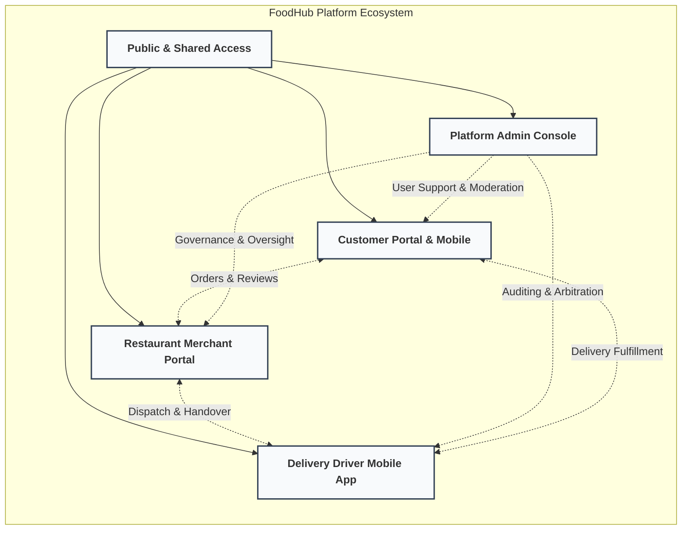
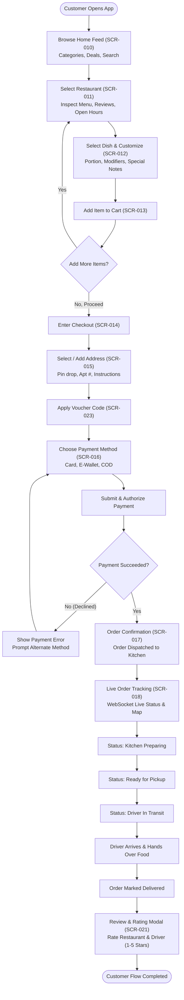
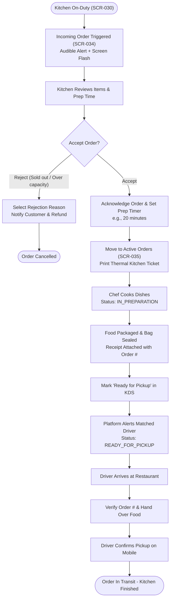
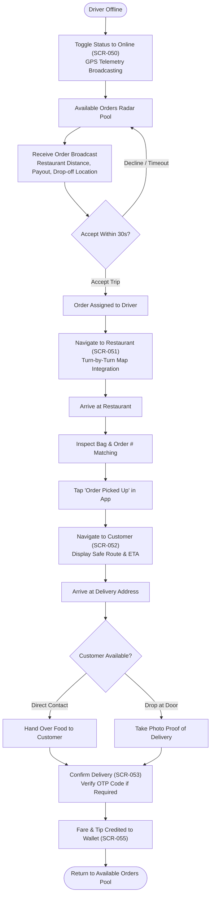
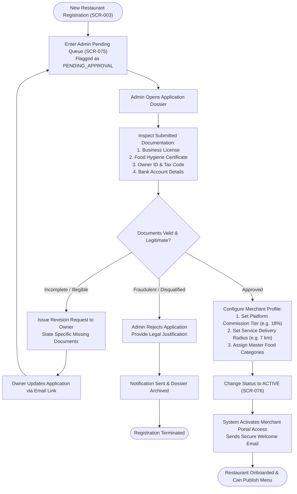
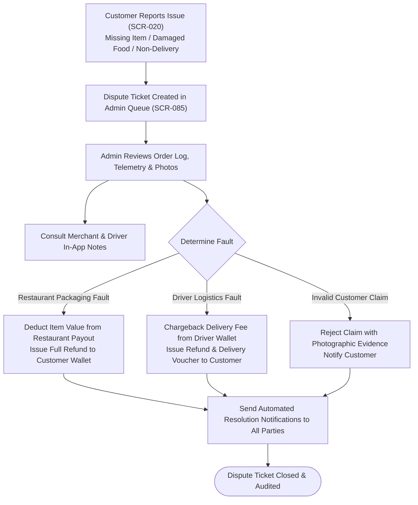
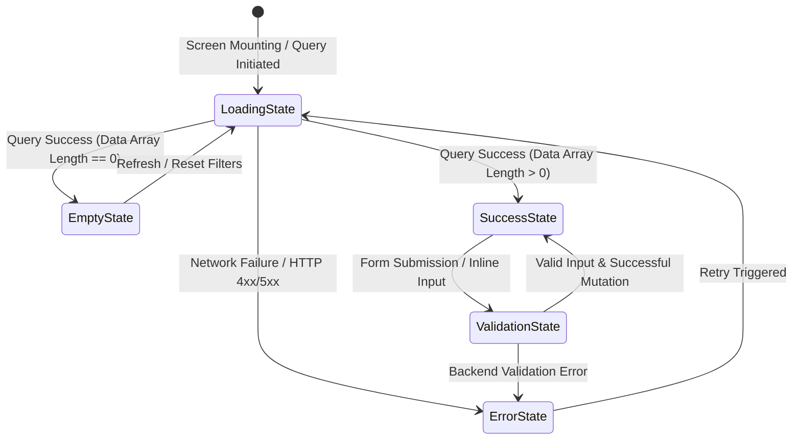

# FoodHub Information Architecture (IA) Specification

> **Document Status:** Approved Baseline (Target V1.0)  
> **Target System:** FoodHub Online Food Ordering & Multi-Tenant Delivery Platform  
> **Actors:** Customer, Restaurant Owner (Merchant), Delivery Driver (Shipper), Platform Administrator  
> **Last Updated:** October 2026

---

## 1. Executive Summary & Architecture Overview

The **FoodHub Information Architecture (IA)** defines the structural design, screen taxonomy, navigation models, user journey flows, and state handling mechanisms for the FoodHub ecosystem. FoodHub is an online food ordering and logistics platform connecting four primary user personas with distinct operational goals:

1. **Customer:** End-consumer browsing menus, placing orders, executing payments, tracking deliveries in real time, and reviewing service.
2. **Restaurant Owner (Merchant):** Commercial vendor managing culinary catalogs, executing incoming order preparation, monitoring real-time kitchen workflows, and analyzing revenue metrics.
3. **Delivery Driver (Shipper):** Logistics partner discovering pickup opportunities, navigating dual-leg routes (merchant pickup and consumer drop-off), and tracking payout balances.
4. **Platform Administrator:** Central governance authority overseeing merchant onboarding compliance, category taxonomy, system-wide promotional campaigns, customer escalations, and platform telemetry.



---

## 2. Site Map & Complete Screen Hierarchy

The application structure is organized into role-based security boundaries. Public screens are universally accessible, authenticated paths require valid role-bound bearer tokens, and shared screens provide standardized fallbacks for HTTP errors.

### 2.1 Textual Screen Hierarchy

```text
Public
├── Landing Page
├── Login
├── Register
└── Browse Restaurants (limited view)

Customer Authenticated
├── Home Feed (restaurant list, promotions, categories)
├── Restaurant Detail
│   ├── Menu
│   ├── Reviews
│   └── Info (hours, address, contact)
├── Cart
├── Checkout
│   ├── Address Selection
│   ├── Payment Method
│   └── Order Confirmation
├── Order Tracking (real-time map + status)
├── Order History
│   └── Order Detail
├── My Reviews
├── Saved Addresses
├── Vouchers / Promotions
├── Profile Settings
└── Notifications

Restaurant Owner Authenticated
├── Dashboard (today's orders, revenue summary)
├── Menu Management
│   ├── Categories
│   └── Items (add/edit/delete)
├── Order Management
│   ├── Incoming Orders
│   ├── Active Orders
│   └── Order History
├── Revenue Reports
│   ├── Daily/Weekly/Monthly
│   └── Export
├── Restaurant Settings
│   ├── Profile & Info
│   ├── Business Hours
│   └── Open/Close Toggle
├── Reviews & Ratings
└── Notifications

Delivery Driver Authenticated
├── Available Orders (nearby)
├── Active Delivery
│   ├── Navigation to Restaurant
│   ├── Navigation to Customer
│   └── Delivery Confirmation
├── Delivery History
├── Earnings
│   ├── Daily/Weekly Summary
│   └── Withdrawal
├── Profile Settings
└── Notifications

Admin Authenticated
├── Dashboard (system-wide KPIs)
├── User Management
│   ├── Customer List
│   ├── Restaurant Owner List
│   ├── Driver List
│   └── User Detail
├── Restaurant Management
│   ├── Pending Approvals
│   ├── Active Restaurants
│   └── Suspended Restaurants
├── Category Management
├── Promotion Management
│   ├── Active Promotions
│   └── Create/Edit Promotion
├── Reports
│   ├── Revenue Reports
│   ├── Order Reports
│   ├── User Reports
│   └── Popular Items
├── Complaints / Reports
└── System Settings

Shared
├── 404 Not Found
├── 403 Forbidden
└── 500 Server Error
```

### 2.2 Global Screen Hierarchy Diagram

```mermaid
flowchart TD
    Root["FoodHub Platform"]

    %% Public
    Root --> Public["Public Area"]
    Public --> PUB01["Landing Page"]
    Public --> PUB02["Login"]
    Public --> PUB03["Register"]
    Public --> PUB04["Browse Restaurants (Limited)"]

    %% Customer
    Root --> CustArea["Customer Portal"]
    CustArea --> CUST01["Home Feed"]
    CustArea --> CUST02["Restaurant Detail"]
    CUST02 --> CUST02A["Menu"]
    CUST02 --> CUST02B["Reviews"]
    CUST02 --> CUST02C["Info & Hours"]
    CustArea --> CUST03["Cart"]
    CustArea --> CUST04["Checkout"]
    CUST04 --> CUST04A["Address Selection"]
    CUST04 --> CUST04B["Payment Method"]
    CUST04 --> CUST04C["Order Confirmation"]
    CustArea --> CUST05["Order Tracking"]
    CustArea --> CUST06["Order History"]
    CUST06 --> CUST06A["Order Detail"]
    CustArea --> CUST07["My Reviews"]
    CustArea --> CUST08["Saved Addresses"]
    CustArea --> CUST09["Vouchers & Promotions"]
    CustArea --> CUST10["Profile Settings"]
    CustArea --> CUST11["Notifications"]

    %% Restaurant
    Root --> RestArea["Restaurant Portal"]
    RestArea --> REST01["Dashboard"]
    RestArea --> REST02["Menu Management"]
    REST02 --> REST02A["Categories"]
    REST02 --> REST02B["Items (Add/Edit/Delete)"]
    RestArea --> REST03["Order Management"]
    REST03 --> REST03A["Incoming Orders"]
    REST03 --> REST03B["Active Orders"]
    REST03 --> REST03C["Order History"]
    RestArea --> REST04["Revenue Reports"]
    REST04 --> REST04A["Daily/Weekly/Monthly"]
    REST04 --> REST04B["Export"]
    RestArea --> REST05["Restaurant Settings"]
    REST05 --> REST05A["Profile & Info"]
    REST05 --> REST05B["Business Hours"]
    REST05 --> REST05C["Open/Close Toggle"]
    RestArea --> REST06["Reviews & Ratings"]
    RestArea --> REST07["Notifications"]

    %% Driver
    Root --> DrivArea["Driver Portal"]
    DrivArea --> DRIV01["Available Orders"]
    DrivArea --> DRIV02["Active Delivery"]
    DRIV02 --> DRIV02A["Nav to Restaurant"]
    DRIV02 --> DRIV02B["Nav to Customer"]
    DRIV02 --> DRIV02C["Delivery Confirmation"]
    DrivArea --> DRIV03["Delivery History"]
    DrivArea --> DRIV04["Earnings"]
    DRIV04 --> DRIV04A["Summary"]
    DRIV04 --> DRIV04B["Withdrawal"]
    DrivArea --> DRIV05["Profile Settings"]
    DrivArea --> DRIV06["Notifications"]

    %% Admin
    Root --> AdminArea["Admin Console"]
    AdminArea --> ADM01["Dashboard (KPIs)"]
    AdminArea --> ADM02["User Management"]
    ADM02 --> ADM02A["Customer List"]
    ADM02 --> ADM02B["Restaurant Owner List"]
    ADM02 --> ADM02C["Driver List"]
    ADM02 --> ADM02D["User Detail"]
    AdminArea --> ADM03["Restaurant Management"]
    ADM03 --> ADM03A["Pending Approvals"]
    ADM03 --> ADM03B["Active Restaurants"]
    ADM03 --> ADM03C["Suspended Restaurants"]
    AdminArea --> ADM04["Category Management"]
    AdminArea --> ADM05["Promotion Management"]
    ADM05 --> ADM05A["Active Promotions"]
    ADM05 --> ADM05B["Create/Edit Promo"]
    AdminArea --> ADM06["System Reports"]
    ADM06 --> ADM06A["Revenue Reports"]
    ADM06 --> ADM06B["Order Reports"]
    ADM06 --> ADM06C["User Reports"]
    ADM06 --> ADM06D["Popular Items"]
    AdminArea --> ADM07["Complaints & Disputes"]
    AdminArea --> ADM08["System Settings"]

    %% Shared
    Root --> SharedArea["Shared System"]
    SharedArea --> ERR01["404 Not Found"]
    SharedArea --> ERR02["403 Forbidden"]
    SharedArea --> ERR03["500 Server Error"]
```



---

## 3. Screen Traceability & Unique Screen IDs

Every user interface state is assigned a canonical identifier `SCR-XXX` for end-to-end traceability across requirements, UX mockups, implementation routes, and test cases.

| Screen ID | Screen Name | Scope / Role | Canonical Route | Presentation | Primary Purpose & Key Capabilities |
| :--- | :--- | :--- | :--- | :--- | :--- |
| **SCR-001** | Landing Page | Public | `/` | Responsive Page | Brand showcase, geo-search input, featured promotions, app download CTAs. |
| **SCR-002** | Login | Public | `/login` | Two-column / Modal | Credential authentication, social SSO, role-based redirection logic. |
| **SCR-003** | Register | Public | `/register` | Multi-step Form | Account registration with role selection (Customer, Merchant, Driver). |
| **SCR-004** | Public Browse | Public | `/explore` | Responsive Page | Restaurant directory with limited guest preview; prompts login on checkout. |
| **SCR-010** | Customer Home Feed | Customer | `/home` | Responsive Page | Personalized carousel, cuisine chips, dynamic restaurant cards, active promos. |
| **SCR-011** | Restaurant Detail | Customer | `/restaurants/:id` | Tabbed Page | Restaurant header, sticky tab bar (Menu, Reviews, About/Info), cart trigger. |
| **SCR-012** | Item Customizer Modal | Customer | `/restaurants/:id?item=:itemId` | Modal / Bottom Sheet | Dish variations, modifiers, special cooking instructions, quantity counters. |
| **SCR-013** | Shopping Cart | Customer | `/cart` | Slide Drawer / Page | Active order items, subtotal calculation, delivery fee preview, checkout CTA. |
| **SCR-014** | Checkout - Main | Customer | `/checkout` | Responsive Step Page | Aggregate checkout screen orchestrating delivery address, payment, and items. |
| **SCR-015** | Address Selection | Customer | `/checkout/address` | Modal / Drawer | Select saved address, geocode pin drop on interactive map, delivery notes. |
| **SCR-016** | Payment Method Picker | Customer | `/checkout/payment` | Modal / Bottom Sheet | Select Credit/Debit card, Digital Wallets, or Cash on Delivery (COD). |
| **SCR-017** | Order Confirmation | Customer | `/orders/:id/confirmed` | Full Page | Order receipt display, estimated ETA, clear animation, button to live tracker. |
| **SCR-018** | Real-Time Order Tracking | Customer | `/orders/:id/track` | Map View + Overlay | Real-time map with driver telemetry (WebSocket), preparation timeline, driver chat. |
| **SCR-019** | Order History | Customer | `/orders` | Paginated List | Past and current orders, filterable by date and status, quick re-order CTA. |
| **SCR-020** | Customer Order Detail | Customer | `/orders/:id` | Detail Page | Complete receipt, item breakdown, payment log, driver info, dispute link. |
| **SCR-021** | My Reviews | Customer | `/profile/reviews` | Card List | List of reviews written by customer with edit/delete actions, photos attached. |
| **SCR-022** | Saved Addresses Manager | Customer | `/profile/addresses` | Card Grid | CRUD interface for saved home/work/custom addresses with default tag. |
| **SCR-023** | Vouchers & Promotions | Customer | `/vouchers` | Voucher Grid | Available voucher codes, discount terms, validity countdowns, claim buttons. |
| **SCR-024** | Customer Profile Settings | Customer | `/profile` | Tabbed Settings | Personal details, phone verification, email updates, password change, 2FA. |
| **SCR-025** | Customer Notifications | Customer | `/notifications` | Feed Drawer / Page | Order alerts, promotional announcements, system broadcasts with unread badges. |
| **SCR-030** | Merchant Dashboard | Restaurant | `/merchant/dashboard` | Metric Grid | Today's revenue, order count, live order queue summary, operating status beacon. |
| **SCR-031** | Menu Management | Restaurant | `/merchant/menu` | Master-Detail | Category tree on left, items table on right with drag-and-drop reordering. |
| **SCR-032** | Menu Category Modal | Restaurant | `/merchant/menu/categories/new` | Modal Form | Create and edit dish categories (e.g., Appetizers, Beverages, Combos). |
| **SCR-033** | Dish Item Editor | Restaurant | `/merchant/menu/items/:id` | Full Page / Drawer | Upload food photos, base price, modifier groups, allergen tags, stock toggle. |
| **SCR-034** | Live Incoming Orders | Restaurant | `/merchant/orders/incoming` | Kanban / Audio Queue | Real-time incoming orders with audio ping, accept/reject modal with timer. |
| **SCR-035** | Active Orders (KDS) | Restaurant | `/merchant/orders/active` | Board / Ticket View | Kitchen Display System: Preparing, Ready for Pickup, Handed to Driver. |
| **SCR-036** | Merchant Order History | Restaurant | `/merchant/orders/history` | Filterable Table | Historical orders, date range picker, status filtering, print thermal receipt. |
| **SCR-037** | Revenue Reports Overview | Restaurant | `/merchant/reports/revenue` | Analytical Charts | Daily, weekly, monthly gross sales, platform commission deduction, net payout. |
| **SCR-038** | Revenue Data Export | Restaurant | `/merchant/reports/export` | Dialog | Export financial ledgers in CSV / XLSX / PDF formats with custom date range. |
| **SCR-039** | Restaurant Profile Settings | Restaurant | `/merchant/settings/profile` | Tabbed Form | Store name, banner, logo, cuisine classifications, contact phone, location. |
| **SCR-040** | Operating Hours & Shifts | Restaurant | `/merchant/settings/hours` | Scheduler Grid | Weekly schedule, regular operating hours, split shifts, public holiday overrides. |
| **SCR-041** | Merchant Reviews Feedback | Restaurant | `/merchant/reviews` | Feedback List | Customer ratings and comments, owner reply composer, satisfaction score breakdown. |
| **SCR-042** | Merchant Notifications | Restaurant | `/merchant/notifications` | Feed Drawer | Operational alerts, dispute notifications, policy updates from Admin. |
| **SCR-050** | Available Deliveries Pool | Driver | `/driver/orders/available` | Map + Bottom Sheet | Nearby ready-for-dispatch orders, estimated distance, payout earnings rate. |
| **SCR-051** | Active Delivery Leg 1 | Driver | `/driver/active/pickup` | Turn-by-Turn Map | Navigation to restaurant, merchant address, order item checklist, arrival confirmation. |
| **SCR-052** | Active Delivery Leg 2 | Driver | `/driver/active/dropoff` | Turn-by-Turn Map | Navigation to customer, contact customer trigger, special delivery instructions. |
| **SCR-053** | Delivery Confirmation | Driver | `/driver/active/complete` | Action Screen | Photo proof of drop-off, digital customer signature or OTP confirmation code. |
| **SCR-054** | Driver Trip History | Driver | `/driver/history` | List View | Completed trips, pickup and drop points, tips earned, distance traveled. |
| **SCR-055** | Driver Earnings Summary | Driver | `/driver/earnings` | Dashboard | Daily/Weekly gross earnings, base pay, customer tips, peak incentive bonuses. |
| **SCR-056** | Driver Payout Withdrawal | Driver | `/driver/earnings/withdraw` | Transaction Modal | Transfer available balance to linked bank account, view payout status. |
| **SCR-057** | Driver Profile & Vehicles | Driver | `/driver/profile` | Form Screen | Driver photo, driving license, vehicle registration, emergency contacts. |
| **SCR-058** | Driver Notifications | Driver | `/driver/notifications` | In-App Feed | Payout notices, surge pricing alerts, customer chat alerts. |
| **SCR-070** | Admin Executive Dashboard | Admin | `/admin/dashboard` | KPI Dashboard | Platform GMV, active users, live order counter, driver density heat map. |
| **SCR-071** | Customer Accounts List | Admin | `/admin/users/customers` | Data Grid | Customer registry, registration date, order frequency, ban/suspend action. |
| **SCR-072** | Merchant Accounts List | Admin | `/admin/users/merchants` | Data Grid | Store owner accounts, linked restaurant entity, verification status. |
| **SCR-073** | Delivery Drivers List | Admin | `/admin/users/drivers` | Data Grid | Active/inactive drivers, background check status, performance ratings. |
| **SCR-074** | User Deep Dive & Audit | Admin | `/admin/users/:id` | Tabbed Detail | Profile metadata, order timeline, payment methods on file, security audit log. |
| **SCR-075** | Restaurant Approvals Queue | Admin | `/admin/merchants/pending` | Review Queue | Review submitted licenses, health inspection certificates, store photos. |
| **SCR-076** | Active Restaurants Directory| Admin | `/admin/merchants/active` | Data Grid | Operational restaurants, menu approval overrides, commission tier overrides. |
| **SCR-077** | Suspended Restaurants | Admin | `/admin/merchants/suspended` | Data Grid | Blacklisted/suspended vendors, violation notes, reinstatement workflow. |
| **SCR-078** | Global Category Taxonomy | Admin | `/admin/categories` | Tree / Table | System food categories (Asian, Italian, Fast Food, etc.), icons, localized tags. |
| **SCR-079** | Platform Promotions Hub | Admin | `/admin/promotions` | Campaign Grid | System-wide discount campaigns, sponsored restaurant vouchers, usage limits. |
| **SCR-080** | Promotion Rule Builder | Admin | `/admin/promotions/builder` | Stepper Form | Rule configuration: minimum basket size, percentage vs. fixed, budget caps. |
| **SCR-081** | Financial Revenue Reports | Admin | `/admin/reports/revenue` | BI Analytics | Platform commissions, payment gateway fees, driver splits, net profits. |
| **SCR-082** | Order Volume Analytics | Admin | `/admin/reports/orders` | BI Analytics | Hourly order velocity, cancellation rates, delivery SLA fulfillment rates. |
| **SCR-083** | User Growth Reports | Admin | `/admin/reports/users` | BI Analytics | Churn rate, new registrations by role, customer lifetime value (LTV). |
| **SCR-084** | Popular Items & Trends | Admin | `/admin/reports/items` | BI Analytics | Top selling dishes, surging search keywords, underserved geographic zones. |
| **SCR-085** | Complaints & Arbitration | Admin | `/admin/complaints` | Ticket Queue | Disputes between customer, restaurant, and driver; refund authorization tool. |
| **SCR-086** | System Platform Settings | Admin | `/admin/settings` | Multi-tab Form | Base commission percentages, delivery radius parameters, SMS/Email API keys. |
| **SCR-095** | 404 Not Found | Shared | Any invalid URL | Minimal Page | Clear error message, smart search suggestions, "Return Home" primary button. |
| **SCR-096** | 403 Forbidden | Shared | Protected access | Minimal Page | Permission denied notice, role switch trigger, "Back to safety" CTA. |
| **SCR-097** | 500 Server Error | Shared | Unhandled error | Minimal Page | Problem Details trace ID, server health indicator, "Retry Request" button. |

---

## 4. Navigation Models by Actor & Form Factor

The user experience adapts dynamically across desktop web, tablet, and mobile operating environments.

### 4.1 Navigation Matrix by Actor

| Actor | Primary Form Factor | Navigation Pattern | Top Bar Components | Sidebar / Drawer Components | Bottom Bar Components (Mobile) |
| :--- | :--- | :--- | :--- | :--- | :--- |
| **Public / Guest** | Responsive Web & Mobile | Header + Hero Search | Brand Logo, Location Selector, Search Input, Sign In, Sign Up CTA | Mobile Nav Drawer (About, Help, Partner Registration, Language) | Home, Search, Sign In |
| **Customer** | Mobile App & Responsive Web | Dual App Bar + Bottom Nav | Delivery Address Dropdown, Search Icon, Filter Chips, Cart Badge | Account Drawer (Addresses, Vouchers, Help Center, Logout) | **1. Home**<br>**2. Browse**<br>**3. Orders**<br>**4. Notifications**<br>**5. Profile** |
| **Restaurant Owner** | Desktop Portal & Kitchen Tablet | Persistent Sidebar + Status Beacon | Live Online/Offline Switch, Sound Alert Toggle, Store Selector, Avatar Menu | **1. Dashboard**<br>**2. Menu Mgmt**<br>**3. Order Queue**<br>**4. Revenue**<br>**5. Reviews**<br>**6. Settings** | Minimal Tab Bar on Tablet: Orders, Menu, Settings |
| **Delivery Driver** | Native Mobile App | Bottom Sheet + Map Layer | Online/Offline Status Pill, Battery/GPS Status, Floating Emergency Call | Profile, Vehicle Docs, Support, Settings | **1. Available**<br>**2. Active**<br>**3. Earnings**<br>**4. History**<br>**5. Profile** |
| **Administrator** | Desktop Web Console (1280px+) | Collapsible Tree Sidebar | Omni-Search, Server Environment Beacon, Incident Alert Bell, Admin Profile | **1. Overview**<br>**2. Users**<br>**3. Merchants**<br>**4. Categories**<br>**5. Promotions**<br>**6. Reports**<br>**7. Disputes**<br>**8. Settings** | *Not applicable (Admin console restricted to desktop/tablet screens)* |

### 4.2 Structural Layouts

#### Customer Navigation Layout (Mobile-First View)
```text
+-------------------------------------------------------------+
| [=] Deliver to: 123 Main St, Apt 4B [v]          [Cart (3)] | <- Top App Bar
+-------------------------------------------------------------+
| [ Search dishes, groceries, or restaurants...             ] | <- Sticky Search Bar
+-------------------------------------------------------------+
| (All)   (Burgers)   (Sushi)   (Pizza)   (Vegan)   (Dessert) | <- Horizontal Category Filter
+-------------------------------------------------------------+
|                                                             |
|                    MAIN SCROLLABLE CONTENT                  |
|                                                             |
| - Special Promotions Banner Carousel                        |
| - Featured Restaurants Near You                             |
| - Recent Order Re-order Shortcuts                           |
|                                                             |
+-------------------------------------------------------------+
|  [Home]      [Browse]      [Orders]      [Alerts]  [Profile]| <- Persistent Bottom Nav Bar
+-------------------------------------------------------------+
```

#### Restaurant Owner Kitchen & Management Layout (Desktop / Tablet)
```text
+---------------------+---------------------------------------------------------------+
| FoodHub Merchant    | Store: "Golden Dragon Bistro" [OPEN *]  [Sound ON] [Avatar v] | <- Top Status Bar
+---------------------+---------------------------------------------------------------+
| [@] Dashboard       | Active Kitchen Orders (KDS View)                              |
| [*] Menu Management | +--------------------+ +--------------------+ +--------------+|
| [!] Order Queue (4) | | Order #1042 (New)  | | Order #1039 (Cook) | | Order #1038  ||
| [$] Revenue Reports | | 2x Ramen, 1x Gyoza | | 1x Bento Box       | | Ready Driver ||
| [o] Reviews & Rating| | [ACCEPT]  [REJECT] | | [MARK READY]       | | Awaiting...  ||
| [=] Settings        | +--------------------+ +--------------------+ +--------------+|
+---------------------+---------------------------------------------------------------+
```

#### Administrator Navigation Layout (Desktop Enterprise Portal)
```text
+---------------------+---------------------------------------------------------------+
| FoodHub Admin Panel | [Search Users, Orders, Stores (Ctrl+K)]   [ENV: PROD] [Admin] |
+---------------------+---------------------------------------------------------------+
| -- OPERATIONS --    | Platform Operational Health & System KPIs                     |
| [*] Dashboard       | +-----------------+ +-----------------+ +-------------------+ |
| [U] User Directory  | | GMV Today       | | Active Orders   | | Driver Pool Density| |
| [M] Merchant Queue  | | $42,850.00      | | 312 in-flight   | | 89 Active / 12 Off| |
| -- CATALOG & SALES--| +-----------------+ +-----------------+ +-------------------+ |
| [C] Categories      |                                                               |
| [P] Promotions      | Pending Restaurant Approvals (3 require review)               |
| -- GOVERNANCE --    | [Review Bakery] [Review Taco Shop] [Review Noodle Bar]        |
| [R] Reports & BI    |                                                               |
| [!] Dispute Tickets |                                                               |
| [S] System Config   |                                                               |
+---------------------+---------------------------------------------------------------+
```

---

## 5. Screen Permission Matrix (Role-Based Access Control)

Access control is enforced at both frontend router guards and backend gateway endpoints. The matrix below defines the accessibility of each functional screen across the platform personas.

*Legend: `ALLOWED` = Full access; `RESTRICTED` = Read-only or scoped access; `FORBIDDEN` = Blocked (redirects to 403 or Login).*

| Screen ID | Screen Name | Public / Guest | Customer | Restaurant Owner | Delivery Driver | Platform Admin |
| :--- | :--- | :---: | :---: | :---: | :---: | :---: |
| **SCR-001** | Landing Page | ALLOWED | ALLOWED | ALLOWED | ALLOWED | ALLOWED |
| **SCR-002** | Login | ALLOWED | FORBIDDEN (Auth) | FORBIDDEN (Auth) | FORBIDDEN (Auth) | FORBIDDEN (Auth) |
| **SCR-003** | Register | ALLOWED | FORBIDDEN (Auth) | FORBIDDEN (Auth) | FORBIDDEN (Auth) | FORBIDDEN (Auth) |
| **SCR-004** | Public Browse | ALLOWED | ALLOWED | ALLOWED | ALLOWED | ALLOWED |
| **SCR-010** | Customer Home Feed | FORBIDDEN | ALLOWED | FORBIDDEN | FORBIDDEN | FORBIDDEN |
| **SCR-011** | Restaurant Detail | RESTRICTED | ALLOWED | RESTRICTED | RESTRICTED | ALLOWED |
| **SCR-012** | Item Customizer | FORBIDDEN | ALLOWED | RESTRICTED | FORBIDDEN | ALLOWED |
| **SCR-013** | Shopping Cart | FORBIDDEN | ALLOWED | FORBIDDEN | FORBIDDEN | FORBIDDEN |
| **SCR-014** | Checkout - Main | FORBIDDEN | ALLOWED | FORBIDDEN | FORBIDDEN | FORBIDDEN |
| **SCR-015** | Address Selection | FORBIDDEN | ALLOWED | FORBIDDEN | FORBIDDEN | FORBIDDEN |
| **SCR-016** | Payment Method Picker | FORBIDDEN | ALLOWED | FORBIDDEN | FORBIDDEN | FORBIDDEN |
| **SCR-017** | Order Confirmation | FORBIDDEN | ALLOWED | FORBIDDEN | FORBIDDEN | FORBIDDEN |
| **SCR-018** | Order Tracking | FORBIDDEN | ALLOWED | FORBIDDEN | FORBIDDEN | ALLOWED |
| **SCR-019** | Order History | FORBIDDEN | ALLOWED | FORBIDDEN | FORBIDDEN | RESTRICTED |
| **SCR-020** | Order Detail (Customer)| FORBIDDEN | ALLOWED | FORBIDDEN | FORBIDDEN | ALLOWED |
| **SCR-021** | My Reviews | FORBIDDEN | ALLOWED | FORBIDDEN | FORBIDDEN | RESTRICTED |
| **SCR-022** | Saved Addresses | FORBIDDEN | ALLOWED | FORBIDDEN | FORBIDDEN | FORBIDDEN |
| **SCR-023** | Vouchers & Promotions | FORBIDDEN | ALLOWED | FORBIDDEN | FORBIDDEN | ALLOWED |
| **SCR-024** | Customer Profile | FORBIDDEN | ALLOWED | FORBIDDEN | FORBIDDEN | RESTRICTED |
| **SCR-025** | Customer Notifications | FORBIDDEN | ALLOWED | FORBIDDEN | FORBIDDEN | FORBIDDEN |
| **SCR-030** | Merchant Dashboard | FORBIDDEN | FORBIDDEN | ALLOWED (Scoped) | FORBIDDEN | ALLOWED |
| **SCR-031** | Menu Management | FORBIDDEN | FORBIDDEN | ALLOWED (Scoped) | FORBIDDEN | ALLOWED |
| **SCR-032** | Menu Category Modal | FORBIDDEN | FORBIDDEN | ALLOWED (Scoped) | FORBIDDEN | ALLOWED |
| **SCR-033** | Dish Item Editor | FORBIDDEN | FORBIDDEN | ALLOWED (Scoped) | FORBIDDEN | ALLOWED |
| **SCR-034** | Live Incoming Orders | FORBIDDEN | FORBIDDEN | ALLOWED (Scoped) | FORBIDDEN | ALLOWED |
| **SCR-035** | Active Orders (KDS) | FORBIDDEN | FORBIDDEN | ALLOWED (Scoped) | FORBIDDEN | ALLOWED |
| **SCR-036** | Merchant Order History | FORBIDDEN | FORBIDDEN | ALLOWED (Scoped) | FORBIDDEN | ALLOWED |
| **SCR-037** | Revenue Reports | FORBIDDEN | FORBIDDEN | ALLOWED (Scoped) | FORBIDDEN | ALLOWED |
| **SCR-038** | Revenue Data Export | FORBIDDEN | FORBIDDEN | ALLOWED (Scoped) | FORBIDDEN | ALLOWED |
| **SCR-039** | Restaurant Profile Settings| FORBIDDEN | FORBIDDEN | ALLOWED (Scoped) | FORBIDDEN | ALLOWED |
| **SCR-040** | Operating Hours & Shifts | FORBIDDEN | FORBIDDEN | ALLOWED (Scoped) | FORBIDDEN | ALLOWED |
| **SCR-041** | Merchant Reviews Feedback | FORBIDDEN | FORBIDDEN | ALLOWED (Scoped) | FORBIDDEN | ALLOWED |
| **SCR-042** | Merchant Notifications | FORBIDDEN | FORBIDDEN | ALLOWED (Scoped) | FORBIDDEN | FORBIDDEN |
| **SCR-050** | Available Deliveries Pool | FORBIDDEN | FORBIDDEN | FORBIDDEN | ALLOWED | ALLOWED |
| **SCR-051** | Delivery Leg 1 (Pickup) | FORBIDDEN | FORBIDDEN | FORBIDDEN | ALLOWED | ALLOWED |
| **SCR-052** | Delivery Leg 2 (Dropoff) | FORBIDDEN | FORBIDDEN | FORBIDDEN | ALLOWED | ALLOWED |
| **SCR-053** | Delivery Confirmation | FORBIDDEN | FORBIDDEN | FORBIDDEN | ALLOWED | ALLOWED |
| **SCR-054** | Driver Trip History | FORBIDDEN | FORBIDDEN | FORBIDDEN | ALLOWED | ALLOWED |
| **SCR-055** | Driver Earnings Summary | FORBIDDEN | FORBIDDEN | FORBIDDEN | ALLOWED | ALLOWED |
| **SCR-056** | Driver Withdrawal | FORBIDDEN | FORBIDDEN | FORBIDDEN | ALLOWED | RESTRICTED |
| **SCR-057** | Driver Profile & Vehicles | FORBIDDEN | FORBIDDEN | FORBIDDEN | ALLOWED | ALLOWED |
| **SCR-058** | Driver Notifications | FORBIDDEN | FORBIDDEN | FORBIDDEN | ALLOWED | FORBIDDEN |
| **SCR-070** | Admin Executive Dashboard | FORBIDDEN | FORBIDDEN | FORBIDDEN | FORBIDDEN | ALLOWED |
| **SCR-071** | Customer Accounts List | FORBIDDEN | FORBIDDEN | FORBIDDEN | FORBIDDEN | ALLOWED |
| **SCR-072** | Merchant Accounts List | FORBIDDEN | FORBIDDEN | FORBIDDEN | FORBIDDEN | ALLOWED |
| **SCR-073** | Delivery Drivers List | FORBIDDEN | FORBIDDEN | FORBIDDEN | FORBIDDEN | ALLOWED |
| **SCR-074** | User Deep Dive & Audit | FORBIDDEN | FORBIDDEN | FORBIDDEN | FORBIDDEN | ALLOWED |
| **SCR-075** | Restaurant Approvals Queue | FORBIDDEN | FORBIDDEN | FORBIDDEN | FORBIDDEN | ALLOWED |
| **SCR-076** | Active Restaurants Directory| FORBIDDEN | FORBIDDEN | FORBIDDEN | FORBIDDEN | ALLOWED |
| **SCR-077** | Suspended Restaurants | FORBIDDEN | FORBIDDEN | FORBIDDEN | FORBIDDEN | ALLOWED |
| **SCR-078** | Global Category Taxonomy | FORBIDDEN | FORBIDDEN | FORBIDDEN | FORBIDDEN | ALLOWED |
| **SCR-079** | Platform Promotions Hub | FORBIDDEN | FORBIDDEN | FORBIDDEN | FORBIDDEN | ALLOWED |
| **SCR-080** | Promotion Rule Builder | FORBIDDEN | FORBIDDEN | FORBIDDEN | FORBIDDEN | ALLOWED |
| **SCR-081** | Financial Revenue Reports | FORBIDDEN | FORBIDDEN | FORBIDDEN | FORBIDDEN | ALLOWED |
| **SCR-082** | Order Volume Analytics | FORBIDDEN | FORBIDDEN | FORBIDDEN | FORBIDDEN | ALLOWED |
| **SCR-083** | User Growth Reports | FORBIDDEN | FORBIDDEN | FORBIDDEN | FORBIDDEN | ALLOWED |
| **SCR-084** | Popular Items & Trends | FORBIDDEN | FORBIDDEN | FORBIDDEN | FORBIDDEN | ALLOWED |
| **SCR-085** | Complaints & Arbitration | FORBIDDEN | FORBIDDEN | FORBIDDEN | FORBIDDEN | ALLOWED |
| **SCR-086** | System Platform Settings | FORBIDDEN | FORBIDDEN | FORBIDDEN | FORBIDDEN | ALLOWED |
| **SCR-095** | 404 Not Found | ALLOWED | ALLOWED | ALLOWED | ALLOWED | ALLOWED |
| **SCR-096** | 403 Forbidden | ALLOWED | ALLOWED | ALLOWED | ALLOWED | ALLOWED |
| **SCR-097** | 500 Server Error | ALLOWED | ALLOWED | ALLOWED | ALLOWED | ALLOWED |

---

## 6. End-to-End User Flows

### 6.1 Customer Flow: Browse → Order → Pay → Track → Receive

This primary revenue flow models the customer discovery lifecycle through to final dish consumption and quality rating.



### 6.2 Restaurant Owner Flow: Receive Order → Accept → Prepare → Ready

This operational workflow models kitchen dispatching, SLA adherence, and driver coordination.



### 6.3 Delivery Driver (Shipper) Flow: See Order → Accept → Pick Up → Deliver

This mobile logistics workflow guides the courier through pickup, transit, and contactless or direct drop-off.



### 6.4 Administrator Flow: Approve Restaurant Onboarding

This governance lifecycle guarantees food safety compliance, legal business licensing, and financial account verification.



### 6.5 Cross-Actor Escalation & Dispute Resolution Flow



---

## 7. UI/UX Screen States Contract

To guarantee consistent behavior across all web and mobile touchpoints, each screen category must strictly adhere to the five core UI states.



### 7.1 Loading State Contract
- **Skeleton Screens:** Data tables, dish cards, and metrics must render animated gray skeleton placeholders mimicking the exact target layout. Generic full-screen blocking spinners are forbidden for content queries.
- **Micro-Interaction Spinners:** Action buttons (e.g., "Place Order", "Accept Delivery", "Save Dish") must display a centered inline spinner while preserving button dimensions, disabling duplicate submissions.
- **Progressive Image Hydration:** Restaurant banners and dish photography must render a low-resolution blurred placeholder (BlurHash / LQIP) until the WebP/AVIF asset is downloaded.

### 7.2 Empty State Contract
- **Contextual Illustration:** Present a brand-aligned, vector graphic representing the zero-data scenario (e.g., an empty shopping bag, clean kitchen pan, zero unread alerts).
- **Clear Explanatory Copy:** Explicitly differentiate between an empty dataset (e.g., *"You haven't placed any orders yet"*) versus a filtered-out dataset (e.g., *"No dishes match 'Gluten-free Pizza' under $15"*).
- **Direct Call to Action (CTA):** Every empty state must offer a single primary remediation button:
  - Empty Cart: *"Explore Popular Restaurants"* -> Redirects to `SCR-010`.
  - Empty Active Orders (Driver): *"Scan Surrounding Zones"* -> Refreshes radar pool.
  - Zero Menu Items (Merchant): *"Add First Menu Item"* -> Opens `SCR-033`.

### 7.3 Error State Contract
- **Client Offline Banner:** When device connectivity is lost (`navigator.onLine === false`), display a persistent yellow/amber top banner: *"Connection lost. Retrying automatically..."* with cached read-only access.
- **Field-Level Validation Errors:** Render inline red helper text below the invalid form control with `aria-invalid="true"` and `aria-describedby="field-error-id"`. Never use transient toast messages for form field validation.
- **Server Faults (500) & API Errors:** Display standard ProblemDetails RFC-7807 trace identifiers (e.g., `Trace ID: 7ed20323-...`) enabling users to quote the exact reference when contacting support, without exposing raw stack traces.
- **Payment Declines:** Keep the checkout form populated and the order draft intact; present high-contrast feedback explaining the decline code (e.g., *"Insufficient funds"* or *"Card expired"*) with immediate option to switch cards.

### 7.4 Success State Contract
- **Transient Confirmations:** Non-destructive actions (e.g., "Item added to cart", "Operating hours updated", "Voucher claimed") display a floating snackbar/toast at top-center for 4 seconds before auto-dismissing.
- **High-Impact Celebrations:** Irreversible or major lifecycle milestones (e.g., Order Placed, Delivery Completed, Restaurant Application Approved) display a full-page modal with celebratory SVG checkmark animation, clear summary details, and a primary next-step CTA.
- **Optimistic UI Updates:** Toggle controls (e.g., restaurant Online/Offline, item In Stock/Out of Stock) flip immediately in the client UI, queueing a background mutation with automatic rollback and toast notification if the API call fails.

### 7.5 Validation State Contract
- **Pre-Submit Validation:** Instant client-side validation using standard schemas (Zod/Joi) triggers on input blur event to avoid premature error flashing while the user is actively typing.
- **Business Rule Constraints:**
  - Cart Minimum: Display progress bar: *"$3.50 more to reach the $15.00 restaurant minimum"*.
  - Operating Hours: Prevent checkout submission if restaurant closes before prep + delivery ETA window.
  - Delivery Radius: Highlight address in red if beyond restaurant's configured maximum transit radius.

---

## 8. Technical Constraints, Breakpoints & Architecture Notes

### 8.1 Responsive Breakpoints

| Breakpoint Token | Minimum Width | Maximum Width | Target Devices & Screen Configurations |
| :--- | :---: | :---: | :--- |
| `mobile` | `320px` | `639px` | Smart phones (iPhone, Pixel, Galaxy). Bottom navigation bar active. |
| `tablet` | `640px` | `1023px` | Tablets & iPads. Split KDS view for Kitchens; expanded grid for Customer. |
| `desktop` | `1024px` | `1439px` | Laptops and standard desktop monitors. Collapsible sidebars active. |
| `wide` | `1440px` | Infinite | High-resolution workstations. Admin analytical consoles and multi-column tables. |

### 8.2 Real-Time Communication Protocols
- **WebSockets / Server-Sent Events (SSE):** Required on `SCR-018` (Customer Order Tracking), `SCR-034` (Merchant Incoming Orders), `SCR-035` (Kitchen Display System), and `SCR-050` (Driver Order Pool) to support sub-second state synchronization.
- **Fallback Polling:** In environments where WebSocket handshakes fail due to proxy restrictions, the frontend falls back automatically to HTTP long-polling with exponential backoff (5s, 10s, 30s).
