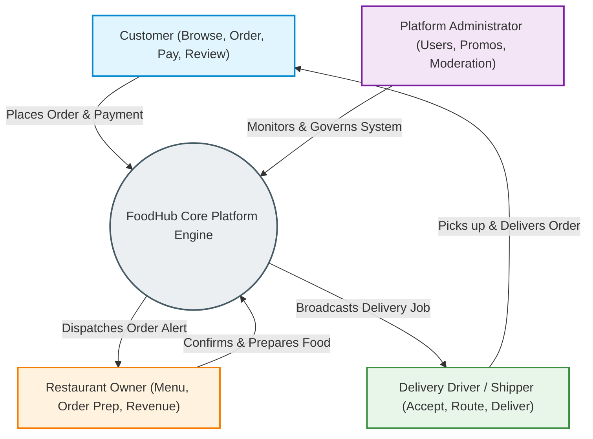
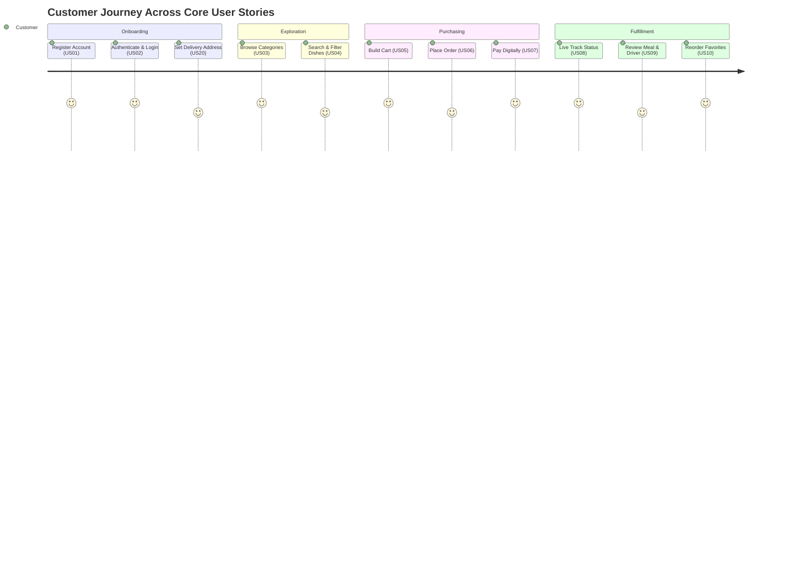
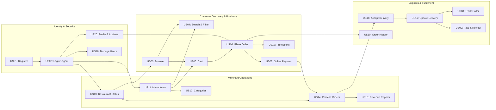

# FoodHub — User Stories & INVEST Analysis

> **Document Identifier:** `DOC-FOODHUB-05`  
> **System Name:** FoodHub Online Food Ordering & Delivery Platform  
> **Version:** 1.0.0  
> **Status:** Approved / Sprint-Ready  
> **Authors:** Software Engineering & Product Management Team  
> **Target Audience:** Product Owners, Scrum Masters, System Architects, Full-Stack Engineers, QA Engineers  

---

## 1. Executive Summary & System Actors

**FoodHub** is a multi-sided, hyper-local food ordering and delivery marketplace connecting four distinct user groups. The platform orchestrates the complete lifecycle of food discovery, culinary preparation, payment processing, route-optimized delivery dispatch, and post-order feedback.



### Core Actor Profiles & Platform Responsibilities

| Actor Role | Persona Definition | Primary Platform Objectives |
|---|---|---|
| **Customer** | End consumer ordering meals for delivery or pickup | Discover restaurants, customize dishes, execute cashless transactions, track deliveries in real time, and submit verified feedback. |
| **Restaurant Owner** | Merchant / Kitchen Manager operating on the platform | Manage menus and categorized inventories, set live restaurant availability, process orders within kitchen capacity limits, and monitor sales analytics. |
| **Delivery Driver (Shipper)** | Independent gig-economy logistics provider | Review available delivery assignments, navigate fulfillment routes, update milestone delivery statuses, and track compensation and tip earnings. |
| **Administrator** | Central platform compliance and operations officer | Oversee user and merchant lifecycle accounts, curate platform-wide taxonomy and promotions, monitor system health, resolve disputes, and audit financial records. |

---

## 2. The INVEST Evaluation Framework

The **INVEST** framework, originally formulated by Bill Wake, provides an industry-standard quality benchmark for evaluating Agile user stories. High-performing engineering teams rely on INVEST to ensure backlog items are sprint-ready, technically sound, and deliver measurable business value.

```
  I - Independent   ==> Loosely coupled; stories can be built and deployed in any sequence.
  N - Negotiable    ==> Co-created scope; focuses on the "what" and "why", leaving "how" open.
  V - Valuable      ==> Yields demonstrable user, business, or technical value upon completion.
  E - Estimable     ==> Sized accurately by engineers; scope and complexity are well understood.
  S - Small         ==> Sized to fit comfortably within a single sprint iteration (1 to 8 SP).
  T - Testable      ==> Verifiable with clear, automated, and objective acceptance criteria.
```

### FoodHub INVEST Application Standards

| Criterion | Definition in FoodHub Backlog | Implementation & Quality Guardrails |
|---|---|---|
| **Independent (I)** | Minimized cross-story dependencies. Where domain relationships exist, interfaces, contracts, or data fixtures isolate stories. | Stories rely on API contracts rather than shared codebases; mock providers isolate payment gateways and third-party mapping SDKs. |
| **Negotiable (N)** | Captures user intention without dictating rigid UI widget layouts or low-level database schemas prematurely. | Backlog items preserve implementation flexibility for frontend styling, UX micro-interactions, and underlying caching strategies. |
| **Valuable (V)** | Delivers demonstrable value directly to at least one of the 4 defined system actors or business operations. | Pure technical chores are reframed as enablers delivering direct security, performance, or operational reliability value. |
| **Estimable (E)** | Sufficient architectural clarity, API specifications, and domain boundaries allow realistic estimation. | Stories are estimated using Fibonacci story points (1, 2, 3, 5, 8, 13) based on risk, complexity, and implementation effort. |
| **Small (S)** | Sized appropriately to be designed, coded, tested, and reviewed within a single two-week development sprint. | Epics larger than 8 story points are decomposed into atomic slices (e.g., separating core checkout from multi-payment gateways). |
| **Testable (T)** | Backlog items include explicit, deterministic Given/When/Then acceptance criteria covering all functional paths. | Each story maps to automated unit tests, integration contracts, and end-to-end Cypress/Playwright test suites. |

---

## 3. Master Product Backlog & Story Sizing Overview

The following 20 user stories define the complete functional footprint of the FoodHub Minimum Viable Product (MVP) and target V1 release.

| ID | User Story Title | Primary Actor | MoSCoW Priority | Story Points | Prerequisites / Dependencies | Primary Value Delivered |
|---|---|---|---|:---:|---|---|
| **US01** | Customer Registration | Customer | Must Have | 3 | None (Foundational) | Secure consumer onboarding |
| **US02** | User Login & Session Logout | All Users | Must Have | 3 | US01 | Secure platform authentication |
| **US03** | Browse Restaurants by Category | Customer | Must Have | 3 | US13 | Restaurant discovery & engagement |
| **US04** | Search & Filter Menu Items | Customer | Should Have | 5 | US03, US11 | Targeted item accessibility |
| **US05** | Add Menu Items to Cart | Customer | Must Have | 3 | US03, US11 | Pre-order assembly & customization |
| **US06** | Place Order & Checkout | Customer | Must Have | 8 | US05, US20 | Transaction initialization |
| **US07** | Process Online Payment | Customer | Must Have | 8 | US06 | Cashless revenue capture |
| **US08** | Real-Time Order Tracking | Customer | Should Have | 5 | US06, US14, US17 | Delivery transparency & peace of mind |
| **US09** | Rate & Review Restaurant | Customer | Could Have | 3 | US08 | Social proof & merchant quality audit |
| **US10** | View Order History & Reorder | Customer | Should Have | 3 | US06 | Customer retention & friction reduction |
| **US11** | Manage Restaurant Menu Items | Restaurant Owner | Must Have | 5 | US02 | Live culinary offering management |
| **US12** | Organize Menu Categories | Restaurant Owner | Should Have | 3 | US11 | Menu hierarchy & usability |
| **US13** | Set Live Restaurant Status | Restaurant Owner | Must Have | 2 | US02 | Capacity control & order throttling |
| **US14** | Process Incoming Orders | Restaurant Owner | Must Have | 5 | US06, US13 | Kitchen workflow coordination |
| **US15** | View Merchant Revenue Reports | Restaurant Owner | Should Have | 5 | US14 | Business financial visibility |
| **US16** | Accept Delivery Assignments | Delivery Driver | Must Have | 5 | US14 | Dispatch matching & driver earnings |
| **US17** | Update Order Delivery Status | Delivery Driver | Must Have | 5 | US16 | Delivery milestone synchronization |
| **US18** | Manage Platform User Accounts | Administrator | Must Have | 5 | US02 | Platform security & user governance |
| **US19** | Manage Discount Promotions | Administrator | Should Have | 5 | US06 | Marketing conversion & sales volume |
| **US20** | Manage Account Profile & Address | All Users | Must Have | 3 | US02 | Accurate fulfillment coordinates |

### Backlog Metrics & Velocity Breakdown
* **Total Story Points:** 87 Story Points
* **Must Have (P1):** 55 Story Points (63.2% — Core MVP baseline)
* **Should Have (P2):** 29 Story Points (33.3% — Operational enhancements)
* **Could Have (P3):** 3 Story Points (3.5% — Value-add social proof)

---

## 4. Comprehensive User Stories & INVEST Analysis



---

### US01 — Customer Registration

> **Story Card:**  
> **As a** prospective customer,  
> **I want to** register an account using my email, mobile phone number, and password,  
> **so that** I can access the FoodHub marketplace and order food to my address.

#### Metadata
* **Actor:** Customer
* **Priority:** Must Have (P1)
* **Story Points:** 3
* **Sprint Readiness:** Ready for Sprint
* **Dependencies:** None (Foundational identity service)

#### INVEST Evaluation Table

| Criterion | Evaluation & Technical Justification |
|---|---|
| **Independent** | **PASS.** Can be implemented and verified against database stubs independently of checkout, payment, or delivery systems. |
| **Negotiable** | **PASS.** Registration flow supports design negotiation (e.g., immediate activation vs. asynchronous email/SMS OTP token verification). |
| **Valuable** | **PASS.** Fundamental entry point; captures verified user identity required for order attribution, fraud prevention, and customer retention. |
| **Estimable** | **PASS.** Standard authentication pattern. Complexity involves input validation, bcrypt password hashing, and duplicate constraint checks. |
| **Small** | **PASS.** Estimated at 3 story points. Scoped strictly to registration API endpoint, DTO validation, and basic client sign-up UI. |
| **Testable** | **PASS.** Easily verified with automated unit tests for invalid email schemas, weak passwords, duplicate records (HTTP 409), and successful account persistence (HTTP 201). |

#### Technical & Architectural Scope Notes
* Secure password storage using bcrypt with a work factor $\ge 12$ or Argon2id.
* Enforce unique constraint indexes on `email` and `phone_number`.
* Returns standardized sanitized user payload (excluding password hash) and emits an `AccountCreatedEvent`.

---

### US02 — User Login & Session Logout

> **Story Card:**  
> **As an** enrolled user (Customer, Restaurant Owner, Shipper, or Administrator),  
> **I want to** log in with my credentials and securely terminate my session upon logout,  
> **so that** I can access my role-authorized capabilities and prevent unauthorized account access.

#### Metadata
* **Actor:** All Users (Customer, Restaurant Owner, Delivery Driver, Administrator)
* **Priority:** Must Have (P1)
* **Story Points:** 3
* **Sprint Readiness:** Ready for Sprint
* **Dependencies:** US01 (Requires seeded or registered user accounts)

#### INVEST Evaluation Table

| Criterion | Evaluation & Technical Justification |
|---|---|
| **Independent** | **PASS.** Requires an existing user store, but authentication mechanics (token generation, hashing verification) stand as an autonomous module. |
| **Negotiable** | **PASS.** Token storage mechanism is negotiable (HTTP-only Secure SameSite cookies vs. Authorization Bearer header storage). |
| **Valuable** | **PASS.** Critical security gate protecting personal data, payment authorizations, merchant settings, and administrative operations. |
| **Estimable** | **PASS.** Established standard using stateless JSON Web Tokens (JWT) with access token (15m expiry) and refresh token (7d rotation). |
| **Small** | **PASS.** Sized at 3 story points covering login endpoint, token issuer, logout token revocation/discard, and auth client state. |
| **Testable** | **PASS.** Testable via HTTP 200 on valid credentials, HTTP 401 for wrong credentials with constant-time response, and token rejection after logout. |

#### Technical & Architectural Scope Notes
* Anti-enumeration protection: return identical generic error `"Invalid email or password"` for missing accounts and password mismatches.
* Account lockout threshold: 5 consecutive failed attempts locks account for 15 minutes.
* Logout executes refresh token invalidation in server-side Redis denylist.

---

### US03 — Browse Restaurants by Category

> **Story Card:**  
> **As a** hungry customer,  
> **I want to** browse restaurants filtered by food categories and view operational status,  
> **so that** I can quickly find restaurants that match my culinary cravings and are currently open.

#### Metadata
* **Actor:** Customer
* **Priority:** Must Have (P1)
* **Story Points:** 3
* **Sprint Readiness:** Ready for Sprint
* **Dependencies:** US13 (Restaurant active/open status flag)

#### INVEST Evaluation Table

| Criterion | Evaluation & Technical Justification |
|---|---|
| **Independent** | **PASS.** Can be tested using mock restaurant and category seed data without active menu items or ordering workflows. |
| **Negotiable** | **PASS.** Presentation format (grid vs. horizontal carousel vs. infinite scroll) and sorting criteria are negotiable during UI design. |
| **Valuable** | **PASS.** Primary top-of-funnel customer engagement mechanism; directly drives restaurant discovery and order conversion. |
| **Estimable** | **PASS.** Straightforward read query with relational joins between `restaurants` and `categories`, indexed by `is_active` and `status`. |
| **Small** | **PASS.** 3 story points; involves a single paginated GET endpoint (`/api/v1/restaurants?category={id}`) and frontend catalog UI. |
| **Testable** | **PASS.** Verified by querying specific categories, checking pagination offsets, and asserting that closed/inactive restaurants are tagged accordingly. |

#### Technical & Architectural Scope Notes
* Read-optimized query with Redis caching (TTL 5 minutes) for category listings.
* Excludes soft-deleted or unapproved restaurants (`status != 'APPROVED'`).
* Response includes merchant summary: name, banner image, average rating, delivery time estimate, and open status.

---

### US04 — Search & Filter Menu Items

> **Story Card:**  
> **As a** customer with specific preferences,  
> **I want to** search for dishes by keyword and filter by price range and dietary flags,  
> **so that** I can locate the exact food I want without browsing entire restaurant menus.

#### Metadata
* **Actor:** Customer
* **Priority:** Should Have (P2)
* **Story Points:** 5
* **Sprint Readiness:** Ready for Sprint
* **Dependencies:** US03 (Restaurant catalog), US11 (Menu item catalog)

#### INVEST Evaluation Table

| Criterion | Evaluation & Technical Justification |
|---|---|
| **Independent** | **PASS.** Decoupled search endpoint; can run against database indexes or full-text search engines independently of cart or checkout. |
| **Negotiable** | **PASS.** Search implementation (PostgreSQL `tsvector` vs. Elasticsearch) and filter sliders can evolve based on catalog scale. |
| **Valuable** | **PASS.** Significantly reduces customer search friction, enhancing conversion rates for users with dietary constraints or budgets. |
| **Estimable** | **PASS.** Well-understood multi-criteria dynamic filtering (keyword, price min/max, vegetarian/halal flags, rating filter). |
| **Small** | **PASS.** 5 story points due to multi-attribute query parsing, SQL sanitization, debounce handling, and empty-state recommendations. |
| **Testable** | **PASS.** Deterministic test cases with known search fixtures asserting exact matches, partial matches, case insensitivity, and out-of-range filters. |

#### Technical & Architectural Scope Notes
* Case-insensitive wildcard / full-text search on item name and description.
* Query parameter sanitization against SQL/NoSQL injection vulnerabilities.
* Max query result size bounded at 50 items per page with cursor pagination.

---

### US05 — Add Menu Items to Cart

> **Story Card:**  
> **As a** customer,  
> **I want to** configure dish quantities, options, and special instructions and add them to my cart,  
> **so that** I can build my meal order before proceeding to payment.

#### Metadata
* **Actor:** Customer
* **Priority:** Must Have (P1)
* **Story Points:** 3
* **Sprint Readiness:** Ready for Sprint
* **Dependencies:** US03 (Active restaurant), US11 (Available menu items)

#### INVEST Evaluation Table

| Criterion | Evaluation & Technical Justification |
|---|---|
| **Independent** | **PASS.** Cart state management can be implemented locally in client storage or temporary session cache without order persistence. |
| **Negotiable** | **PASS.** Multi-restaurant conflict policy (prompting modal to clear cart vs. creating separate tabs) can be negotiated. |
| **Valuable** | **PASS.** Core shopping funnel mechanic; enables item customization, add-on pricing calculation, and order assembly. |
| **Estimable** | **PASS.** High domain clarity: item ID, quantity delta, option group selections, line-item subtotal calculation, single-merchant constraint. |
| **Small** | **PASS.** 3 story points; covers cart persistence (Redis/localStorage), item addition, quantity updates, and merchant conflict guard. |
| **Testable** | **PASS.** Easily verified by asserting line-item calculation ($Quantity \times (Base + Options)$) and rejection of out-of-stock items. |

#### Technical & Architectural Scope Notes
* Business constraint: A customer cart can only contain items from a single restaurant at any time.
* Adding an item from a different restaurant triggers a confirmation alert: *"Create new order? Your existing cart will be cleared."*
* Server-side re-validation of item availability and price prior to storage.

---

### US06 — Place Order & Checkout

> **Story Card:**  
> **As a** customer ready to purchase,  
> **I want to** specify my delivery address, contact phone, and delivery notes and submit my order,  
> **so that** the restaurant receives my request and starts preparing my meal.

#### Metadata
* **Actor:** Customer
* **Priority:** Must Have (P1)
* **Story Points:** 8
* **Sprint Readiness:** Ready for Sprint
* **Dependencies:** US05 (Populated cart), US20 (Saved delivery address)

#### INVEST Evaluation Table

| Criterion | Evaluation & Technical Justification |
|---|---|
| **Independent** | **PASS.** Order creation persists an order in `PENDING_PAYMENT` state, decoupled from the third-party payment gateway integration. |
| **Negotiable** | **PASS.** Order confirmation communication (in-app alert vs. SMS vs. email push) is negotiable. |
| **Valuable** | **PASS.** Core commercial conversion event for the platform; translates shopping intent into an enforceable contract. |
| **Estimable** | **PASS.** High architectural complexity (pricing engine, tax, delivery fee calculation, platform commission, snapshotting prices). |
| **Small** | **PASS.** Sized at 8 story points. Complex due to transactional consistency, concurrency locks, and minimum order validations. |
| **Testable** | **PASS.** Verifiable via integration tests asserting price freezing (item price changes after order do not alter placed order total). |

#### Technical & Architectural Scope Notes
* Database transaction wrapping: Insert `orders`, insert `order_items` snapshots, debit promo code usage, clear cart.
* Minimum order value validation against restaurant settings (`subtotal >= min_order_amount`).
* Order state initialized to `AWAITING_PAYMENT` with a 15-minute expiration lock on inventory.

---

### US07 — Process Online Payment

> **Story Card:**  
> **As a** customer placing an order,  
> **I want to** securely pay using digital payment methods (Credit/Debit Card, Digital Wallet),  
> **so that** my transaction is finalized safely without requiring physical cash handling.

#### Metadata
* **Actor:** Customer
* **Priority:** Must Have (P1)
* **Story Points:** 8
* **Sprint Readiness:** Ready for Sprint
* **Dependencies:** US06 (Initialized order requiring payment)

#### INVEST Evaluation Table

| Criterion | Evaluation & Technical Justification |
|---|---|
| **Independent** | **PASS.** Payment processing integrates via a clean payment adapter interface; can be mocked during testing. |
| **Negotiable** | **PASS.** Payment gateway provider (Stripe, VNPay, PayPal, Mock Gateway) is interchangeable via Adapter pattern. |
| **Valuable** | **PASS.** Eliminates cash-on-delivery risk, ensures guaranteed merchant and driver revenue, and speeds up fulfillment. |
| **Estimable** | **PASS.** Sizing reflects external webhook orchestration, idempotency key guarantees, and failure rollback logic. |
| **Small** | **PASS.** 8 story points. Covers client checkout tokenization, backend payment intent creation, webhook processing, and transaction log. |
| **Testable** | **PASS.** Validated using mock webhook events for success, decline, insufficient funds, network timeouts, and replay attacks. |

#### Technical & Architectural Scope Notes
* PCI-DSS Compliance: Zero raw card data touches FoodHub servers; uses hosted fields/tokens.
* Idempotency key (`idempotency_key = order_id + payment_attempt`) prevents duplicate charges on network retries.
* Webhook updates order status to `PAID` / `CONFIRMED` and emits `PaymentSucceededEvent`.

---

### US08 — Real-Time Order Tracking

> **Story Card:**  
> **As a** customer waiting for my food,  
> **I want to** monitor the live status and courier location of my order on a map,  
> **so that** I know exactly when my meal will be delivered.

#### Metadata
* **Actor:** Customer
* **Priority:** Should Have (P2)
* **Story Points:** 5
* **Sprint Readiness:** Ready for Sprint
* **Dependencies:** US06 (Placed order), US14 (Kitchen status), US17 (Driver status)

#### INVEST Evaluation Table

| Criterion | Evaluation & Technical Justification |
|---|---|
| **Independent** | **PASS.** Consumes status change and GPS stream events; can be verified using simulated location publisher scripts. |
| **Negotiable** | **PASS.** Real-time protocol is negotiable (WebSockets vs. Server-Sent Events [SSE] vs. Short Polling fallback). |
| **Valuable** | **PASS.** Drastically reduces customer anxiety, minimizes "Where is my order?" support tickets, and boosts app engagement. |
| **Estimable** | **PASS.** Clear technical requirements: connection establishment, channel subscription by `order_id`, and UI timeline/map rendering. |
| **Small** | **PASS.** 5 story points. Encompasses WebSocket/SSE connection lifecycle, status stepper component, and map coordinate rendering. |
| **Testable** | **PASS.** Verifiable by emitting synthetic status events (`PREPARING`, `READY_FOR_PICKUP`, `OUT_FOR_DELIVERY`) and asserting UI updates. |

#### Technical & Architectural Scope Notes
* Authorization constraint: Only the customer who placed the order or system admins can subscribe to the order channel.
* Graceful degradation: If WebSocket connection fails, fallback to HTTP polling every 10 seconds.
* Mask driver contact info; provide relay in-app messaging or anonymized call proxy.

---

### US09 — Rate & Review Restaurant

> **Story Card:**  
> **As a** customer who completed a dining experience,  
> **I want to** submit a 1-to-5 star rating and written review with optional photos,  
> **so that** I can share my honest feedback and assist other diners in making informed choices.

#### Metadata
* **Actor:** Customer
* **Priority:** Could Have (P3)
* **Story Points:** 3
* **Sprint Readiness:** Ready for Sprint
* **Dependencies:** US08 (Order must have status `DELIVERED`)

#### INVEST Evaluation Table

| Criterion | Evaluation & Technical Justification |
|---|---|
| **Independent** | **PASS.** Independent post-fulfillment lifecycle event. Can be designed, tested, and released without impacting the core ordering pipeline. |
| **Negotiable** | **PASS.** Review criteria (single overall rating vs. split food/delivery ratings) and photo limits are negotiable. |
| **Valuable** | **PASS.** Builds platform social proof, motivates restaurant quality control, and enhances search ranking algorithms. |
| **Estimable** | **PASS.** Standard CRUD operation with boundary validation, multipart image upload, and aggregate recalculation. |
| **Small** | **PASS.** 3 story points. Includes review submission endpoint, rating boundary checks, image file validation, and merchant score recompute. |
| **Testable** | **PASS.** Verifiable by attempting reviews on uncompleted orders (HTTP 403), duplicate reviews on same order (HTTP 409), and score updates. |

#### Technical & Architectural Scope Notes
* Eligibility check: Only orders with status `DELIVERED` within the past 7 days can be reviewed.
* Aggregate rating calculation: Recalculates `restaurants.average_rating` asynchronously via background worker or database trigger.
* Profanity filter check applied to written text prior to public publishing.

---

### US10 — View Order History & Reorder

> **Story Card:**  
> **As a** returning customer,  
> **I want to** review my past orders and re-add previously purchased items directly to my cart,  
> **so that** I can quickly reorder my favorite meals with a single click.

#### Metadata
* **Actor:** Customer
* **Priority:** Should Have (P2)
* **Story Points:** 3
* **Sprint Readiness:** Ready for Sprint
* **Dependencies:** US06 (Placed orders), US05 (Cart engine)

#### INVEST Evaluation Table

| Criterion | Evaluation & Technical Justification |
|---|---|
| **Independent** | **PASS.** Relies on historical order records; operates independently of live order processing and delivery dispatch. |
| **Negotiable** | **PASS.** Behavior when past items are out-of-stock (skip item with warning vs. abort reorder) is negotiable with product team. |
| **Valuable** | **PASS.** High customer retention driver; slashes repeat ordering friction from minutes to seconds. |
| **Estimable** | **PASS.** Read queries with user-scoped filtering, combined with cart repopulation logic. |
| **Small** | **PASS.** 3 story points. Covers paginated order list view, itemized receipt view, and "Reorder" action dispatch. |
| **Testable** | **PASS.** Verifiable by inspecting user tenancy (user cannot see other users' history) and validating cart contents upon reordering. |

#### Technical & Architectural Scope Notes
* Scoped query: `WHERE customer_id = :authenticated_user_id ORDER BY created_at DESC`.
* Reorder validation: Checks active pricing and availability of every item in the historical order before injecting into the active cart.

---

### US11 — Manage Restaurant Menu Items

> **Story Card:**  
> **As a** restaurant owner,  
> **I want to** create, update, temporarily pause, and delete dishes on my menu,  
> **so that** my digital offering accurately reflects my kitchen's prices, descriptions, and stock.

#### Metadata
* **Actor:** Restaurant Owner
* **Priority:** Must Have (P1)
* **Story Points:** 5
* **Sprint Readiness:** Ready for Sprint
* **Dependencies:** US02 (Restaurant owner authentication & tenancy)

#### INVEST Evaluation Table

| Criterion | Evaluation & Technical Justification |
|---|---|
| **Independent** | **PASS.** Operates within the merchant management module; menus can be populated before the restaurant opens to the public. |
| **Negotiable** | **PASS.** Image upload handling (direct CDN upload vs. server relay) and rich-text description formatting can be negotiated. |
| **Valuable** | **PASS.** Essential merchant utility; an outdated menu results in unfulfillable orders, refunds, and lost revenue. |
| **Estimable** | **PASS.** Standard CRUD with multi-tenancy enforcement, file upload, price format validation, and soft-deletion. |
| **Small** | **PASS.** 5 story points. Includes form validation, image upload constraints, availability toggle, and tenancy authorization. |
| **Testable** | **PASS.** Validated by testing price boundary inputs ($Price > 0$), unauthorized access from different restaurant owners, and soft deletes. |

#### Technical & Architectural Scope Notes
* Strict tenancy isolation: Restaurant Owner can only mutate items belonging to `restaurant_id` tied to their authenticated profile.
* Soft-deletion policy: Items referenced in historical orders are flagged `is_deleted = TRUE` to maintain historic ledger integrity.
* Instant toggle: `is_available` boolean toggles customer visibility within $\le 500\text{ ms}$.

---

### US12 — Organize Menu Categories

> **Story Card:**  
> **As a** restaurant owner,  
> **I want to** categorize my dishes into logical groups (e.g., Appetizers, Main Courses, Drinks) and set display order,  
> **so that** customers can seamlessly navigate my menu without confusion.

#### Metadata
* **Actor:** Restaurant Owner
* **Priority:** Should Have (P2)
* **Story Points:** 3
* **Sprint Readiness:** Ready for Sprint
* **Dependencies:** US11 (Menu item catalog)

#### INVEST Evaluation Table

| Criterion | Evaluation & Technical Justification |
|---|---|
| **Independent** | **PASS.** Categories can be structured and sorted independently of specific menu item creation. |
| **Negotiable** | **PASS.** UI ordering mechanism (drag-and-drop sortable list vs. numeric display order input) is negotiable. |
| **Valuable** | **PASS.** Enhances menu readability; large menus without categories experience significantly higher bounce rates. |
| **Estimable** | **PASS.** Standard relational entity with `restaurant_id`, `name`, `display_order`, and foreign key linking to items. |
| **Small** | **PASS.** 3 story points. Includes category CRUD operations and reordering sequence updates. |
| **Testable** | **PASS.** Tested by creating duplicate category names under same merchant (HTTP 409) and verifying ordered output in customer menu. |

#### Technical & Architectural Scope Notes
* Unique constraint: `UNIQUE(restaurant_id, category_name)`.
* Deletion constraint: Prevent category deletion if it contains active menu items unless reassignment is specified.

---

### US13 — Set Live Restaurant Status

> **Story Card:**  
> **As a** restaurant owner,  
> **I want to** toggle my restaurant between Open, Closed, and Busy,  
> **so that** I can control order inflow according to my kitchen's real-time operational capacity.

#### Metadata
* **Actor:** Restaurant Owner
* **Priority:** Must Have (P1)
* **Story Points:** 2
* **Sprint Readiness:** Ready for Sprint
* **Dependencies:** US02 (Restaurant owner authentication)

#### INVEST Evaluation Table

| Criterion | Evaluation & Technical Justification |
|---|---|
| **Independent** | **PASS.** Standalone state toggle endpoint modifying a single field in the `restaurants` table. |
| **Negotiable** | **PASS.** Automated scheduling (cron-based open/close hours) vs. manual toggle can be rolled out iteratively. |
| **Valuable** | **PASS.** Prevents kitchen chaos during peak rushes; protects the merchant's fulfillment SLA and customer satisfaction. |
| **Estimable** | **PASS.** Highly estimable. Involves a single PATCH endpoint (`/api/v1/merchant/restaurant/status`) and an enum field. |
| **Small** | **PASS.** 2 story points. Very low complexity, clear inputs, immediate database and cache invalidation outcome. |
| **Testable** | **PASS.** Easily verified by toggling `CLOSED` and asserting that customers cannot initiate checkout for this restaurant (HTTP 409). |

#### Technical & Architectural Scope Notes
* Enum values: `OPEN`, `CLOSED`, `BUSY` (prep time automatically padded by $+20\text{ min}$).
* Immediate cache eviction in Redis for public restaurant discovery listings.

---

### US14 — Process Incoming Orders

> **Story Card:**  
> **As a** restaurant owner,  
> **I want to** receive real-time order alerts and accept or reject orders with prep time estimates,  
> **so that** my kitchen can prepare food efficiently and manage customer expectations.

#### Metadata
* **Actor:** Restaurant Owner
* **Priority:** Must Have (P1)
* **Story Points:** 5
* **Sprint Readiness:** Ready for Sprint
* **Dependencies:** US06 (Order placement), US13 (Open status)

#### INVEST Evaluation Table

| Criterion | Evaluation & Technical Justification |
|---|---|
| **Independent** | **PASS.** Operates on orders placed in `PAID` / `PENDING_ACCEPTANCE` state; downstream delivery dispatch is decoupled. |
| **Negotiable** | **PASS.** Kitchen audio chime alerts and auto-print ticket options are negotiable based on hardware integrations. |
| **Valuable** | **PASS.** Central kitchen operational workflow; confirms order feasibility and initiates culinary preparation. |
| **Estimable** | **PASS.** Clear state transitions: `PAID` $\rightarrow$ `CONFIRMED` / `PREPARING` or `REJECTED`. |
| **Small** | **PASS.** 5 story points. Encompasses merchant dashboard WebSocket listener, acceptance modal with prep time, and rejection reason logging. |
| **Testable** | **PASS.** Validated by transitioning state, rejecting with reason (which triggers refund event), and verifying state locks. |

#### Technical & Architectural Scope Notes
* Timeout rule: If an order is not accepted within 10 minutes, the system marks it `AUTO_CANCELLED` and triggers customer refund.
* Rejection requires mandatory reason code (`OUT_OF_STOCK`, `KITCHEN_OVERLOADED`, `INVALID_ADDRESS`).

---

### US15 — View Merchant Revenue Reports

> **Story Card:**  
> **As a** restaurant owner,  
> **I want to** view daily, weekly, and monthly revenue analytics and net payout breakdowns,  
> **so that** I can evaluate my sales trends, commission deductions, and business profitability.

#### Metadata
* **Actor:** Restaurant Owner
* **Priority:** Should Have (P2)
* **Story Points:** 5
* **Sprint Readiness:** Ready for Sprint
* **Dependencies:** US14 (Processed orders), US07 (Settled payments)

#### INVEST Evaluation Table

| Criterion | Evaluation & Technical Justification |
|---|---|
| **Independent** | **PASS.** Read-only analytical queries against completed orders; does not block or depend on active order flow. |
| **Negotiable** | **PASS.** Visualization charts (bar charts vs. area graphs) and CSV export formats can be refined iteratively. |
| **Valuable** | **PASS.** Critical business value for merchant retention; delivers transparency regarding platform fees, taxes, and net earnings. |
| **Estimable** | **PASS.** Standard SQL aggregation queries grouping by date intervals with sum/average projections. |
| **Small** | **PASS.** 5 story points. Involves optimized reporting query, date range filtering, financial aggregation, and summary charts. |
| **Testable** | **PASS.** Validated with known order seed data verifying Gross Sales $-$ Platform Commission $-$ Discounts $=$ Net Payout. |

#### Technical & Architectural Scope Notes
* Strict tenancy: Queries must restrict filter: `WHERE restaurant_id = :merchant_restaurant_id AND status = 'DELIVERED'`.
* Pre-aggregated reporting views or indexed materialized queries to ensure dashboard load time $< 1\text{ second}$.

---

### US16 — Accept Delivery Assignments

> **Story Card:**  
> **As a** delivery driver (shipper),  
> **I want to** view available delivery jobs with pickup/drop-off locations and estimated earnings and accept an order,  
> **so that** I can secure delivery assignments and maximize my income.

#### Metadata
* **Actor:** Delivery Driver (Shipper)
* **Priority:** Must Have (P1)
* **Story Points:** 5
* **Sprint Readiness:** Ready for Sprint
* **Dependencies:** US14 (Order confirmed/ready by kitchen)

#### INVEST Evaluation Table

| Criterion | Evaluation & Technical Justification |
|---|---|
| **Independent** | **PASS.** Decoupled matching engine; drivers interact with available broadcast jobs independently of kitchen cooking operations. |
| **Negotiable** | **PASS.** Job assignment algorithm (broadcast to nearest drivers vs. direct dispatch push) is negotiable. |
| **Valuable** | **PASS.** Bridges culinary preparation with physical doorstep fulfillment; essential for two-sided marketplace operation. |
| **Estimable** | **PASS.** Requires concurrency control (preventing two drivers from accepting the exact same order). Optimistic locking. |
| **Small** | **PASS.** 5 story points. Involves open delivery pool query, atomic acceptance transaction, and driver active job cap enforcement. |
| **Testable** | **PASS.** Concurrency test: simulate 5 simultaneous driver acceptance requests for one order; exactly one receives HTTP 200, four receive HTTP 409. |

#### Technical & Architectural Scope Notes
* Concurrency safeguard: Database row-level locking or Redis distributed lock (`SETNX order_delivery_lock`).
* Driver eligibility check: Driver must be active (`is_active = TRUE`), online, and have fewer than 2 active in-flight deliveries.

---

### US17 — Update Order Delivery Status

> **Story Card:**  
> **As a** delivery driver (shipper),  
> **I want to** transition an order through pickup, transit, and delivery milestones with proof of delivery,  
> **so that** the customer and merchant are kept updated and my payout is credited upon completion.

#### Metadata
* **Actor:** Delivery Driver (Shipper)
* **Priority:** Must Have (P1)
* **Story Points:** 5
* **Sprint Readiness:** Ready for Sprint
* **Dependencies:** US16 (Accepted delivery assignment)

#### INVEST Evaluation Table

| Criterion | Evaluation & Technical Justification |
|---|---|
| **Independent** | **PASS.** Relies on an assigned delivery order; updates dispatch state machines without modifying order line items. |
| **Negotiable** | **PASS.** Proof of delivery mechanism (customer signature vs. photo upload vs. confirmation PIN) is negotiable. |
| **Valuable** | **PASS.** Ensures transparency across the delivery lifecycle, triggers customer notifications, and releases driver earnings. |
| **Estimable** | **PASS.** Finite state machine updates (`ACCEPTED` $\rightarrow$ `ARRIVED_AT_STORE` $\rightarrow$ `PICKED_UP` $\rightarrow$ `DELIVERED`). |
| **Small** | **PASS.** 5 story points. Covers state machine validation, photo upload endpoint for proof of delivery, and payout settlement trigger. |
| **Testable** | **PASS.** Testable by asserting that invalid transitions (e.g. jumping from `ACCEPTED` directly to `DELIVERED`) are rejected with HTTP 422. |

#### Technical & Architectural Scope Notes
* Delivery State Machine:
  ```
  ASSIGNED -> ARRIVED_AT_STORE -> PICKED_UP -> OUT_FOR_DELIVERY -> DELIVERED
                                                                \-> FAILED_DELIVERY
  ```
* Completion of `DELIVERED` status emits `OrderFulfillmentCompletedEvent` and credits driver digital wallet.

---

### US18 — Manage Platform User Accounts

> **Story Card:**  
> **As a** platform administrator,  
> **I want to** search, view, activate, suspend, and edit role permissions of any platform user,  
> **so that** I can maintain platform integrity, manage fraud, and protect marketplace participants.

#### Metadata
* **Actor:** Administrator
* **Priority:** Must Have (P1)
* **Story Points:** 5
* **Sprint Readiness:** Ready for Sprint
* **Dependencies:** US02 (Admin authentication & RBAC)

#### INVEST Evaluation Table

| Criterion | Evaluation & Technical Justification |
|---|---|
| **Independent** | **PASS.** Administrative user management operates autonomously across the central user table. |
| **Negotiable** | **PASS.** Scope of suspension (temporary shadow-ban vs. permanent lockout) and audit trail details are negotiable. |
| **Valuable** | **PASS.** Essential governance tool; enables swift response to malicious actors, payment fraud, or abusive drivers/merchants. |
| **Estimable** | **PASS.** Admin CRUD operations with role assignment and account state flags (`ACTIVE`, `SUSPENDED`, `PENDING_VERIFICATION`). |
| **Small** | **PASS.** 5 story points. Includes paginated admin user list, filter by role/status, toggle status endpoint, and audit logging. |
| **Testable** | **PASS.** Validated by verifying non-admin access is blocked with HTTP 403, and suspended users cannot authenticate (HTTP 401). |

#### Technical & Architectural Scope Notes
* Security constraint: Admins cannot deactivate their own active administrator account (prevents platform lockout).
* Every admin action produces an immutable record in `audit_logs` (admin_id, target_user_id, action, timestamp, reason).

---

### US19 — Manage Discount Promotions

> **Story Card:**  
> **As a** platform administrator,  
> **I want to** create, update, and monitor promotional discount codes and platform vouchers,  
> **so that** FoodHub can attract new diners, boost order volume, and reward loyal users.

#### Metadata
* **Actor:** Administrator
* **Priority:** Should Have (P2)
* **Story Points:** 5
* **Sprint Readiness:** Ready for Sprint
* **Dependencies:** US06 (Checkout calculation engine)

#### INVEST Evaluation Table

| Criterion | Evaluation & Technical Justification |
|---|---|
| **Independent** | **PASS.** Promo code engine can be developed and managed in the admin dashboard independently of checkout consumption. |
| **Negotiable** | **PASS.** Discount mechanics (percentage vs. flat amount, minimum cart thresholds, first-order only rules) can be configured dynamically. |
| **Valuable** | **PASS.** Core growth marketing lever; directly drives acquisition campaigns, seasonal promotions, and user reactivation. |
| **Estimable** | **PASS.** Well-defined promotion data model with date windows, usage caps, discount limits, and validation algorithms. |
| **Small** | **PASS.** 5 story points. Covers admin promotion management CRUD, redemption limit tracking, and validation API endpoint. |
| **Testable** | **PASS.** Testable by asserting rejection of expired codes, codes below minimum spend, and codes exceeding global usage limits. |

#### Technical & Architectural Scope Notes
* Promotion constraints: `start_date`, `end_date`, `discount_type` (`PERCENTAGE` / `FIXED`), `discount_value`, `max_discount_amount`, `min_order_amount`, `total_usage_limit`, `per_user_limit`.
* Atomic decrement of remaining usage counter during checkout submission.

---

### US20 — Manage Account Profile & Address

> **Story Card:**  
> **As an** authenticated user of any role,  
> **I want to** update my personal details, saved delivery addresses, and change my security password,  
> **so that** my account profile remains accurate, secure, and ready for fast delivery fulfillment.

#### Metadata
* **Actor:** All Users (Customer, Restaurant Owner, Shipper, Administrator)
* **Priority:** Must Have (P1)
* **Story Points:** 3
* **Sprint Readiness:** Ready for Sprint
* **Dependencies:** US02 (Authenticated session)

#### INVEST Evaluation Table

| Criterion | Evaluation & Technical Justification |
|---|---|
| **Independent** | **PASS.** Independent user self-service module; does not interfere with ordering or fulfillment pipelines. |
| **Negotiable** | **PASS.** Number of saved addresses (default limit: 5) and avatar image hosting strategies are open to negotiation. |
| **Valuable** | **PASS.** Ensures couriers have accurate delivery GPS coordinates and contact phone numbers, drastically cutting delivery failures. |
| **Estimable** | **PASS.** Standard profile update endpoint with validation for phone formats and password verification rules. |
| **Small** | **PASS.** 3 story points. Covers user profile GET/PUT, address book CRUD, and password change with current password check. |
| **Testable** | **PASS.** Validated by testing password change with incorrect current password (HTTP 400), invalid phone schemas, and address limits. |

#### Technical & Architectural Scope Notes
* Changing password invalidates all existing refresh tokens across devices.
* Users cannot self-escalate their `role` property via the profile update endpoint (protected DTO binding).

---

## 5. Cross-Cutting Architectural Constraints & Dependency Matrix



### Architectural Guardrails Across All Stories
1. **Zero-Trust Role-Based Access Control (RBAC):** Every endpoint enforces strict role checks (`ROLE_CUSTOMER`, `ROLE_RESTAURANT`, `ROLE_SHIPPER`, `ROLE_ADMIN`). Client UI rendering does not replace API gateway authorization.
2. **Multi-Tenant Data Isolation:** Restaurant Owners and Drivers can only query and mutate records linked to their authorized primary keys.
3. **Financial Precision:** All monetary calculations use 64-bit integer cents (or smallest currency unit) to prevent floating-point rounding errors.
4. **Idempotent State Operations:** Order submission, payment webhook processing, and delivery status transitions require idempotency keys to safeguard against network retransmissions.

---

## 6. Document Traceability & Related Specifications

* **Detailed Acceptance Criteria:** [06-acceptance-criteria.md](file:///c:/Users/iDEAPAD/Downloads/t%C3%A9t/FoodHub/docs/06-acceptance-criteria.md)
* **Sprint Backlog Target:** V1 MVP Core Launch (55 SP Must-Have scope)
