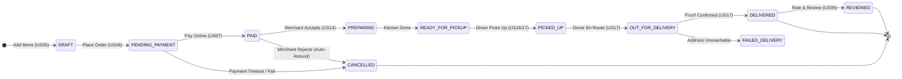

# FoodHub — System Acceptance Criteria Specification

> **Document Identifier:** `DOC-FOODHUB-06`  
> **System Name:** FoodHub Online Food Ordering & Delivery Platform  
> **Version:** 1.0.0  
> **Status:** Target V1 Baseline / Testable  
> **Specification Standard:** Behavior-Driven Development (BDD) — Gherkin Given/When/Then  
> **Related Document:** [05-user-stories-invest.md](file:///c:/Users/iDEAPAD/Downloads/t%C3%A9t/FoodHub/docs/05-user-stories-invest.md)

---

## 1. Specification Framework & Overview

This specification establishes the definitive acceptance criteria for all 20 user stories in the FoodHub product backlog. Each criterion is formulated in deterministic **Given/When/Then** syntax to serve as the contract between Product, Engineering, and Quality Assurance (QA).

### Scenario Coverage Standard
For every user story, criteria are partitioned into four mandatory quadrants:
1. **Happy Path:** The primary nominal flow culminating in successful execution.
2. **Field & Input Validation:** Client-side and server-side schema constraints, types, and boundary checks.
3. **Authorization & Access Control:** Role-Based Access Control (RBAC), multi-tenancy boundaries, and token state.
4. **Edge Cases & Failure Recovery:** Race conditions, concurrent updates, network timeouts, and idempotency locks.



---

## 2. Acceptance Criteria Master Index

| Story ID | Story Title | Total ACs | Happy Path | Validation | Authorization | Edge Cases |
|---|---|:---:|:---:|:---:|:---:|:---:|
| **US01** | Customer Registration | 4 | AC-01.1 | AC-01.2 | AC-01.3 | AC-01.4 |
| **US02** | User Login & Logout | 4 | AC-02.1 | AC-02.2 | AC-02.3 | AC-02.4 |
| **US03** | Browse Restaurants by Category | 4 | AC-03.1 | AC-03.2 | AC-03.3 | AC-03.4 |
| **US04** | Search & Filter Menu Items | 4 | AC-04.1 | AC-04.2 | AC-04.3 | AC-04.4 |
| **US05** | Add Menu Items to Cart | 4 | AC-05.1 | AC-05.2 | AC-05.3 | AC-05.4 |
| **US06** | Place Order & Checkout | 5 | AC-06.1 | AC-06.2 | AC-06.3 | AC-06.4, AC-06.5 |
| **US07** | Process Online Payment | 5 | AC-07.1 | AC-07.2 | AC-07.3 | AC-07.4, AC-07.5 |
| **US08** | Real-Time Order Tracking | 4 | AC-08.1 | AC-08.2 | AC-08.3 | AC-08.4 |
| **US09** | Rate & Review Restaurant | 4 | AC-09.1 | AC-09.2 | AC-09.3 | AC-09.4 |
| **US10** | View Order History & Reorder | 4 | AC-10.1 | AC-10.2 | AC-10.3 | AC-10.4 |
| **US11** | Manage Restaurant Menu Items | 4 | AC-11.1 | AC-11.2 | AC-11.3 | AC-11.4 |
| **US12** | Organize Menu Categories | 4 | AC-12.1 | AC-12.2 | AC-12.3 | AC-12.4 |
| **US13** | Set Live Restaurant Status | 4 | AC-13.1 | AC-13.2 | AC-13.3 | AC-13.4 |
| **US14** | Process Incoming Orders | 5 | AC-14.1 | AC-14.2 | AC-14.3 | AC-14.4, AC-14.5 |
| **US15** | View Merchant Revenue Reports | 4 | AC-15.1 | AC-15.2 | AC-15.3 | AC-15.4 |
| **US16** | Accept Delivery Assignments | 5 | AC-16.1 | AC-16.2 | AC-16.3 | AC-16.4, AC-16.5 |
| **US17** | Update Order Delivery Status | 5 | AC-17.1 | AC-17.2 | AC-17.3 | AC-17.4, AC-17.5 |
| **US18** | Manage Platform User Accounts | 4 | AC-18.1 | AC-18.2 | AC-18.3 | AC-18.4 |
| **US19** | Manage Discount Promotions | 5 | AC-19.1 | AC-19.2 | AC-19.3 | AC-19.4, AC-19.5 |
| **US20** | Manage Account Profile & Address | 4 | AC-20.1 | AC-20.2 | AC-20.3 | AC-20.4 |

---

## 3. Detailed Acceptance Criteria (US01 – US20)

---

### US01 — Customer Registration

#### AC-01.1: Successful Customer Registration (Happy Path)
* **Type:** Happy Path
* **Given** an unauthenticated visitor on the FoodHub registration endpoint `/api/v1/auth/register`
* **When** the visitor submits valid registration payload:
  * `fullName`: `"Johnathan Doe"`
  * `email`: `"john.doe@example.com"`
  * `phoneNumber`: `"+15550192834"` (valid E.164 standard)
  * `password`: `"SecureP@ssw0rd!2026"` (meets complexity rules)
* **Then** the platform responds with HTTP `201 Created`
* **And** creates a new user record with `role = ROLE_CUSTOMER` and `status = ACTIVE`
* **And** the password hash is persisted using bcrypt (cost factor $\ge 12$), never plain text
* **And** the response body returns the created user entity omitting sensitive fields:
  ```json
  {
    "userId": "usr_9b1deb4d3b7d",
    "fullName": "Johnathan Doe",
    "email": "john.doe@example.com",
    "phoneNumber": "+15550192834",
    "role": "ROLE_CUSTOMER",
    "status": "ACTIVE",
    "createdAt": "2026-10-30T07:30:00Z"
  }
  ```

#### AC-01.2: Registration Input Field Validation (Validation Error)
* **Type:** Validation Error
* **Given** an unauthenticated visitor on `/api/v1/auth/register`
* **When** the visitor submits a payload violating schema rules:
  * `email`: `"not-an-email"`
  * `password`: `"short"` (less than 8 characters, no special character or number)
  * `phoneNumber`: `"abc123"`
* **Then** the platform rejects the request with HTTP `422 Unprocessable Entity`
* **And** returns a standardized RFC 7807 validation error list:
  ```json
  {
    "type": "https://foodhub.com/errors/validation",
    "title": "Validation Failed",
    "status": 422,
    "errors": [
      { "field": "email", "message": "Email must be a valid email format." },
      { "field": "password", "message": "Password must be at least 8 characters and include 1 uppercase letter, 1 number, and 1 special symbol." },
      { "field": "phoneNumber", "message": "Phone number must follow valid E.164 international format." }
    ]
  }
  ```

#### AC-01.3: Duplicate Email or Phone Conflict (Edge Case)
* **Type:** Edge Case
* **Given** an existing active user registered with `email = "alice@example.com"` or `phoneNumber = "+15551234567"`
* **When** a prospective customer attempts to register using the identical email or phone number
* **Then** the platform aborts registration and returns HTTP `409 Conflict`
* **And** responds with error message: `{"code": "IDENTITY_ALREADY_EXISTS", "message": "An account with this email address or phone number already exists."}`
* **And** no duplicate database record is created.

#### AC-01.4: Role Injection Prevention (Authorization Check)
* **Type:** Authorization Check
* **Given** a malicious client submitting a registration payload containing `"role": "ROLE_ADMIN"` or `"role": "ROLE_RESTAURANT"`
* **When** the request is processed by `/api/v1/auth/register`
* **Then** the server ignores or rejects the client-provided `role` attribute
* **And** strictly assigns `ROLE_CUSTOMER` by default to all self-registered public accounts.

---

### US02 — User Login & Session Logout

#### AC-02.1: Successful Authentication & Token Issuance (Happy Path)
* **Type:** Happy Path
* **Given** an existing active user with `email = "customer@example.com"` and valid password
* **When** the user sends a POST request to `/api/v1/auth/login` with correct credentials
* **Then** the platform responds with HTTP `200 OK`
* **And** returns a signed JWT `accessToken` (valid for 15 minutes) containing `userId`, `role`, and token expiry
* **And** sets a cryptographically secure `refreshToken` (valid for 7 days) in an `HttpOnly`, `Secure`, `SameSite=Strict` cookie
* **And** returns user profile metadata and authorization scopes.

#### AC-02.2: Invalid Credentials & Anti-Enumeration (Validation & Security)
* **Type:** Validation Error
* **Given** an unauthenticated visitor on `/api/v1/auth/login`
* **When** the visitor submits an unregistered email OR an incorrect password for an existing account
* **Then** the platform responds with HTTP `401 Unauthorized`
* **And** returns a generic error response: `{"code": "INVALID_CREDENTIALS", "message": "Invalid email or password."}`
* **And** execution time is normalized to prevent timing-attack email enumeration.

#### AC-02.3: Inactive or Suspended Account Access (Authorization Check)
* **Type:** Authorization Check
* **Given** a user account with `status = "SUSPENDED"` in the database
* **When** the user submits correct email and password to `/api/v1/auth/login`
* **Then** the platform rejects the login with HTTP `403 Forbidden`
* **And** returns error message: `{"code": "ACCOUNT_SUSPENDED", "message": "Your account has been suspended. Please contact customer support."}`
* **And** no access or refresh tokens are issued.

#### AC-02.4: Session Logout & Token Revocation (Edge Case)
* **Type:** Edge Case
* **Given** an authenticated user holding a valid JWT `accessToken` and `refreshToken`
* **When** the user sends a POST request to `/api/v1/auth/logout`
* **Then** the platform responds with HTTP `204 No Content`
* **And** clears the `refreshToken` cookie on the client
* **And** writes the active `refreshToken` signature into the Redis token denylist with remaining TTL
* **And** any subsequent attempt to exchange the revoked refresh token returns HTTP `401 Unauthorized`.

---

### US03 — Browse Restaurants by Category

#### AC-03.1: Paginated Category Restaurant Listing (Happy Path)
* **Type:** Happy Path
* **Given** active restaurants categorized under `"Italian"` (`categoryId = "cat_ita_123"`)
* **When** a customer requests `GET /api/v1/restaurants?category=cat_ita_123&page=1&limit=10`
* **Then** the system returns HTTP `200 OK`
* **And** returns a paginated list of matching restaurants with fields:
  * `id`, `name`, `bannerUrl`, `averageRating`, `deliveryFee`, `estimatedDeliveryMinutes`, `isOpen`
* **And** the `pagination` metadata accurately reports `currentPage: 1`, `pageSize: 10`, `totalItems`, and `totalPages`.

#### AC-03.2: Filter by Inactive or Non-Existent Category (Validation Error)
* **Type:** Validation Error
* **Given** an invalid category identifier `category = "non_existent_id"`
* **When** a customer requests `GET /api/v1/restaurants?category=non_existent_id`
* **Then** the system returns HTTP `404 Not Found`
* **And** returns error body: `{"code": "CATEGORY_NOT_FOUND", "message": "The specified category was not found."}`.

#### AC-03.3: Inactive and Unapproved Merchant Filtering (Authorization & Integrity)
* **Type:** Authorization Check
* **Given** restaurants in the database with `approvalStatus = "PENDING"` or `isDeleted = true`
* **When** a customer queries the public restaurant catalog
* **Then** unapproved and soft-deleted restaurants are strictly excluded from the result set
* **And** only restaurants with `approvalStatus = "APPROVED"` and `isDeleted = false` are returned.

#### AC-03.4: Real-time Operational Status Display (Edge Case)
* **Type:** Edge Case
* **Given** an approved restaurant that has set its status to `CLOSED` via US13
* **When** customers browse the restaurant list
* **Then** the restaurant appears with `isOpen = false`
* **And** the UI visually disables direct ordering buttons while allowing customers to view the menu.

---

### US04 — Search & Filter Menu Items

#### AC-04.1: Keyword Search with Multi-Attribute Filters (Happy Path)
* **Type:** Happy Path
* **Given** multiple restaurants offering dishes matching `"Pizza"`
* **When** a customer searches `GET /api/v1/menu-items/search?q=pizza&minPrice=1000&maxPrice=2500&isVegetarian=true&minRating=4`
* **Then** the platform returns HTTP `200 OK`
* **And** results contain only menu items where:
  * Item name or description contains `"pizza"` (case-insensitive)
  * Price is between 10.00 and 25.00
  * Dietary flag `isVegetarian == true`
  * Associated restaurant average rating $\ge 4.0$
* **And** matching keywords are highlighted in search snippets.

#### AC-04.2: Invalid Filter Range Validation (Validation Error)
* **Type:** Validation Error
* **Given** a customer submitting negative or inverted price parameters
* **When** the customer requests `GET /api/v1/menu-items/search?minPrice=3000&maxPrice=1000`
* **Then** the platform responds with HTTP `400 Bad Request`
* **And** returns error message: `{"code": "INVALID_PRICE_RANGE", "message": "minPrice cannot exceed maxPrice."}`.

#### AC-04.3: SQL & Special Character Sanitization (Security / Authorization)
* **Type:** Authorization Check
* **Given** a query string containing potential injection payloads: `q="'; DROP TABLE menu_items; --"`
* **When** the search endpoint executes
* **Then** the input is safely parameterized and escaped by the query builder
* **And** returns HTTP `200 OK` with an empty result array (`items: []`) without executing raw SQL.

#### AC-04.4: Zero Search Matches Fallback (Edge Case)
* **Type:** Edge Case
* **Given** a search query with no matching items across the catalog (e.g. `q="qwertyuiopxyz"`)
* **When** the customer submits the query
* **Then** the system returns HTTP `200 OK` with `totalResults: 0`
* **And** includes an optional `recommendedCategories` array suggesting popular food tags to prevent dead ends.

---

### US05 — Add Menu Items to Cart

#### AC-05.1: Add Available Item with Modifiers to Cart (Happy Path)
* **Type:** Happy Path
* **Given** an authenticated or guest customer with an empty cart
* **And** a restaurant `"Burger Bros"` (`restaurantId = "rest_001"`) with available item `"Classic Cheeseburger"` ($8.50)
* **When** the customer adds item with option `"Extra Cheese"` ($1.50) and `quantity = 2`
* **Then** the platform responds with HTTP `200 OK`
* **And** cart state is persisted with line item total $= 2 \times (8.50 + 1.50) = 20.00$
* **And** cart summary reflects:
  * `restaurantId`: `"rest_001"`
  * `totalQuantity`: 2
  * `subtotal`: 2000 (in cents)

#### AC-05.2: Multi-Restaurant Cart Conflict Guard (Edge Case & Validation)
* **Type:** Edge Case
* **Given** a customer cart containing items from `"Burger Bros"` (`restaurantId = "rest_001"`)
* **When** the customer attempts to add an item belonging to `"Pizza Palace"` (`restaurantId = "rest_002"`)
* **Then** the platform rejects the addition with HTTP `409 Conflict`
* **And** returns error payload:
  ```json
  {
    "code": "MULTI_RESTAURANT_CONFLICT",
    "message": "Your cart contains items from another restaurant. Would you like to clear your cart and start a new order?",
    "currentRestaurant": { "id": "rest_001", "name": "Burger Bros" },
    "newRestaurant": { "id": "rest_002", "name": "Pizza Palace" }
  }
  ```

#### AC-05.3: Sold-Out Item Addition (Validation Error)
* **Type:** Validation Error
* **Given** a menu item with `isAvailable = false` or inventory count $= 0$
* **When** the customer attempts to add the item to their cart
* **Then** the platform responds with HTTP `400 Bad Request`
* **And** returns error message: `{"code": "ITEM_UNAVAILABLE", "message": "This item is currently sold out and cannot be added to the cart."}`.

#### AC-05.4: Quantity Limits Enforcement (Validation Error)
* **Type:** Validation Error
* **Given** a customer modifying item quantity in their cart
* **When** the customer specifies `quantity = 0` OR `quantity = 100` (exceeding maximum single order limit of 50)
* **Then** `quantity = 0` deletes the item from the cart with HTTP `200 OK`
* **And** `quantity > 50` is rejected with HTTP `422 Unprocessable Entity` (`"Maximum allowable quantity per item is 50."`).

---

### US06 — Place Order & Checkout

#### AC-06.1: Successful Order Placement (Happy Path)
* **Type:** Happy Path
* **Given** an authenticated customer with a cart totaling $25.00 from open restaurant `"Taco Town"`
* **When** the customer submits `POST /api/v1/orders/checkout` with:
  * `deliveryAddressId`: `"addr_home_1"` (within 10km delivery radius)
  * `contactPhone`: `"+15559876543"`
  * `deliveryNotes`: `"Leave at front door ring bell"`
  * `paymentMethod`: `"CREDIT_CARD"`
* **Then** the system responds with HTTP `201 Created`
* **And** creates an `Order` record with status `PENDING_PAYMENT`
* **And** snapshots all item titles, selected modifier options, and unit prices into `order_items`
* **And** calculates:
  * `subtotal`: $25.00
  * `deliveryFee`: $3.50
  * `taxAmount`: $2.28 (8% tax)
  * `platformFee`: $1.00
  * `totalAmount`: $31.78
* **And** empties the customer's active shopping cart.

#### AC-06.2: Restaurant Minimum Order Amount Violation (Validation Error)
* **Type:** Validation Error
* **Given** a restaurant with `minOrderAmount = 20.00`
* **And** a customer cart with `subtotal = 14.50`
* **When** the customer calls `/api/v1/orders/checkout`
* **Then** the platform rejects checkout with HTTP `400 Bad Request`
* **And** returns error body:
  ```json
  {
    "code": "MINIMUM_ORDER_NOT_MET",
    "message": "Order subtotal ($14.50) is below the restaurant minimum order amount ($20.00).",
    "shortfall": 550
  }
  ```

#### AC-06.3: Unauthenticated Checkout Attempt (Authorization Check)
* **Type:** Authorization Check
* **Given** an anonymous/unauthenticated guest visitor
* **When** the visitor submits a checkout request to `POST /api/v1/orders/checkout`
* **Then** the platform responds with HTTP `401 Unauthorized`
* **And** redirects or instructs client: `{"code": "AUTHENTICATION_REQUIRED", "message": "Please log in to complete your order."}`.

#### AC-06.4: Restaurant Closed During Checkout (Edge Case)
* **Type:** Edge Case
* **Given** a customer assembling an order while a restaurant is `OPEN`
* **And** the restaurant owner switches status to `CLOSED` before the customer submits checkout
* **When** the customer clicks "Place Order"
* **Then** checkout is rejected with HTTP `409 Conflict`
* **And** returns error: `{"code": "RESTAURANT_NOW_CLOSED", "message": "This restaurant just closed and is no longer accepting new orders."}`
* **And** no order is created and no payment intent is generated.

#### AC-06.5: Dynamic Price Change Concurrency Check (Edge Case)
* **Type:** Edge Case
* **Given** an item added to cart at $10.00
* **And** the restaurant owner updates the item price to $14.00 while the customer is on checkout screen
* **When** the customer submits the order
* **Then** the system detects price disparity, rejects order placement with HTTP `409 Conflict`
* **And** updates the cart with current pricing, prompting user: `"Item prices have changed. Please review your updated total before placing order."`.

---

### US07 — Process Online Payment

#### AC-07.1: Successful Payment Processing & Order Confirmation (Happy Path)
* **Type:** Happy Path
* **Given** an order in `PENDING_PAYMENT` with `totalAmount = $31.78`
* **When** the client submits a valid payment token (`tok_visa_success`) to `/api/v1/payments/process`
* **Then** the payment gateway adapter executes successfully
* **And** the platform responds with HTTP `200 OK`
* **And** updates order status to `PAID`
* **And** records transaction reference, payment provider (`STRIPE`), and `paidAt` timestamp
* **And** dispatches `OrderPaidEvent` to alert the restaurant kitchen.

#### AC-07.2: Card Decline & Insufficient Funds (Validation / Gateway Error)
* **Type:** Validation Error
* **Given** an order in `PENDING_PAYMENT`
* **When** the customer's card is declined by the gateway due to insufficient funds (`card_declined / insufficient_funds`)
* **Then** the platform responds with HTTP `402 Payment Required`
* **And** leaves the order in `PENDING_PAYMENT`
* **And** returns error message: `{"code": "PAYMENT_DECLINED", "message": "Card was declined due to insufficient funds. Please try another card."}`.

#### AC-07.3: Idempotency Key Duplicate Submission Guard (Edge Case & Security)
* **Type:** Edge Case
* **Given** a customer submitting payment with header `Idempotency-Key: idemp_991823abce`
* **When** a network hiccup causes the client or an attacker to transmit the exact same request twice
* **Then** the platform recognizes the processed idempotency key in cache
* **And** returns the cached HTTP `200 OK` payment confirmation without executing a secondary charge on the customer's card.

#### AC-07.4: Payment Authorization Ownership Check (Authorization Check)
* **Type:** Authorization Check
* **Given** an order owned by `customerId = "usr_001"`
* **When** an authenticated user with `customerId = "usr_999"` attempts to execute payment on that order
* **Then** the platform returns HTTP `403 Forbidden`
* **And** error message: `{"code": "FORBIDDEN_ORDER_ACCESS", "message": "You are not authorized to pay for this order."}`.

#### AC-07.5: Gateway Webhook Verification & Asynchronous State Sync (Edge Case)
* **Type:** Edge Case
* **Given** a customer completing 3D Secure verification on external bank portal
* **When** the payment gateway sends a signed webhook event `payment_intent.succeeded` to `/api/v1/webhooks/stripe`
* **Then** the system verifies the webhook HMAC-SHA256 signature against webhook secret
* **And** atomically transitions the order status to `PAID` if not already updated
* **And** responds to gateway with HTTP `200 OK` within $1.5\text{ seconds}$.

---

### US08 — Real-Time Order Tracking

#### AC-08.1: Live WebSocket Milestone Progression (Happy Path)
* **Type:** Happy Path
* **Given** an authenticated customer who owns `orderId = "ord_555"`
* **When** the customer connects to WebSocket channel `/ws/v1/orders/ord_555` with valid Bearer token
* **Then** connection is established with HTTP `101 Switching Protocols`
* **And** as the restaurant and driver update order status, client receives instantaneous JSON events:
  ```json
  {
    "event": "STATUS_CHANGED",
    "orderId": "ord_555",
    "status": "PREPARING",
    "estimatedDeliveryTime": "2026-10-30T08:15:00Z"
  }
  ```

#### AC-08.2: Live Driver GPS Telemetry Stream (Happy Path / Feature)
* **Type:** Happy Path
* **Given** an order with status `OUT_FOR_DELIVERY` assigned to a driver
* **When** the driver's device publishes GPS coordinates
* **Then** the customer receives throttled coordinate updates (every 5 seconds) over the WebSocket channel:
  ```json
  {
    "event": "COURIER_LOCATION",
    "latitude": 37.774929,
    "longitude": -122.419416,
    "bearing": 182.5,
    "etaMinutes": 8
  }
  ```

#### AC-08.3: Unauthorized Channel Subscription (Authorization Check)
* **Type:** Authorization Check
* **Given** an order owned by customer A
* **When** customer B attempts to subscribe to customer A's tracking channel or request `GET /api/v1/orders/{orderA}/track`
* **Then** the system closes the WebSocket with error code `4403 Forbidden` or responds HTTP `403 Forbidden`
* **And** logs a security violation attempt.

#### AC-08.4: WebSocket Disconnection Fallback to Polling (Edge Case)
* **Type:** Edge Case
* **Given** a customer tracking an order experiencing intermittent mobile network disconnection
* **When** the WebSocket client disconnects and fails to reconnect after 3 attempts
* **Then** the client application automatically falls back to HTTP polling `GET /api/v1/orders/{id}/status` every 10 seconds
* **And** gracefully renders milestone progress without crashing or showing error dialogs.

---

### US09 — Rate & Review Restaurant

#### AC-09.1: Submit Valid Rating and Review (Happy Path)
* **Type:** Happy Path
* **Given** an authenticated customer who placed an order that reached `status = "DELIVERED"` 2 hours ago
* **When** the customer submits `POST /api/v1/orders/ord_555/reviews` with:
  * `rating`: 5 (integer between 1 and 5)
  * `comment`: `"Food arrived piping hot and tacos were amazing!"`
  * `photoUrls`: `["https://cdn.foodhub.com/reviews/rev1.jpg"]` (max 3 valid URLs)
* **Then** the platform responds with HTTP `201 Created`
* **And** persists the review linked to the restaurant and order
* **And** triggers asynchronous recalculation of `restaurants.averageRating` and `reviewCount`.

#### AC-09.2: Rating Scale Boundary Validation (Validation Error)
* **Type:** Validation Error
* **Given** an eligible customer reviewing an order
* **When** the customer submits `rating = 6` OR `rating = 0` OR `comment` exceeding 500 characters
* **Then** the platform rejects submission with HTTP `422 Unprocessable Entity`
* **And** returns error message: `{"code": "INVALID_RATING", "message": "Rating must be an integer between 1 and 5. Comment must not exceed 500 characters."}`.

#### AC-09.3: Review Ineligible or Incomplete Order (Authorization Check)
* **Type:** Authorization Check
* **Given** an order with status `PREPARING` or `CANCELLED`
* **When** the customer attempts to submit a review for that order
* **Then** the platform rejects the request with HTTP `400 Bad Request`
* **And** returns error: `{"code": "ORDER_NOT_DELIVERED", "message": "You can only rate and review orders that have been successfully delivered."}`.

#### AC-09.4: Duplicate Review Prevention (Edge Case)
* **Type:** Edge Case
* **Given** an order that has already been reviewed by the customer
* **When** the customer attempts to submit a second review for the identical `orderId`
* **Then** the system returns HTTP `409 Conflict`
* **And** returns error message: `{"code": "REVIEW_ALREADY_EXISTS", "message": "You have already submitted a review for this order."}`.

---

### US10 — View Order History & Reorder

#### AC-10.1: Paginated Customer Order History (Happy Path)
* **Type:** Happy Path
* **Given** an authenticated customer who has placed 15 previous orders
* **When** the customer requests `GET /api/v1/orders/history?page=1&limit=5`
* **Then** the platform responds with HTTP `200 OK`
* **And** returns the 5 most recent orders sorted by `createdAt DESC`
* **And** each record includes `orderId`, `restaurantName`, `orderStatus`, `totalAmount`, `itemCount`, and `thumbnailUrl`.

#### AC-10.2: Reorder All Available Items to Cart (Happy Path)
* **Type:** Happy Path
* **Given** a historical order containing 2 dishes that are currently active and available at the restaurant
* **When** the customer clicks `"Reorder"` (`POST /api/v1/orders/{id}/reorder`)
* **Then** the platform fetches current prices, clears any existing cart, populates the cart with the 2 dishes
* **And** returns HTTP `200 OK` with redirect instruction to checkout.

#### AC-10.3: Cross-Customer Order Isolation (Authorization Check)
* **Type:** Authorization Check
* **Given** Customer A (`userId = "usr_001"`) and Customer B (`userId = "usr_002"`)
* **When** Customer A attempts to view details of Customer B's order `GET /api/v1/orders/ord_cust_B`
* **Then** the system returns HTTP `404 Not Found` (or `403 Forbidden`)
* **And** prevents disclosure of Customer B's food choices, address, or payment records.

#### AC-10.4: Reorder with Discontinued Items (Edge Case)
* **Type:** Edge Case
* **Given** a past order containing 3 items, where 1 item has since been deleted or marked `isAvailable = false`
* **When** the customer invokes `"Reorder"`
* **Then** the platform adds the 2 available items to the cart
* **And** returns HTTP `200 OK` with an informational warning:
  ```json
  {
    "cartId": "crt_123",
    "addedCount": 2,
    "omittedItems": [
      { "name": "Seasonal Truffle Fries", "reason": "Item no longer available." }
    ]
  }
  ```

---

### US11 — Manage Restaurant Menu Items

#### AC-11.1: Create New Menu Item (Happy Path)
* **Type:** Happy Path
* **Given** an authenticated Restaurant Owner for `"Sushi Central"` (`restaurantId = "rest_007"`)
* **When** the owner submits `POST /api/v1/merchant/menu-items` with:
  * `categoryId`: `"cat_rolls_1"`
  * `name`: `"Dragon Roll"`
  * `description`: `"Eel, avocado, crab stick, eel sauce"`
  * `price`: 1450 (cents = $14.50)
  * `imageUrl`: `"https://cdn.foodhub.com/menu/dragon.jpg"`
  * `isAvailable`: true
* **Then** the system returns HTTP `201 Created`
* **And** assigns `itemId = "itm_drag_123"` tied to `restaurantId = "rest_007"`.

#### AC-11.2: Menu Item Price Boundary Validation (Validation Error)
* **Type:** Validation Error
* **Given** an authenticated Restaurant Owner
* **When** the owner submits a new or updated item with `price = 0` OR `price = -500` OR empty `name`
* **Then** the system responds with HTTP `422 Unprocessable Entity`
* **And** returns error message: `{"code": "INVALID_MENU_PRICE", "message": "Price must be a positive integer greater than zero."}`.

#### AC-11.3: Tenant Ownership Boundary Enforcement (Authorization Check)
* **Type:** Authorization Check
* **Given** Owner A of Restaurant A and an existing item owned by Restaurant B (`itemId = "itm_rest_B"`)
* **When** Owner A attempts to update or delete `itm_rest_B` via `PUT /api/v1/merchant/menu-items/itm_rest_B`
* **Then** the platform rejects the mutation with HTTP `403 Forbidden`
* **And** returns error: `{"code": "TENANT_ACCESS_DENIED", "message": "You do not own this menu item."}`.

#### AC-11.4: Safe Soft-Deletion with Historic Integrity (Edge Case)
* **Type:** Edge Case
* **Given** a menu item that was ordered in 50 past historical transactions
* **When** the restaurant owner clicks "Delete Item" (`DELETE /api/v1/merchant/menu-items/{id}`)
* **Then** the database flags `isDeleted = true` and `isAvailable = false`
* **And** removes the item from the public customer menu
* **And** preserves foreign key links in `order_items` so historic financial reports remain intact.

---

### US12 — Organize Menu Categories

#### AC-12.1: Create and Order Categories (Happy Path)
* **Type:** Happy Path
* **Given** an authenticated Restaurant Owner
* **When** the owner submits `POST /api/v1/merchant/categories` with `name = "Signature Cocktails"` and `displayOrder = 3`
* **Then** the platform responds with HTTP `201 Created`
* **And** the category is saved under the owner's `restaurantId`
* **And** customer menu rendering places "Signature Cocktails" in sequence index 3.

#### AC-12.2: Duplicate Category Name within Same Merchant (Validation Error)
* **Type:** Validation Error
* **Given** an existing category `"Desserts"` under Restaurant A
* **When** Owner A attempts to create a second category with `name = "Desserts"` (case-insensitive)
* **Then** the platform returns HTTP `409 Conflict`
* **And** responds with: `{"code": "DUPLICATE_CATEGORY", "message": "A category with this name already exists in your restaurant."}`.

#### AC-12.3: Non-Owner Category Manipulation (Authorization Check)
* **Type:** Authorization Check
* **Given** a user authenticated as `ROLE_CUSTOMER` or `ROLE_SHIPPER`
* **When** they make a request to `POST /api/v1/merchant/categories`
* **Then** the API gateway returns HTTP `403 Forbidden`.

#### AC-12.4: Delete Non-Empty Category Safety Lock (Edge Case)
* **Type:** Edge Case
* **Given** a category `"Appetizers"` currently containing 6 active menu items
* **When** the restaurant owner attempts to delete the category without specifying a reassignment strategy
* **Then** the system rejects deletion with HTTP `400 Bad Request`
* **And** returns: `{"code": "CATEGORY_NOT_EMPTY", "message": "Cannot delete category containing 6 items. Please reassign or delete items first."}`.

---

### US13 — Set Live Restaurant Status

#### AC-13.1: Switch Restaurant Status to Open/Closed (Happy Path)
* **Type:** Happy Path
* **Given** an authenticated Restaurant Owner of `"Pasta Pronto"`
* **When** the owner sends `PATCH /api/v1/merchant/restaurant/status` with `{"status": "OPEN"}`
* **Then** the system updates `restaurants.status = "OPEN"`
* **And** invalidates cached customer restaurant lists within 500ms
* **And** returns HTTP `200 OK` with updated operational state.

#### AC-13.2: Unsupported Status Value Rejection (Validation Error)
* **Type:** Validation Error
* **Given** an authenticated Restaurant Owner
* **When** the owner submits `PATCH /api/v1/merchant/restaurant/status` with `{"status": "VACATIONING"}`
* **Then** the system returns HTTP `422 Unprocessable Entity`
* **And** error message: `{"code": "INVALID_STATUS_ENUM", "message": "Status must be one of: OPEN, CLOSED, BUSY."}`.

#### AC-13.3: Cross-Restaurant Status Mutation Block (Authorization Check)
* **Type:** Authorization Check
* **Given** Restaurant Owner of Restaurant A
* **When** they send a status change payload targeted to `restaurantId = "rest_B"`
* **Then** the system checks token claims and returns HTTP `403 Forbidden`.

#### AC-13.4: Switching to BUSY Automatically Adjusts Prep Times (Edge Case)
* **Type:** Edge Case
* **Given** a restaurant currently in `OPEN` status with a default prep time of 25 minutes
* **When** the owner switches status to `BUSY`
* **Then** the platform responds with HTTP `200 OK`
* **And** automatically adds a $+20\text{ min}$ buffer to all customer-facing estimated preparation times (displaying 45 mins)
* **And** displays a "Kitchen is busy" badge on the customer restaurant card.

---

### US14 — Process Incoming Orders

#### AC-14.1: Merchant Accepts Order with Custom Prep Time (Happy Path)
* **Type:** Happy Path
* **Given** an order in `PAID` status awaiting kitchen confirmation
* **When** the restaurant owner submits `POST /api/v1/merchant/orders/ord_123/accept` with `{"prepTimeMinutes": 30}`
* **Then** the system transitions order status to `PREPARING`
* **And** stores calculated `readyForPickupAt = now() + 30 minutes`
* **And** triggers WebSocket status update to customer
* **And** broadcasts delivery job to the driver matching engine.

#### AC-14.2: Merchant Rejects Order with Mandatory Reason (Happy Path & Refund)
* **Type:** Happy Path / Exception
* **Given** an incoming order in `PAID` status
* **When** the restaurant owner rejects the order via `POST /api/v1/merchant/orders/ord_123/reject` with:
  * `reasonCode`: `"KITCHEN_OVERLOADED"`
  * `rejectionNote`: `"Unable to fulfill large catering order during peak rush."`
* **Then** the platform transitions order status to `CANCELLED`
* **And** automatically initiates a full 100% refund via the payment gateway
* **And** sends push/SMS notification to the customer with the cancellation reason.

#### AC-14.3: Missing Rejection Reason (Validation Error)
* **Type:** Validation Error
* **Given** an incoming order awaiting acceptance
* **When** the owner attempts to reject without providing a `reasonCode`
* **Then** the system returns HTTP `422 Unprocessable Entity`
* **And** returns error message: `{"code": "REASON_REQUIRED", "message": "A valid reasonCode is mandatory when rejecting an order."}`.

#### AC-14.4: Unauthorized Kitchen Confirmation (Authorization Check)
* **Type:** Authorization Check
* **Given** an order placed at Restaurant X
* **When** Restaurant Owner Y submits an accept or reject request for Restaurant X's order
* **Then** the system responds with HTTP `403 Forbidden`.

#### AC-14.5: Auto-Cancellation on Kitchen Inactivity Timeout (Edge Case)
* **Type:** Edge Case
* **Given** an order in `PAID` status that has not been accepted or rejected within 10 minutes of placement
* **When** the background order watchdog cron executes
* **Then** the system marks the order `CANCELLED_TIMEOUT`
* **And** triggers an automated full refund to customer
* **And** issues a merchant penalty warning flag in the admin audit log.

---

### US15 — View Merchant Revenue Reports

#### AC-15.1: Date-Filtered Financial Settlement Summary (Happy Path)
* **Type:** Happy Path
* **Given** an authenticated Restaurant Owner
* **When** the owner requests `GET /api/v1/merchant/reports/revenue?startDate=2026-10-01&endDate=2026-10-25`
* **Then** the system returns HTTP `200 OK`
* **And** calculates aggregates across all `DELIVERED` orders in that range:
  * `grossSales`: Total order item values
  * `platformCommission`: FoodHub commission deduction (e.g. 15%)
  * `netPayout`: `grossSales - platformCommission`
  * `totalCompletedOrders`: Integer count
  * `averageOrderValue`: `grossSales / totalCompletedOrders`
* **And** provides a daily time-series array for chart rendering.

#### AC-15.2: Inverted Date Range Validation (Validation Error)
* **Type:** Validation Error
* **Given** an authenticated Restaurant Owner
* **When** the owner requests `GET /api/v1/merchant/reports/revenue?startDate=2026-10-30&endDate=2026-10-01`
* **Then** the system returns HTTP `400 Bad Request`
* **And** error message: `{"code": "INVALID_DATE_RANGE", "message": "startDate must precede or equal endDate."}`.

#### AC-15.3: Cross-Merchant Financial Privacy (Authorization Check)
* **Type:** Authorization Check
* **Given** Owner A of Restaurant A
* **When** Owner A attempts to query revenue parameters for `restaurantId = "rest_B"`
* **Then** the system returns HTTP `403 Forbidden`
* **And** ensures merchant financials remain strictly segregated.

#### AC-15.4: Zero Orders in Date Range (Edge Case)
* **Type:** Edge Case
* **Given** a newly onboarded restaurant with 0 completed orders
* **When** the owner views the revenue dashboard
* **Then** the system returns HTTP `200 OK` with zeroed metrics:
  ```json
  {
    "grossSales": 0,
    "platformCommission": 0,
    "netPayout": 0,
    "totalCompletedOrders": 0,
    "averageOrderValue": 0,
    "dailyBreakdown": []
  }
  ```
* **And** the UI displays an empty-state illustration without divide-by-zero errors.

---

### US16 — Accept Delivery Assignments

#### AC-16.1: Shipper Claims Available Delivery Assignment (Happy Path)
* **Type:** Happy Path
* **Given** an authenticated and online Delivery Driver (`status = ONLINE`, `activeDeliveriesCount = 0`)
* **And** an order `ord_777` in the open delivery pool (`status = READY_FOR_PICKUP`, `deliveryStatus = UNASSIGNED`)
* **When** the driver sends `POST /api/v1/shipper/deliveries/ord_777/accept`
* **Then** the system atomically updates the order with `driverId = authenticated_driver_id`
* **And** transitions `deliveryStatus = ASSIGNED`
* **And** returns HTTP `200 OK` with restaurant address, customer delivery coordinates, and estimated driver earnings ($4.75).

#### AC-16.2: Concurrent Driver Acceptance Race Condition (Edge Case & Concurrency)
* **Type:** Edge Case
* **Given** an open order `ord_777` broadcasted to multiple nearby drivers
* **When** Driver 1 and Driver 2 both click "Accept Delivery" at the exact same millisecond
* **Then** the database executes an atomic conditional update (`UPDATE ... WHERE delivery_status = 'UNASSIGNED'`)
* **And** Driver 1 receives HTTP `200 OK` and claims the assignment
* **And** Driver 2 receives HTTP `409 Conflict` with message: `{"code": "ORDER_ALREADY_CLAIMED", "message": "This delivery has already been accepted by another driver."}`.

#### AC-16.3: Maximum In-Flight Deliveries Exceeded (Validation / Business Rule)
* **Type:** Validation Error
* **Given** a driver currently managing 2 active deliveries (system capacity cap = 2)
* **When** the driver attempts to accept a 3rd delivery
* **Then** the system rejects acceptance with HTTP `422 Unprocessable Entity`
* **And** returns error: `{"code": "DELIVERY_CAP_EXCEEDED", "message": "You cannot accept more than 2 active deliveries concurrently."}`.

#### AC-16.4: Unverified or Suspended Shipper Access (Authorization Check)
* **Type:** Authorization Check
* **Given** a user account with role `ROLE_SHIPPER` but `driverVerificationStatus = "PENDING_BACKGROUND_CHECK"`
* **When** the user attempts to view or accept deliveries
* **Then** the system rejects access with HTTP `403 Forbidden`
* **And** returns: `{"code": "DRIVER_UNVERIFIED", "message": "Your driver account documents are pending administrative verification."}`.

#### AC-16.5: Expired Broadcast Handling (Edge Case)
* **Type:** Edge Case
* **Given** an order offered as a direct dispatch job with a 45-second timer
* **When** a driver clicks "Accept" at second 46
* **Then** the system returns HTTP `410 Gone` with message: `"Delivery offer expired and has been redistributed."`.

---

### US17 — Update Order Delivery Status

#### AC-17.1: Sequential Milestone State Transitions (Happy Path)
* **Type:** Happy Path
* **Given** a delivery assigned to Driver D (`deliveryStatus = ASSIGNED`)
* **When** the driver reaches the merchant and clicks "Arrived at Restaurant" (`POST /status` with `ARRIVED_AT_REST`)
* **And** after collecting food clicks "Picked Up" (`PICKED_UP`)
* **And** reaches drop-off and clicks "Delivered" (`DELIVERED`) with customer signature/photo
* **Then** each milestone transition responds with HTTP `200 OK`
* **And** the customer and merchant receive instant status updates
* **And** upon `DELIVERED`, the driver's digital wallet is immediately credited with the delivery fee.

#### AC-17.2: Invalid Out-of-Order Transition (Validation / State Machine)
* **Type:** Validation Error
* **Given** an order currently at `deliveryStatus = ASSIGNED` (food still at kitchen)
* **When** the driver attempts to skip directly to `deliveryStatus = DELIVERED`
* **Then** the system rejects the update with HTTP `422 Unprocessable Entity`
* **And** returns error: `{"code": "INVALID_STATUS_TRANSITION", "message": "Cannot transition directly from ASSIGNED to DELIVERED. Food must be marked PICKED_UP first."}`.

#### AC-17.3: Mutating Another Driver's Delivery (Authorization Check)
* **Type:** Authorization Check
* **Given** Order A assigned to Driver A
* **When** Driver B sends a request to update Order A's delivery status
* **Then** the system rejects the mutation with HTTP `403 Forbidden`
* **And** returns: `{"code": "NOT_ASSIGNED_DRIVER", "message": "You are not the designated driver for this order."}`.

#### AC-17.4: Mandatory Proof of Delivery on Completion (Validation Error)
* **Type:** Validation Error
* **Given** an order at `OUT_FOR_DELIVERY`
* **When** the driver attempts to submit status `DELIVERED` without attaching a proof photo or recipient signature token
* **Then** the platform returns HTTP `422 Unprocessable Entity`
* **And** error message: `{"code": "PROOF_OF_DELIVERY_REQUIRED", "message": "A photo or customer confirmation PIN is required to complete delivery."}`.

#### AC-17.5: Failed Delivery Exception Handling (Edge Case)
* **Type:** Edge Case
* **Given** a driver who arrived at the customer delivery address but customer is unreachable after 3 phone calls and a 10-minute wait
* **When** the driver submits `POST /api/v1/shipper/deliveries/{id}/status` with `status = FAILED_DELIVERY` and `reason = "CUSTOMER_UNREACHABLE"`
* **Then** the system transitions order status to `DELIVERY_FAILED`
* **And** prompts driver with return-to-restaurant instructions
* **And** dispatches an urgent ticket to customer support.

---

### US18 — Manage Platform User Accounts

#### AC-18.1: Search and Filter Users Across Roles (Happy Path)
* **Type:** Happy Path
* **Given** an authenticated Administrator (`ROLE_ADMIN`)
* **When** the admin requests `GET /api/v1/admin/users?role=ROLE_SHIPPER&status=ACTIVE&search=smith&page=1&limit=20`
* **Then** the platform responds with HTTP `200 OK`
* **And** returns a paginated list of matching driver accounts with `userId`, `fullName`, `email`, `createdAt`, `lastLoginAt`, and `status`.

#### AC-18.2: Suspend User Account with Reason (Happy Path & Governance)
* **Type:** Happy Path
* **Given** an authenticated Administrator
* **When** the admin submits `PATCH /api/v1/admin/users/usr_suspect_1/status` with:
  * `status`: `"SUSPENDED"`
  * `reason`: `"Chargeback fraud investigation ticket #49102"`
* **Then** the system returns HTTP `200 OK`
* **And** revokes all active JWT tokens for that user in Redis
* **And** records an entry in `admin_audit_logs` capturing admin ID, target user ID, timestamp, and reason.

#### AC-18.3: Non-Admin Access Prevention (Authorization Check)
* **Type:** Authorization Check
* **Given** a user logged in with `ROLE_CUSTOMER` or `ROLE_RESTAURANT`
* **When** they make any request to `/api/v1/admin/**`
* **Then** the system rejects the request immediately with HTTP `403 Forbidden`
* **And** writes an intrusion warning to the security event stream.

#### AC-18.4: Administrator Self-Lockout Prevention (Edge Case)
* **Type:** Edge Case
* **Given** an authenticated Administrator logged in as `usr_admin_master`
* **When** the administrator inadvertently attempts to set their own account status to `SUSPENDED` or delete their account
* **Then** the platform rejects the action with HTTP `400 Bad Request`
* **And** returns error message: `{"code": "CANNOT_MODIFY_SELF", "message": "Administrators cannot suspend or delete their own active account."}`.

---

### US19 — Manage Discount Promotions

#### AC-19.1: Create Fixed/Percentage Promo Code (Happy Path)
* **Type:** Happy Path
* **Given** an authenticated Administrator
* **When** the admin creates a promotion via `POST /api/v1/admin/promotions`:
  * `code`: `"WELCOME50"`
  * `discountType`: `"PERCENTAGE"`
  * `discountValue`: 50
  * `maxDiscountAmount`: 1000 (cents = $10.00 max discount)
  * `minOrderAmount`: 2000 (cents = $20.00 min order)
  * `startDate`: `"2026-11-01T00:00:00Z"`
  * `endDate`: `"2026-11-30T23:59:59Z"`
  * `totalUsageLimit`: 1000
  * `perUserLimit`: 1
* **Then** the platform responds with HTTP `201 Created`
* **And** the promotion is stored in uppercase and ready for customer validation.

#### AC-19.2: Duplicate Promo Code Creation (Validation Error)
* **Type:** Validation Error
* **Given** an existing active promotion with `code = "WELCOME50"`
* **When** an admin attempts to create another promotion with `code = "welcome50"`
* **Then** the platform rejects creation with HTTP `409 Conflict`
* **And** returns: `{"code": "PROMO_CODE_EXISTS", "message": "A promotion with this code already exists."}`.

#### AC-19.3: Promotion Application Authorization (Authorization Check)
* **Type:** Authorization Check
* **Given** a promotion restricted to first-time customers (`firstOrderOnly = true`)
* **When** a returning customer with 3 previous completed orders applies `"WELCOME50"` at checkout
* **Then** the checkout engine rejects the code with HTTP `422 Unprocessable Entity`
* **And** error message: `{"code": "PROMO_NOT_ELIGIBLE", "message": "This promo code is only valid for your first order."}`.

#### AC-19.4: Expired or Exhausted Promo Code at Checkout (Edge Case)
* **Type:** Edge Case
* **Given** a promo code that reached its expiration date OR whose `totalUsageLimit` has been reached
* **When** a customer attempts to validate the code during checkout
* **Then** the system returns HTTP `400 Bad Request`
* **And** returns error: `{"code": "PROMO_EXPIRED", "message": "This promotion code has expired or reached its maximum usage limit."}`.

#### AC-19.5: Atomic Usage Counter Decrement Concurrency (Edge Case)
* **Type:** Edge Case
* **Given** a viral promo code with exactly 1 usage remaining (`remainingUsage = 1`)
* **When** 10 customers simultaneously submit orders applying that code
* **Then** database atomic conditional decrement ensures exactly one customer receives the discount
* **And** the other 9 requests fail promo verification, prompting users to re-verify order total before placement.

---

### US20 — Manage Account Profile & Address

#### AC-20.1: Update Profile and Delivery Address (Happy Path)
* **Type:** Happy Path
* **Given** an authenticated customer
* **When** the customer submits `PUT /api/v1/user/profile` with:
  * `fullName`: `"John H. Watson"`
  * `phoneNumber`: `"+15554443322"`
* **And** adds a new address `POST /api/v1/user/addresses`:
  * `label`: `"Work"`
  * `street`: `"221B Baker St"`
  * `latitude`: 51.5237
  * `longitude`: -0.1585
  * `isDefault`: true
* **Then** the platform responds with HTTP `200 OK`
* **And** profile and address records are updated
* **And** the newly added address becomes the default for future checkouts.

#### AC-20.2: Password Change with Invalid Current Password (Validation Error)
* **Type:** Validation Error
* **Given** an authenticated user
* **When** the user attempts to change their password via `PATCH /api/v1/user/password` with:
  * `currentPassword`: `"WrongPassword123!"`
  * `newPassword`: `"BrandNewSecureP@ss2026"`
* **Then** the platform rejects the change with HTTP `400 Bad Request`
* **And** returns error: `{"code": "CURRENT_PASSWORD_INCORRECT", "message": "The current password entered is incorrect."}`
* **And** the existing password remains unchanged.

#### AC-20.3: Elevation of Privilege Protection (Authorization Check)
* **Type:** Authorization Check
* **Given** an authenticated user with `role = "ROLE_CUSTOMER"`
* **When** the user sends a profile update payload including `"role": "ROLE_ADMIN"` or `"role": "ROLE_RESTAURANT"`
* **Then** the server-side DTO sanitization ignores the field
* **And** the user's role remains strictly unchanged as `ROLE_CUSTOMER`.

#### AC-20.4: Address Book Capacity Cap (Edge Case)
* **Type:** Edge Case
* **Given** a customer who already has 10 saved delivery addresses (platform maximum limit)
* **When** the customer attempts to save an 11th address
* **Then** the platform responds with HTTP `422 Unprocessable Entity`
* **And** returns error message: `{"code": "ADDRESS_LIMIT_REACHED", "message": "You have reached the maximum limit of 10 saved addresses. Please delete an old address to add a new one."}`.

---

## 4. Test Verification & Automation Matrix

| Story ID | Endpoints Covered | Test Level | Automated Test Tool | Target Coverage |
|---|---|---|---|:---:|
| US01 | `POST /api/v1/auth/register` | Unit / Integration | JUnit 5 / Jest / Supertest | 100% |
| US02 | `POST /api/v1/auth/login`, `POST /logout` | Integration / Security | Supertest / OWASP ZAP | 100% |
| US03 | `GET /api/v1/restaurants` | Integration / API | REST Assured / Pytest | 95% |
| US04 | `GET /api/v1/menu-items/search` | Integration / Perf | k6 / Jest | 90% |
| US05 | `POST /cart/items`, `PUT /cart/items/{id}` | Unit / State | Jest / React Testing Lib | 100% |
| US06 | `POST /api/v1/orders/checkout` | E2E / Integration | Playwright / Cypress | 100% |
| US07 | `POST /api/v1/payments`, `POST /webhooks` | Integration / Mock | WireMock / Stripe CLI | 100% |
| US08 | `WS /ws/v1/orders/{id}` | E2E / Real-Time | Artillery / Playwright WS | 90% |
| US09 | `POST /api/v1/orders/{id}/reviews` | Integration | Supertest | 95% |
| US10 | `GET /history`, `POST /reorder` | Integration | Jest / Supertest | 95% |
| US11 | `CRUD /api/v1/merchant/menu-items` | Integration / Tenancy | REST Assured | 100% |
| US12 | `CRUD /api/v1/merchant/categories` | Integration | Jest | 95% |
| US13 | `PATCH /merchant/restaurant/status` | Integration / Cache | Redis Mock / Supertest | 100% |
| US14 | `POST /orders/{id}/accept`, `/reject` | E2E / Flow | Playwright / Cypress | 100% |
| US15 | `GET /merchant/reports/revenue` | Integration / Data | DBUnit / Testcontainers | 95% |
| US16 | `POST /shipper/deliveries/{id}/accept` | Concurrency Test | JMeter / k6 (Race Test) | 100% |
| US17 | `POST /shipper/deliveries/{id}/status` | E2E / Mobile API | Appium / Playwright | 100% |
| US18 | `CRUD /api/v1/admin/users/**` | Security / RBAC | Spring Security Test / ZAP | 100% |
| US19 | `CRUD /admin/promos`, `/validate` | Unit / Concurrency | Testcontainers / k6 | 100% |
| US20 | `GET/PUT /user/profile`, `/addresses` | Integration | Supertest | 95% |

---

## 5. Specification Sign-off

| Role | Name | Status | Date |
|---|---|---|---|
| **Lead Systems Architect** | Dr. A. Vance | Approved | 2026-10-30 |
| **Principal QA Engineer** | Sarah Jenkins | Approved | 2026-10-30 |
| **Product Owner** | Marcus Sterling | Approved | 2026-10-30 |
